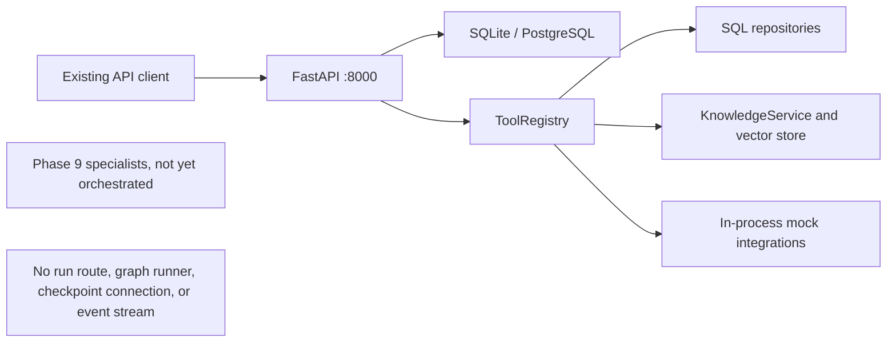
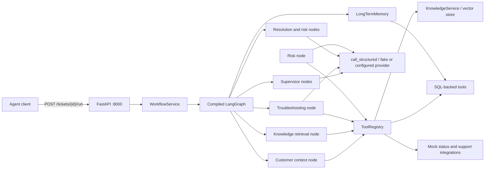
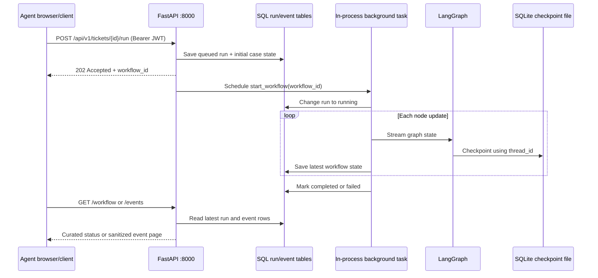
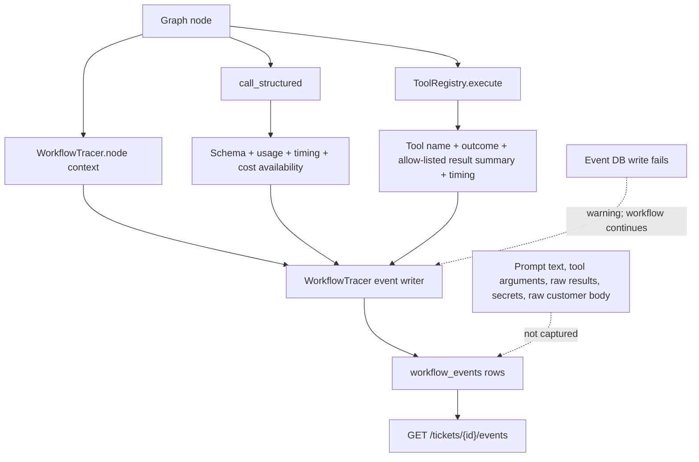
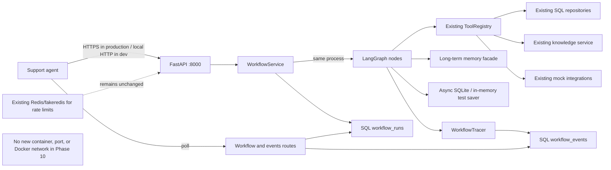

# Phase 10 - Infrastructure and Wiring Design Evolution

## Scope: backend wiring, not a new container topology

This document follows Phase 10 in `TASKS.md` (Workflow graph and trace).
Phase 10 adds application-level connections inside the existing FastAPI
process. It does not add a Dockerfile, Compose service, listening port,
external queue, or cloud resource. The Phase 14 container work remains
separate.

The run worker is FastAPI's in-process `BackgroundTasks` mechanism for this
version. The graph's checkpoint database is a local SQLite file by default
and is ignored by Git; tests use the in-memory saver.

## Starting point: reachable pieces, no graph path

Before the phase, the API, SQL database, tool registry, knowledge service,
memory facade, and specialist classes already existed. There was no request
path that connected a ticket to those specialists in sequence.



There is no new inbound port from the customer-facing internet to an agent.
The agents run inside the same backend process as the existing API.

## P10-1: checkpoint and database connections

The SQLAlchemy database stores durable workflow metadata: run status, the
latest JSON state, token totals, and sanitized workflow events. LangGraph's
checkpointer separately stores graph snapshots under the workflow's
`thread_id`.

```mermaid
flowchart TB
    App["FastAPI process"] --> RunRepo["WorkflowRunRepository"]
    RunRepo --> SQL["Configured SQL database"]
    App --> SaverFactory{"CHECKPOINT_DB_PATH"}
    SaverFactory -->|:memory:| TestSaver["InMemorySaver"]
    SaverFactory -->|local path| SqliteSaver["AsyncSqliteSaver"]
    SqliteSaver --> CheckpointFile["data/checkpoints.db by default"]
    Git["Git tracking"] -. ignores data/ and *.db .-> CheckpointFile
```

These are separate persistence responsibilities: SQL run rows support API
polling and audit, while checkpoint records support graph continuation. The
checkpointer is opened for the application lifespan and closed at shutdown.

## P10-2 through P10-4: in-process component routing

The API routes to the workflow service; the service invokes the compiled
graph. The graph calls Python specialist nodes, and only the applicable
nodes call the already-registered tools, memory facade, or structured LLM
boundary.



All arrows except a configured model provider are in-process Python calls.
Tools continue to use `ToolRegistry`; workflow nodes do not make direct
network requests to the database or integrations.

## P10-5: HTTP start, background execution, and polling

The run route requires an agent role, creates a queued workflow record, and
responds with HTTP 202. FastAPI then invokes the workflow service as a
background task. Authenticated viewers and agents can poll the latest
workflow and event routes; the response data is intentionally curated.



This background mechanism shares the API process lifecycle. It is suitable
for this offline-first v1; a separate worker/queue is a future scale-out
choice.

## P10-6: telemetry path and privacy boundary

Node contexts create start/completion events. `call_structured` reports
schema names, elapsed time, token counts, and known cost. `ToolRegistry`
reports the tool name, outcome, approval-required flag, and elapsed time.
The tracer writes event rows using independent short-lived SQL sessions so
telemetry does not share a specialist's business transaction.



The events endpoint returns the latest run's events in chronological order.
The status endpoint does not expose the full workflow checkpoint, internal
notes, tool arguments, or raw message body.

## End-of-Phase-10 wiring



## Component routing reference

| Component | Connection | Network exposure in this phase |
|---|---|---|
| Run API | Agent-authenticated request to FastAPI. | Existing API port only. |
| Workflow service | In-process background task, session factory, compiled graph. | No listener. |
| LangGraph | Calls node functions in sequence and streams state snapshots. | No listener. |
| Tool registry | Used by customer, knowledge, troubleshooting, and risk agents. | Existing DB/RAG/mock connections only. |
| SQL repositories | Persist tickets, runs, memory notes, and events. | Existing configured database connection. |
| Checkpointer | `AsyncSqliteSaver` for configured file path; in-memory for tests. | Local file, no network port. |
| Structured LLM | Fake provider offline; selected real provider only when configured. | No outbound connection in fake mode; optional outbound provider request otherwise. |
| Workflow events API | Read-only authenticated endpoint. | Same FastAPI listener. |
| Docker/Compose | Unchanged. | No new container or network rule. |

## Honest infrastructure status

- The run/status/events path is implemented and tested with local SQLite and
  the fake provider.
- In-process background tasks are not a durable distributed worker system;
  process loss can interrupt a running task even though graph checkpoints
  exist.
- A live provider, remote Redis, remote vector store, cloud environment, and
  container deployment were not required for or claimed by these tests.
- No `.gitignore` change is needed: the existing rules already ignore `data/`
  and SQLite/database files.

## Related files

- [Phase 10 system design evolution](../design_evolution/Phase10_Project_System_Design_Evolution.md)
- [Phase 10 codebase explanation](../explain_codebase/phase10_explained.md)
- [Phase 10 interview Q&A](../QnA/Phase10_Interview_QnA.md)
- [Application lifespan and wiring](../../backend/app/main.py)
- [Workflow graph](../../agents/graph.py)
- [Checkpointer factory](../../agents/checkpointer.py)
- [Workflow service](../../backend/app/services/workflow_service.py)
- [Workflow tracer](../../backend/app/services/workflow_tracer.py)
- [Tool registry](../../backend/app/tools/registry.py)
- [Task tracker](../../TASKS.md)
