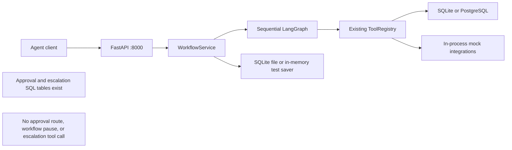
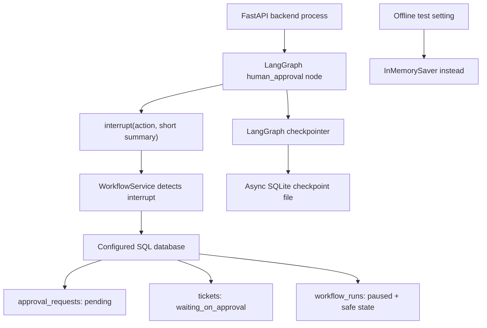
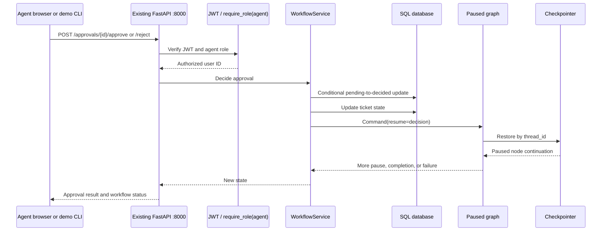
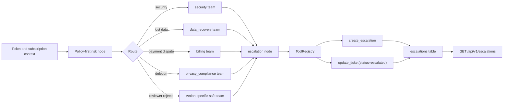
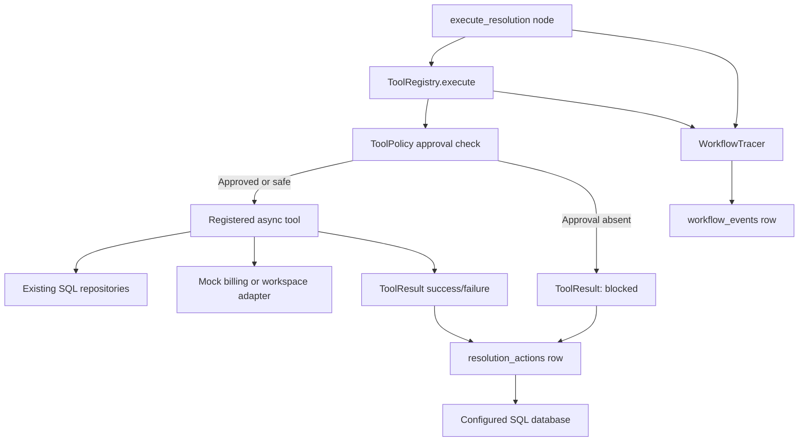
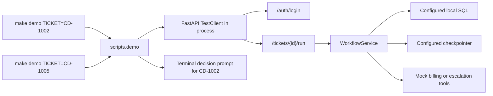
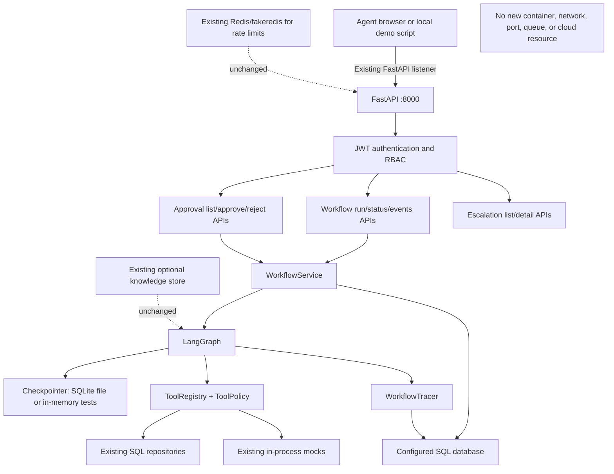

# Phase 11 - Infrastructure and Wiring Design Evolution

## Scope: new application routes, not new containers

This document follows Phase 11 in `TASKS.md` (Approval and escalation).
The phase adds application-level routing inside the existing FastAPI process.
It does not add a Docker service, network, port, external queue, or cloud
resource. Container and Compose work remains a later phase.

The main operational change is a controlled pause in the workflow. The
checkpoint database holds LangGraph continuation state; the configured SQL
database holds the business records that agents and APIs need to read.

## Starting point: existing application wiring

Before Phase 11, the backend could start a workflow and stream progress. The
tool registry, SQL approval/escalation tables, and LangGraph checkpointer
already existed, but the workflow did not connect those pieces to an actual
pause/resume or escalation branch.

There are no external inbound connections to the agents. All graph nodes,
tool functions, SQL repositories, and local mock integrations run in the
backend process.

## P11-1: connect the interrupt to checkpoint and SQL

The graph determines that an action requires approval and calls LangGraph's
interrupt function. The workflow service sees the interrupt in the streamed
state. It writes the pending request and ticket/run statuses to the configured
SQL database, while LangGraph saves its continuation snapshot under the
workflow's `thread_id`.

These stores are complementary:

- SQL records are the user-visible approval request and workflow status.
- The checkpointer preserves where the graph must continue.

The checkpointer file is local state and is already covered by the repository's
ignore rules. The event tracer records `approval_requested` without storing
tool arguments or raw ticket text.

## P11-2: route the agent's decision back to the same process

The approval API is served by the existing FastAPI listener. Authentication
and role checks run before the service is called. The service records the
decision in SQL, then invokes the compiled graph with a resume command and
the existing checkpoint thread ID.

The endpoint is not a new process or exposed port. The role check prevents a
viewer from deciding even if they can read an approval. A conditional SQL
update prevents duplicate decisions under concurrent requests.

## P11-3: route records through existing registered tools

Policy rules determine the destination team within the graph. The escalation
node uses the existing registry to create a database record and set the
ticket status. The new escalation read API returns paginated records through
the same FastAPI listener.

The team names are stored as application data. No mail server, chat system,
or external incident platform is contacted.

## P11-4: reuse the tool execution boundary

The executor does not create direct database or integration connections of
its own. It calls the already-configured `ToolRegistry`, which checks policy
and invokes an allow-listed tool. That tool uses the existing repository or
mock adapter. A separate SQL action record captures each result.

The business action and the action audit row use separate service/repository
transactions. A durable approval record exists before an approval-required
tool is called. The current mock integrations do not perform irreversible
external operations.

## P11-5: local demo routing

`make demo` starts the app in the same process through FastAPI's test client,
uses demo authentication, and calls the same HTTP routes as a browser. It
needs a local demo secret and database configuration but does not need
Docker, Redis, a remote vector store, or an API key when the fake LLM is used.

The script does not open a second HTTP listener. It exercises application
routes without requiring an already-running server.

## End-of-Phase-11 component wiring

## Component routing reference

| Component | Connection and role | Network exposure in this phase |
|---|---|---|
| Approval API | FastAPI route; authenticates an agent and delegates the decision. | Existing API listener only. |
| Workflow service | Stores decisions and resumes a graph using its thread ID. | In-process Python call. |
| LangGraph interrupt | Saves continuation state and yields an approval request. | No listener; checkpoint connection only. |
| SQL database | Holds approval, ticket, workflow, action, escalation, and event records. | Existing configured DB connection. |
| Checkpointer | Holds graph snapshots separately from SQL business records. | Local SQLite file or test memory saver. |
| ToolRegistry | Enforces registered-tool allow-list and policy at execution. | In-process Python call. |
| Mock integrations | Simulate refund and workspace operations. | No external network call. |
| Escalation API | Reads team assignment and status. | Existing API listener only. |
| Docker/Compose | Unchanged; no new services or network edges. | No new container topology. |

## Honest infrastructure status

- Phase 11 routes and workflow behavior are exercised with temporary SQLite,
  an in-memory checkpointer, and mock integrations.
- The demo script uses the same application routes and remains local.
- In-process `BackgroundTasks` are not a durable distributed worker system.
- No real refund, email, cloud resource, container stack, or live model call
  is claimed.
- No `.gitignore` change is required: `data/`, SQLite/database files,
  Python caches, and local environment files are already ignored.

## Related files

- [Phase 11 system design evolution](../design_evolution/Phase11_Project_System_Design_Evolution.md)
- [Phase 11 codebase explanation](../explain_codebase/phase11_explained.md)
- [Phase 11 interview Q&A](../QnA/Phase11_Interview_QnA.md)
- [Application lifespan and wiring](../../backend/app/main.py)
- [Workflow graph](../../agents/graph.py)
- [Workflow service](../../backend/app/services/workflow_service.py)
- [Approval and escalation routes](../../backend/app/api/)
- [Checkpointer](../../agents/checkpointer.py)
- [Tool registry](../../backend/app/tools/registry.py)
- [Task tracker](../../TASKS.md)
