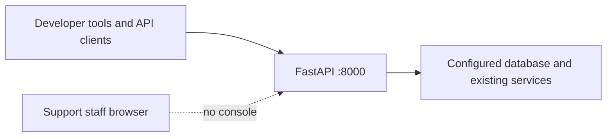
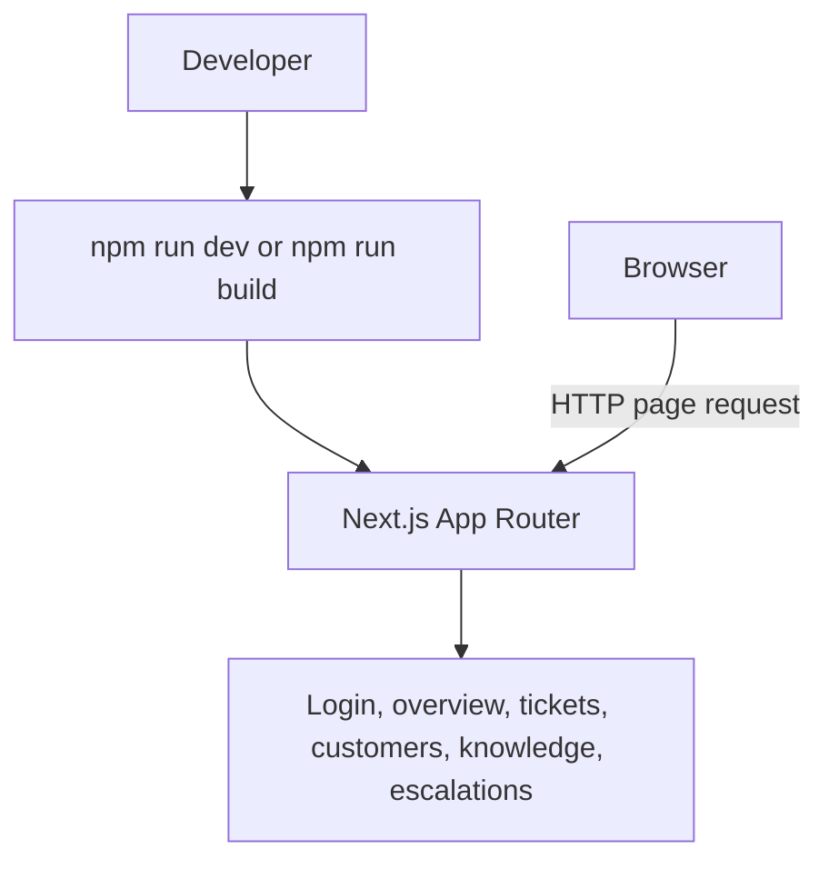
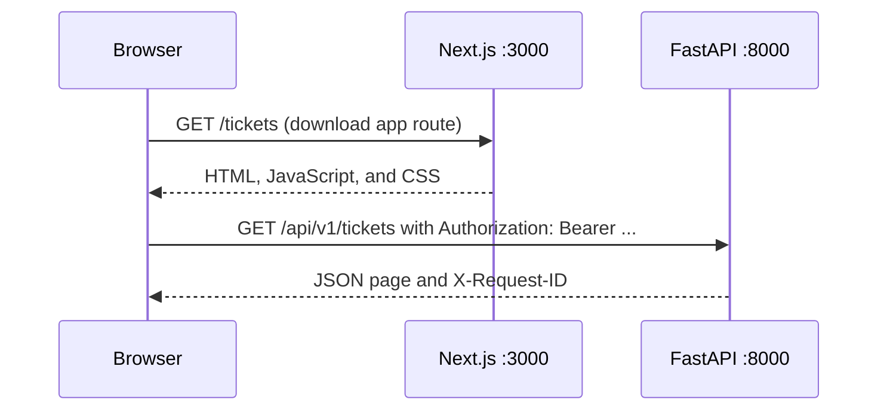
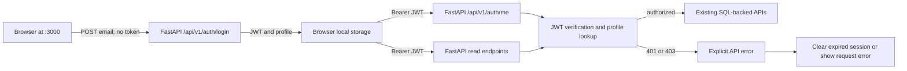
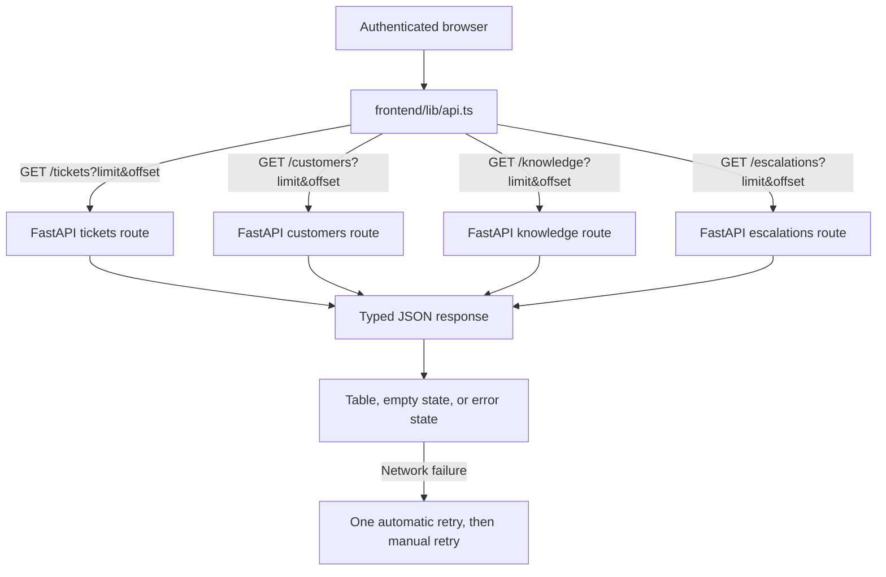
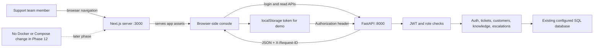

# Phase 12 - Infrastructure and Wiring Design Evolution

## Scope: browser-to-API wiring, not a new container topology

This document follows Phase 12 in `TASKS.md`: Console shell. It explains how
the Next.js console is served and how the browser routes API calls. This phase
adds frontend application code and its build configuration, but does not add
a Dockerfile, Compose service, container network, reverse proxy, or cloud
resource. Container work belongs to the later delivery phase.

## Starting point: no frontend process

At the start of this phase, the backend could serve authenticated requests on
its configured HTTP listener. The project had no browser bundle or frontend
development server.

## P12-1: add the Next.js development/build process

Next.js serves the app's HTML and JavaScript. Locally, `npm run dev` starts
the frontend development server, conventionally on port `3000`. The app uses
App Router routes and shared UI code; it does not introduce another backend
service.

## P12-2: route API traffic from the browser

After the page loads, its client-side API code sends requests directly from
the browser to the configured FastAPI URL. `NEXT_PUBLIC_API_URL` defaults to
`http://localhost:8000`. It is public configuration, not a secret. Because
Next.js inlines `NEXT_PUBLIC_*` values during build, the frontend must be
built with the correct API URL for its target environment.

There is no Next.js server-side proxy in this design. The browser's origin and
the API's origin are different in local development, so the backend CORS
configuration must allow the frontend origin, such as
`http://localhost:3000`. A CORS failure appears to the browser as a connection
problem rather than as an application JSON error.

## P12-3: route login and protected reads

The login request is sent without a bearer token. The API returns a
time-limited signed token and profile. The browser saves them in local
storage, then includes the token in `/auth/me` and protected list requests.
The backend validates the JWT and role on every protected endpoint; the
frontend's read-only role label is presentation only.

Demo sign-in is passwordless, allowed only in demo mode by the backend, and
is not a production authentication design. Browser storage also means a
successful script injection could access the token; the backend still
enforces authorization, but production security should consider an
HttpOnly-cookie design and appropriate CSRF protections.

## P12-4: wire read-only page routes

Every list uses the shared API client and requests a bounded page. The client
adds query parameters and the bearer token; the API response includes the
items and pagination totals. Pages offer no state-changing controls.

## End-of-Phase-12 component wiring

## Component and routing reference

| Component | Connection and role | Exposure in Phase 12 |
|---|---|---|
| Next.js app | Serves pages and browser assets. | Local development server, normally `:3000`; production host not set up here. |
| Browser API client | Calls `NEXT_PUBLIC_API_URL` with bearer authentication. | Browser-to-backend HTTP; it is not a server-side proxy. |
| FastAPI | Authenticates users and serves existing JSON APIs. | Existing configured API listener, normally `:8000` locally. |
| CORS | Allows the frontend origin to call the API from a browser. | Must include the selected frontend origin in backend configuration. |
| Browser local storage | Holds the demo token and cached display profile. | Per-browser storage; not a new infrastructure service. |
| Existing data stores | Continue to serve backend repositories. | No database, Redis, or vector-store configuration change. |
| Docker/Compose | Unchanged by this phase. | No image or container network has been added. |

## Honest infrastructure status

- The frontend dependencies install and its production bundle builds locally.
- Frontend tests and lint run locally; no CI workflow was executed as part of
  this phase.
- `NEXT_PUBLIC_API_URL` defaults to localhost and must be overridden at build
  time for another environment.
- A local browser requires the backend CORS allow-list to include the
  frontend origin.
- No Docker image, Compose stack, TLS ingress, reverse proxy, or cloud
  deployment is claimed.
- No `.gitignore` change was needed: the existing rules already ignore
  `node_modules/`, `.next/`, build output, and `.env.*` while allowing
  `.env.example`.

## Related files

- [Phase 12 system design evolution](../design_evolution/Phase12_Project_System_Design_Evolution.md)
- [Phase 12 codebase explanation](../explain_codebase/phase12_explained.md)
- [Phase 12 interview Q&A](../QnA/Phase12_Interview_QnA.md)
- [Frontend configuration](../../frontend/)
- [API client and base URL](../../frontend/lib/api.ts)
- [Frontend sample environment](../../frontend/.env.example)
- [Backend CORS and app wiring](../../backend/app/main.py)
- [Backend settings](../../backend/app/core/config.py)
- [Task tracker](../../TASKS.md)
