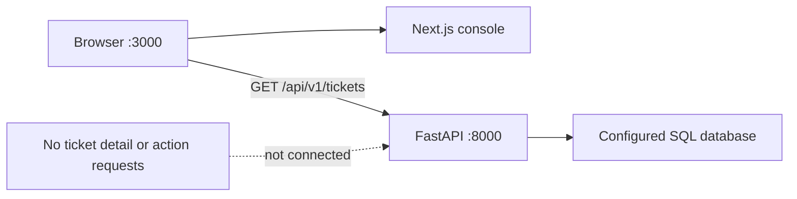
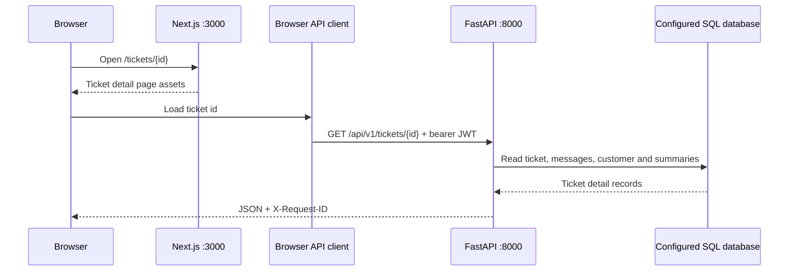
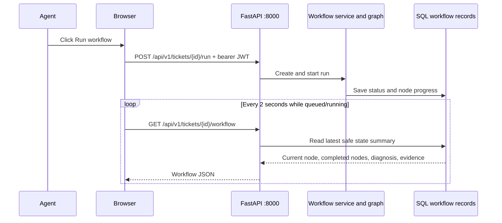
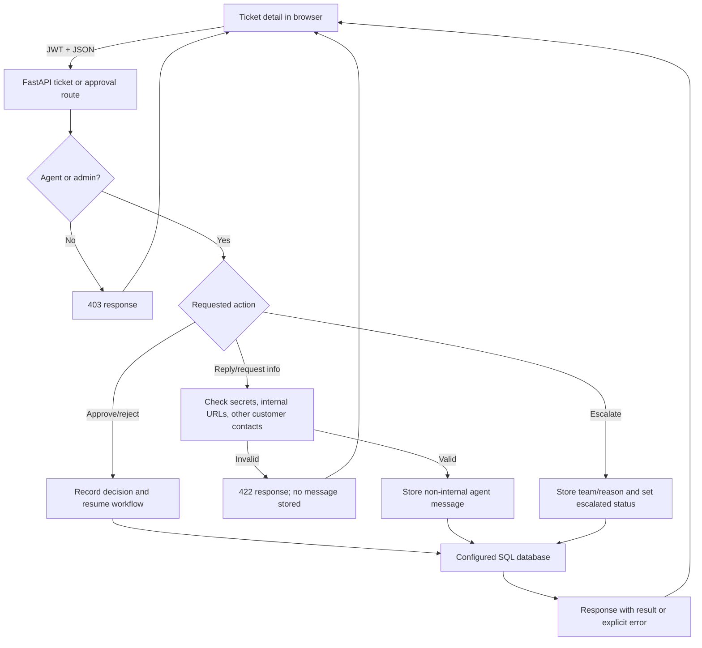
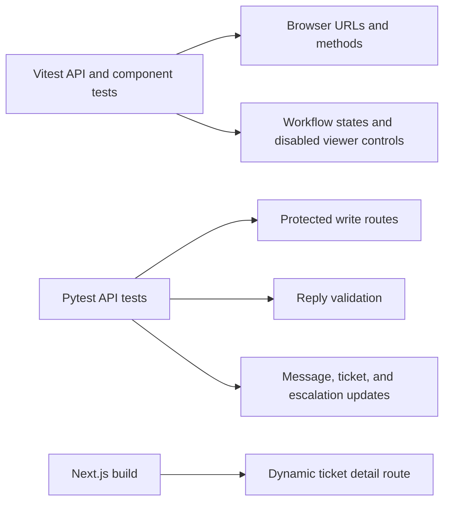
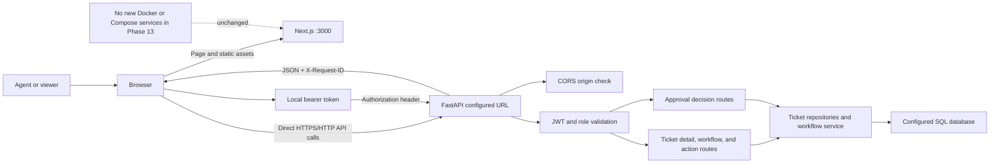

# Phase 13 - Infrastructure and Wiring Design Evolution

## Scope: browser-to-API wiring, not a new container topology

This document follows Phase 13 in `TASKS.md`: Ticket workflow screen. It
explains how the ticket detail page uses the existing Next.js and FastAPI
processes and how workflow polling and actions travel over HTTP.

Phase 13 does not add a Dockerfile, Compose service, container network,
reverse proxy, database, or cloud resource. The frontend calls the configured
backend URL directly from the browser, as in Phase 12.

## Starting point: list traffic only

Before this phase, the browser fetched a page of ticket summaries. It did not
request a ticket conversation or call workflow and ticket-action routes.

## P13-1: route a ticket detail page to the existing API

The ticket list links to `/tickets/{id}` in the Next.js App Router. The
browser-side typed API client calls the backend using the configured
`NEXT_PUBLIC_API_URL`, which defaults to `http://localhost:8000` for local
development.

There is no Next.js API proxy. Because the browser calls FastAPI directly,
the backend CORS allow-list must allow the frontend's origin, for example
`http://localhost:3000`. `NEXT_PUBLIC_API_URL` is public configuration, not
a place for credentials, and is compiled into the frontend build.

## P13-2: connect the workflow run and polling path

Starting a run sends one authenticated `POST` to FastAPI. The page then
reads the workflow status every two seconds while it is queued or running.
Every refresh is a normal API request; the browser does not connect directly
to the database or graph checkpointer.

When the backend reports `paused`, `completed`, or `failed`, the screen stops
the timer. A paused run waits for an agent decision. A failed network read
appears as an error with a retry option; it is not shown as a successful
workflow.

## P13-3: wire protected agent actions

The browser sends action requests to existing or documented FastAPI routes.
The frontend role check disables controls for viewers, while the API still
checks the bearer token and agent role for every write.

Reply and request-information routes record mock messages only. The system
does not deliver email. Requesting information also changes the ticket status
to `waiting_on_customer`. Manual escalation stores a named team, reason, and
link to the latest workflow when available, then marks the ticket
`escalated`. Refund and other approval-gated actions remain behind the
backend approval and tool-policy path.

## P13-4: validate the connections

Frontend tests verify that controls call the expected paths and that the
workflow component translates progress into readable states. Backend API
tests verify role checks, validation failures, and durable records. The
production build checks route compilation and frontend types.

## End-of-Phase-13 component wiring

## Component and routing reference

| Component | Connection and role | Phase 13 behavior |
|---|---|---|
| Next.js app | Serves the console pages and assets. | Adds the dynamic ticket detail route; no new listening port or service. |
| Browser API client | Calls `NEXT_PUBLIC_API_URL` directly. | Adds typed ticket, workflow, approval, reply, request-info, and escalation calls. |
| Bearer token | Read from browser storage by the API client. | Sent in `Authorization`; the server validates it on every protected request. |
| CORS | Backend browser-origin policy. | Must include the selected frontend origin; no proxy is introduced. |
| FastAPI ticket routes | Authenticated API endpoints. | Reads ticket detail, starts workflow, stores safe mock replies, and records manual escalation. |
| Workflow and approval services | Backend orchestration. | Own workflow persistence, progress, pause/resume, and approval decisions. |
| SQL database | Existing configured data store. | Continues to hold ticket, message, workflow, approval, and escalation records. |
| Docker/Compose | Unchanged by this phase. | No container wiring or network is added. |

## Honest infrastructure status

- The frontend and backend are separate local processes (commonly ports 3000
  and 8000); the browser makes direct API calls.
- The API base address defaults to localhost and must be configured for a
  different environment.
- CORS must allow the browser frontend origin.
- Workflow refresh is HTTP polling every two seconds while the workflow is
  queued or running; it is not a websocket.
- Replies and escalations are local demo records. No real email or external
  team notification is sent.
- No Docker image, Compose stack, TLS ingress, reverse proxy, or cloud
  deployment is claimed for Phase 13.
- No `.gitignore` change was needed: the existing ignore rules already cover
  frontend dependencies, Next.js output, coverage, and environment files.

## Related files

- [Phase 13 system design evolution](../design_evolution/Phase13_Project_System_Design_Evolution.md)
- [Phase 13 codebase explanation](../explain_codebase/phase13_explained.md)
- [Phase 13 interview Q&A](../QnA/Phase13_Interview_QnA.md)
- [Ticket detail route](<../../frontend/app/(console)/tickets/[id]/page.tsx>)
- [Frontend API client](../../frontend/lib/api.ts)
- [Frontend environment configuration](../../frontend/.env.example)
- [Backend app and middleware wiring](../../backend/app/main.py)
- [Ticket API routes](../../backend/app/api/tickets.py)
- [Ticket action service](../../backend/app/services/ticket_actions.py)
- [API contract](../../docs/API_CONTRACT.md)
- [Task tracker](../../TASKS.md)
