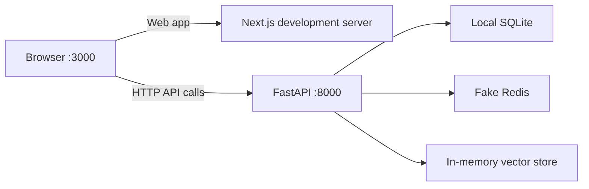
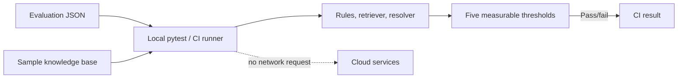
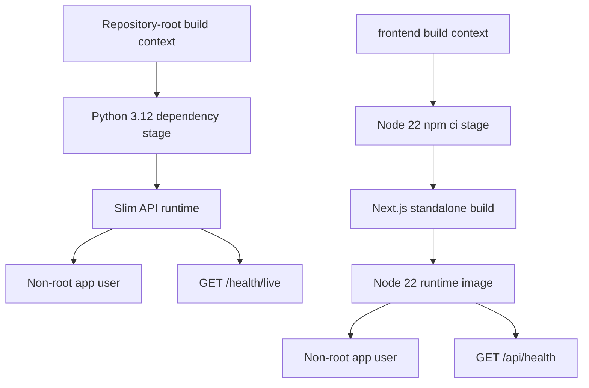
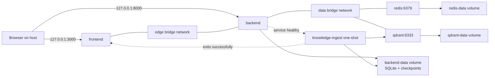
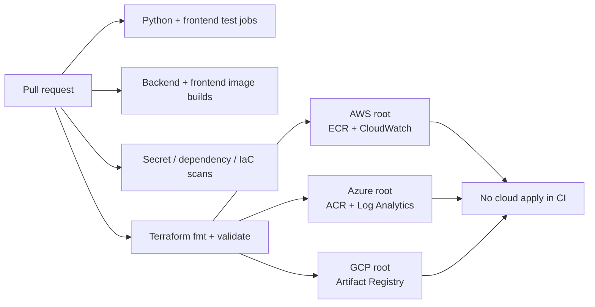
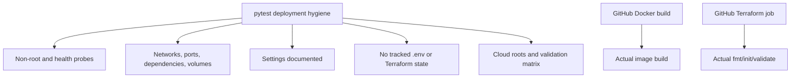
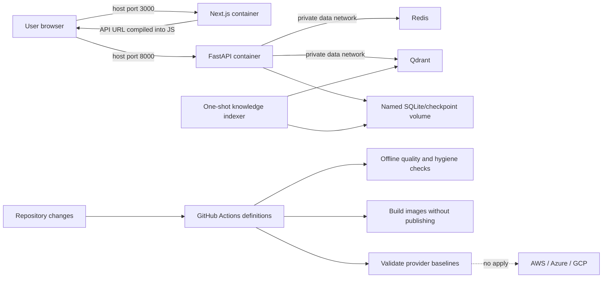

# Phase 14 - Infrastructure and Wiring Design Evolution

## Scope: local containers and delivery scaffolds

This document follows Phase 14 in `TASKS.md`: Evaluation and delivery. It
describes the Docker build contexts, browser-to-API routing, Compose network
boundaries, persistence, and validation workflows.

This phase creates a local demo stack and cloud registry/logging
configurations. It does not create a complete production cloud runtime.

## Starting point: separate local development processes

Before Phase 14, a developer started Next.js and FastAPI separately. The
browser called the API directly; Redis, Qdrant, and the SQLite database were
local development/test dependencies.

There was no image build context, Compose network, or delivery workflow yet.

## P14-1: keep evaluation off the application network

The quality scorecard runs as an offline test. It loads sample tickets and
knowledge articles from the repository, then checks the actual classification,
retrieval, escalation, citation, and grounding behavior.

It does not send ticket data to an external model, Redis, or cloud account.

## P14-2: define separate image build contexts

The backend Docker build context is the repository root because its imports
span `backend`, `agents`, `rag`, `memory`, `integrations`, and `sample_data`.
The root `.dockerignore` excludes local state and unrelated development
files. The frontend build context is `frontend`; its `.dockerignore` excludes
local dependencies, Next.js output, and environment files.

The frontend API base URL is a build argument, because the URL is inlined
into the browser bundle at build time. For local Compose, the default is
`http://localhost:8000`.

## P14-3: wire the Compose services

The local Compose configuration has two bridge networks:

- **`edge`** connects the frontend and backend containers.
- **`data`** connects the backend, Redis, Qdrant, and the one-shot article
  indexer.

The frontend uses the host-published API URL from the user's browser. It
does not need to resolve the backend's Docker DNS name. Redis and Qdrant have
no published host ports.

Startup ordering is intentional. The backend first creates and seeds the
SQLite demo database. The one-shot indexer then adds the article rows and
Qdrant vectors. The frontend waits for both a healthy backend and a
successful indexer run.

### Port and routing reference

| Caller | Destination | Address | Purpose |
|---|---|---|---|
| User's browser | Frontend container | `127.0.0.1:3000` | Serve the support console. |
| User's browser | Backend container | `127.0.0.1:8000` | Browser-side API requests and CORS. |
| Backend container | Redis container | `redis:6379` | Rate limit and short-term data services. |
| Backend / indexer | Qdrant container | `qdrant:6333` | Knowledge-vector search and indexing. |
| Host | Redis / Qdrant | Not published | Avoid exposing data services in the local demo. |

`NEXT_PUBLIC_API_URL` must be a URL the browser can reach. The internal
Compose name `backend` only resolves for containers on the Docker network and
is therefore not the default browser URL.

## P14-4: connect source control checks to cloud configuration

GitHub Actions runs application tests, builds images without publishing
them, scans for secrets and known issues, and runs Terraform formatting and
validation for each provider root.

The roots are baseline examples. A remote state configuration is supplied
through an ignored `backend.hcl` copied from its tracked `.example` file.
Terraform state and actual variable files are not source-controlled.

The Terraform roots do not yet create a full CloudDesk runtime. Compute,
load balancing or public ingress, Redis, databases, Qdrant, secrets, and
provider-specific application deployment remain to be designed and reviewed.

## P14-5: validate wiring assumptions

Deployment hygiene tests parse the Compose file and inspect the image and
cloud scaffolding. They are fast local checks; CI additionally invokes Docker
builds and the Terraform CLI.

## End-of-Phase-14 wiring

## Honest infrastructure status

- Backend and frontend Dockerfiles, `.dockerignore` files, and Compose
  configuration are present.
- The frontend production build was verified locally in standalone mode.
- Backend tests (203), frontend tests (9), frontend lint, Ruff, and the
  in-memory CD-1002 demo passed locally.
- Docker and Terraform CLIs are not installed in the current environment;
  actual image builds and `terraform validate` have not run locally.
- GitHub workflow definitions are present but have not run on GitHub.
- Terraform roots create only registries and baseline logging resources; they
  are not full application deployments.
- No cloud credentials have been used, and no resources have been applied.
- No `.gitignore` rule was needed for images or Compose; the existing rules
  cover local app data and environment files. Terraform plan-file patterns
  were added for the new Terraform workflow.

## Related files

- [Phase 14 system design evolution](../design_evolution/Phase14_Project_System_Design_Evolution.md)
- [Phase 14 codebase explanation](../explain_codebase/phase14_explained.md)
- [Phase 14 interview Q&A](../QnA/Phase14_Interview_QnA.md)
- [Backend Dockerfile](../../backend/Dockerfile)
- [Frontend Dockerfile](../../frontend/Dockerfile)
- [Frontend health route](<../../frontend/app/api/health/route.ts>)
- [Compose stack](../../docker-compose.yml)
- [Backend environment settings](../../backend/app/core/config.py)
- [Deployment guide](../../docs/DEPLOYMENT.md)
- [Terraform roots](../../deployment/)
- [GitHub workflows](../../.github/workflows/)
- [Deployment hygiene tests](../../tests/deployment/test_hygiene.py)
