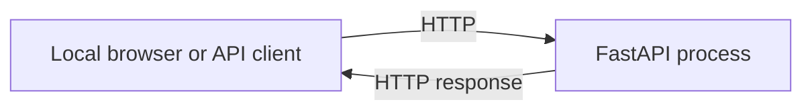
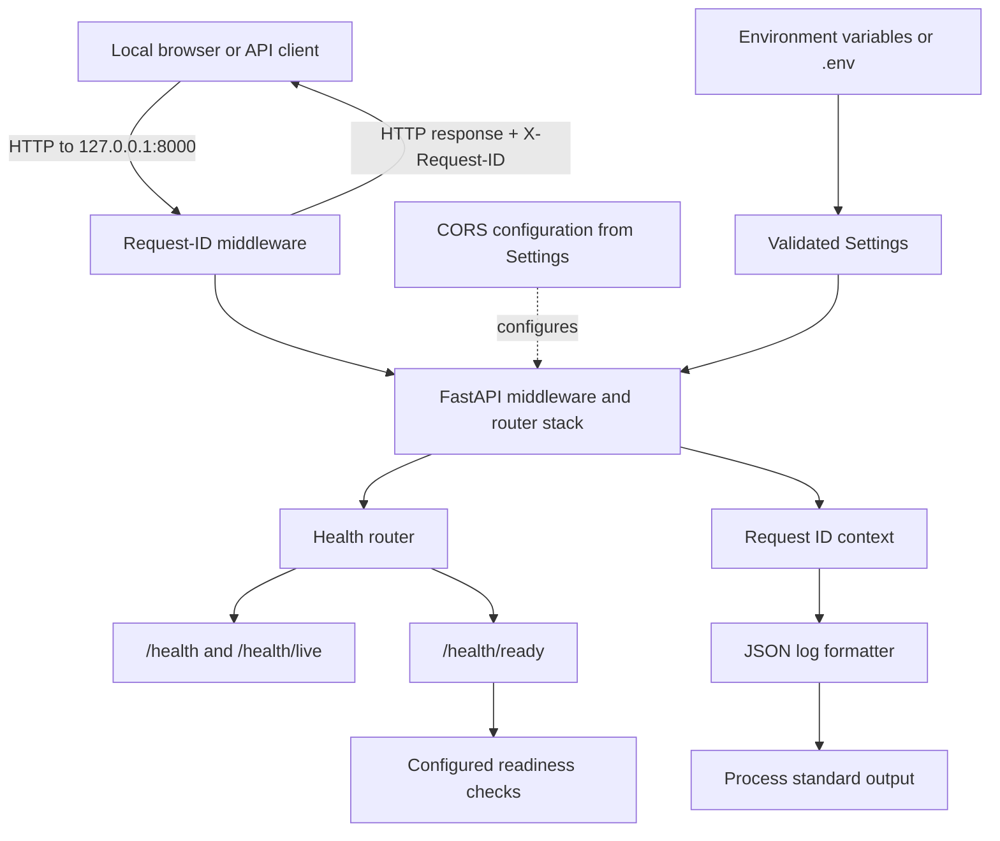
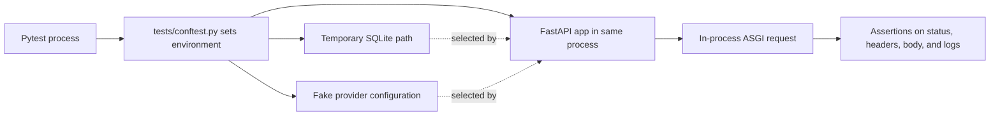
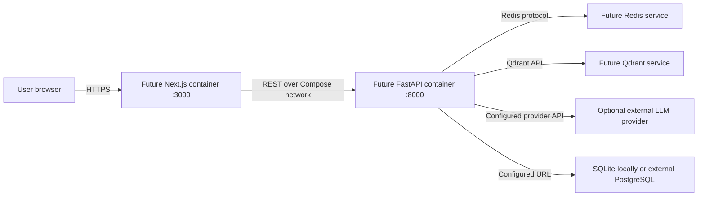

# Phase 1 — Infrastructure and Wiring Design Evolution

## Scope: what is actually deployed in this phase?

Phase 1 runs as a **single local FastAPI process**. There is no Dockerfile,
Docker Compose file, container network, reverse proxy, database container, or
Redis container in the implemented Phase 1 repository. Therefore, the diagrams
below describe actual local wiring and do not imply that containers are already
available.

The goal is to make the current component connections clear and to show where
future infrastructure can connect as later phases are built.

## Initial local wiring

The initial design is one application process receiving HTTP requests. It is
simple to run, but does not yet show where configuration, health checks,
request tracking, or test isolation fit.

## Phase 1 component wiring

The current local setup adds request tracking, CORS policy, configuration,
health routes, and JSON logs around the app. A caller connects to the server
over HTTP (the Makefile defaults to `127.0.0.1:8000`). The configured CORS
origin defaults to a local frontend address, but the frontend itself is not
implemented in this phase.

### Component responsibilities and routing

| Component | Connection or route | Role in Phase 1 |
|---|---|---|
| Local caller | HTTP to `127.0.0.1:8000` by default | Sends a request and receives the API response. |
| Uvicorn/FastAPI process | Application server | Hosts the API in a single process; the Makefile supplies the default host and port. |
| CORS middleware | Browser-origin policy | Allows configured origins and exposes `X-Request-ID` to browser code. It does not create or host a frontend. |
| Request-ID middleware | Wraps HTTP request/response | Preserves a valid caller ID or creates a UUID, then adds it to the response. |
| Health router | `/health`, `/health/live`, `/health/ready` | Exposes process liveness and configured readiness results. |
| Settings | Environment and optional `.env` | Supplies the CORS origins, log level, and other application configuration. |
| JSON logger | Application to standard output | Writes structured log records; request context can be included. |
| Pytest harness | Test process, not a network service | Configures fake providers and a temporary SQLite file path; tests call the ASGI app directly. |

### Health route behavior

- `GET /health` and `GET /health/live` return HTTP 200 with
  `{"status":"ok"}` if the application can answer.
- `GET /health/ready` runs the readiness checks registered on the app. It
  returns HTTP 200 when all checks pass and HTTP 503 when any check fails.
- The default application registers an application-only readiness check. No
  database, cache, or vector service is started or checked by Phase 1.

### Request path

1. The caller opens an HTTP request to the local server.
2. Request-ID middleware validates the supplied ID. It creates a new UUID if
   no acceptable ID was supplied.
3. The application routes the request to its health handler.
4. Any application logs can carry the request ID through the logging context.
5. Middleware adds `X-Request-ID` to the response before returning it to the
   caller.

## Test-time wiring is intentionally separate

The automated tests use the in-process ASGI interface rather than requiring a
Docker network or a listening server. Test configuration selects fake AI and
embedding providers, in-memory vector-store mode, and a temporary SQLite
database location. This makes the Phase 1 tests independent of external APIs
and persistent developer data.

## Future container direction — not part of Phase 1

The project specification describes a later Docker Compose arrangement with a
frontend, backend, Redis, and Qdrant. The following is a **future target from
the project design**, not an implemented Phase 1 topology. It is included to
show how the local foundation may eventually be reached by other components.

When that future topology is implemented, service names and health dependencies
must be verified against the actual Compose configuration; do not assume those
routes or services exist based on this design sketch.

## Phase 1 infrastructure summary

- **Network:** local HTTP; no custom Docker bridge or inter-container routing.
- **Entry point:** Uvicorn serving the FastAPI app, with `127.0.0.1:8000` as
  the Makefile default.
- **Request handling:** CORS configuration and request-ID middleware surround
  the FastAPI routes.
- **Observability:** JSON logs go to the process output stream.
- **Health:** liveness is process-level; readiness uses only checks registered
  by the application, currently an application-only check by default.
- **Tests:** in-process ASGI calls with fake settings and temporary test data.
- **External dependencies:** none are required to run the Phase 1 tests.

## Related files

- [Application wiring](../../backend/app/main.py)
- [Request-ID middleware](../../backend/app/middleware/request_id.py)
- [Health routes](../../backend/app/api/health.py)
- [Settings and CORS configuration](../../backend/app/core/config.py)
- [Makefile server command](../../Makefile)
- [Test environment setup](../../tests/conftest.py)
- [Phase 1 plan](../../PLAN_PHASE.md)
