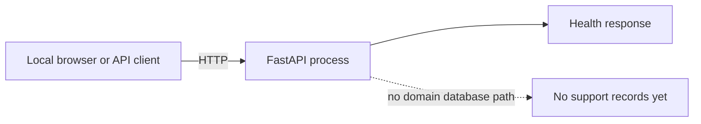
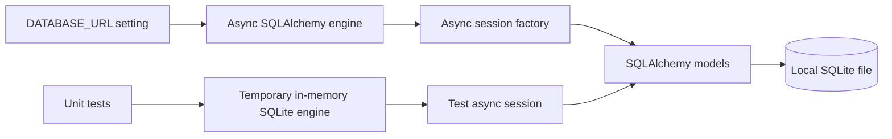
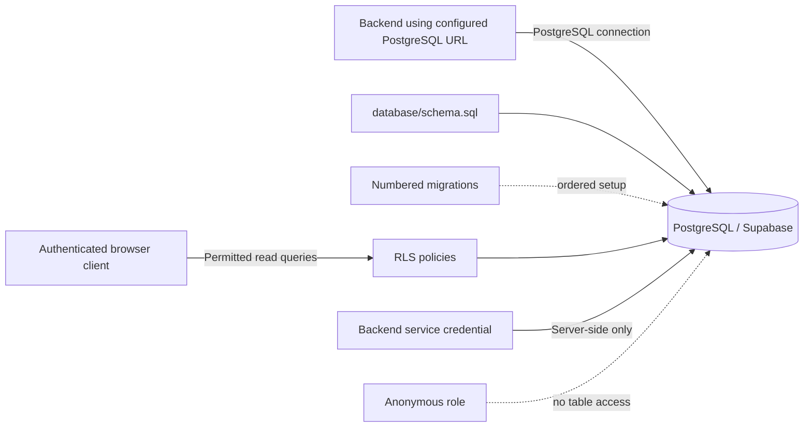
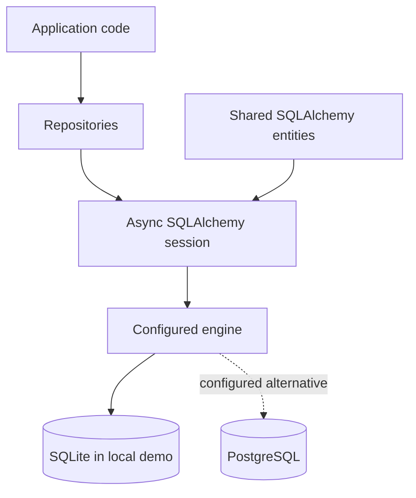
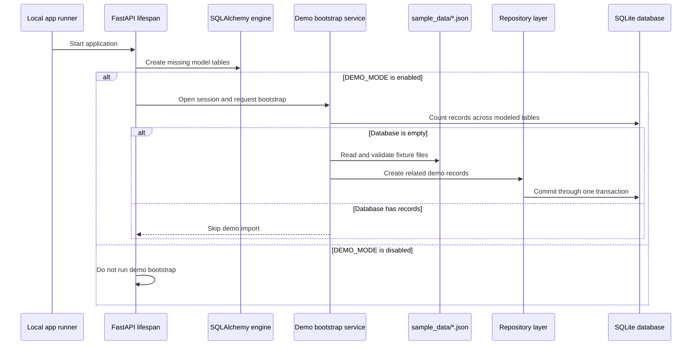
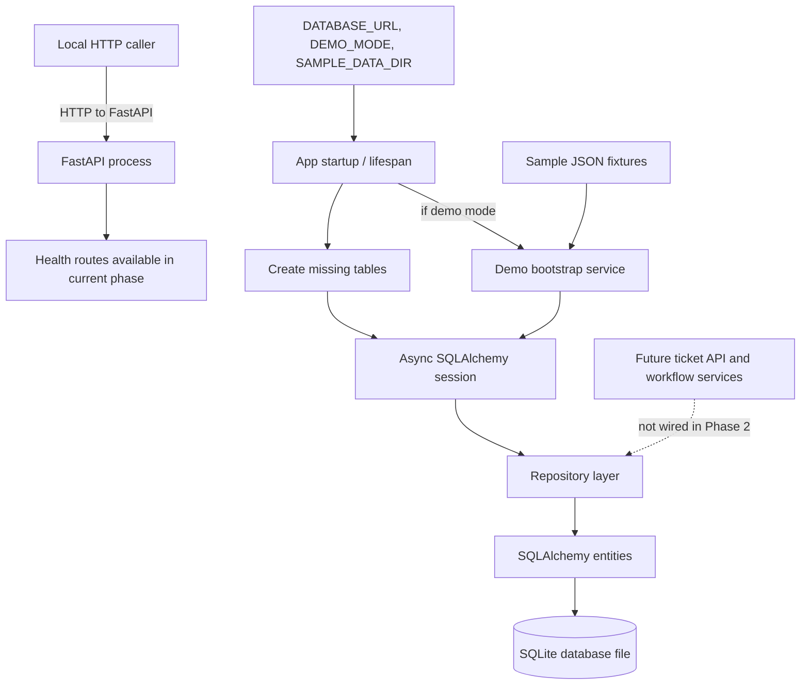

# Phase 2 — Infrastructure and Wiring Design Evolution

## Scope: what is actually connected in this phase?

Phase 2 connects the FastAPI application's startup to an asynchronous
SQLAlchemy engine, a database session, repositories, and local demo fixtures.
SQLite is the default local database. PostgreSQL schema, migrations, and
Supabase row-level security scripts are also provided as setup assets.

There is **no Dockerfile, Docker Compose stack, container network, frontend
container, Redis service, or live Supabase deployment** in the Phase 2
implementation. The diagrams below show the implemented wiring and identify
the PostgreSQL option without presenting it as an active cloud service.

## Starting point: one local service

Before Phase 2, the local caller reaches a single FastAPI process. It answers
health requests, but it is not wired to persist support records.

## Milestone P2-1: connect the application to a database engine

The database URL selects the database driver and location. In the local
default, SQLAlchemy opens an asynchronous SQLite database file. The database
setup code creates the parent directory for a file-based SQLite path when
needed. Tests can instead point it at an in-memory SQLite database.

No separate database server or network port is needed for local SQLite.

## Milestone P2-2: prepare PostgreSQL schema and database-side access rules

The PostgreSQL path is prepared with schema and migration files. Supabase RLS
policies restrict authenticated browser reads according to the user's support
role; viewers cannot read internal ticket messages or agent-only operational
records. The setup guidance keeps privileged server credentials on the backend.

This depicts the prepared deployment option. It does not mean the repository
has configured a real Supabase URL, credentials, or running database.

## Milestone P2-3: route application persistence through repositories

Repository classes are used between application code and SQLAlchemy models.
They receive a session and issue database operations through it. The model
maps those operations to the configured backend. This is an application
boundary, not an HTTP route: Phase 2 has not yet exposed ticket CRUD endpoints.

## Milestone P2-4: wire demo fixtures into startup

The FastAPI lifespan runs table creation at application startup. With demo
mode enabled, it opens a session and calls the bootstrap service. The bootstrap
service reads JSON from the configured sample-data directory and uses
repositories to store records only when the database is completely empty.

## End-of-phase local wiring

The implemented local path is one application process plus a SQLite file and
fixture files on the same machine. HTTP requests currently reach the
application's available health routes; the Phase 2 repositories and database
are set up for future services but are not yet exposed through ticket APIs.

## Component and routing reference

| Component | Connection or route | Phase 2 responsibility |
|---|---|---|
| Local caller | HTTP to the FastAPI process | Can call routes that exist in the current app; Phase 2 does not add ticket CRUD endpoints. |
| FastAPI lifespan | Runs on app startup and shutdown | Creates missing tables, optionally loads demo data, and disposes the engine at shutdown. |
| Settings | `DATABASE_URL`, `DEMO_MODE`, `SAMPLE_DATA_DIR` | Selects the database, whether to seed, and where fixtures are read from. |
| Async engine and session | SQLAlchemy database connection | Provides sessions to repositories and bootstrap code. |
| SQLite | Local file URL by default; in-memory URL in tests | Stores local demonstration and test records. |
| Repository layer | In-process calls, not a network route | Encapsulates SQLAlchemy create/find/list/update/delete behavior. |
| PostgreSQL scripts | SQL executed during database setup | Define the PostgreSQL schema, ordered migrations, and Supabase RLS policies. |
| Sample fixtures | Local JSON files | Provide demo records; they are read by the bootstrap service, not served as HTTP responses. |
| Docker network | None | Docker and Compose are not part of the Phase 2 implementation. |

## Network and security boundaries

- **Local HTTP:** the API server is the HTTP entry point. The database file is
  local storage and is not an HTTP service.
- **SQLite:** a file-backed local database does not require a separate network
  service. Tests use an in-memory database to isolate their records.
- **PostgreSQL:** a configured PostgreSQL URL would connect to a PostgreSQL
  server. The checked-in schema, migrations, and RLS policies prepare that
  option; no live cloud connection is claimed.
- **Credentials:** setup guidance requires privileged database credentials to
  remain server-side. Do not put service-role credentials in browser code.
- **Containers:** no container-to-container routing exists in this phase.

## Related files

- [Application startup and teardown](../../backend/app/main.py)
- [Database engine and session factory](../../backend/app/core/database.py)
- [Settings](../../backend/app/core/config.py)
- [Demo bootstrap wiring](../../backend/app/services/seed_service.py)
- [PostgreSQL setup instructions](../../database/README.md)
- [PostgreSQL schema](../../database/schema.sql)
- [RLS policies](../../database/rls_policies.sql)
- [Phase 1 infrastructure baseline](./Phase1_Infra_design_evolution.md)
- [Phase 2 task tracker](../../TASKS.md)
