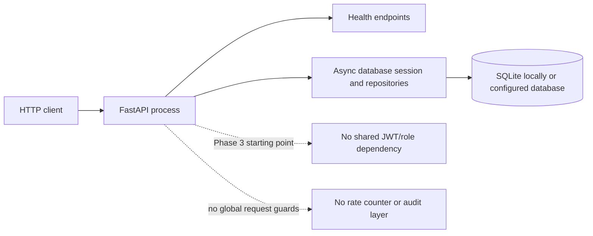
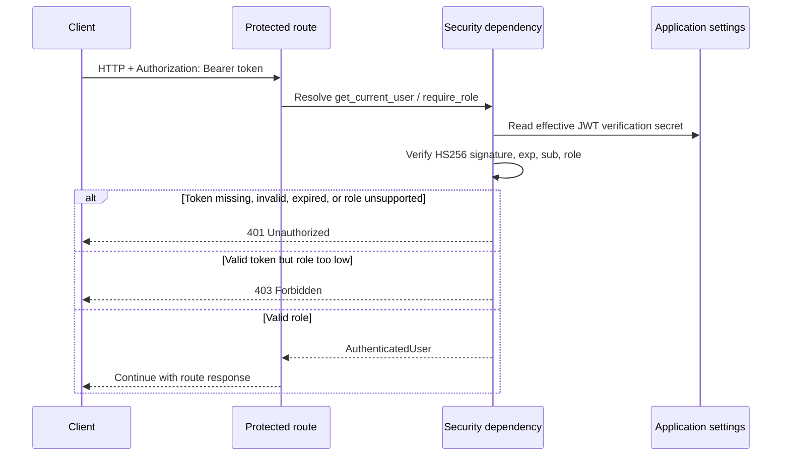
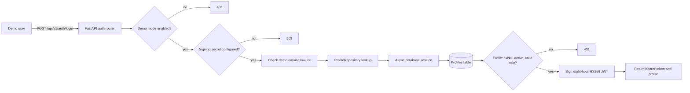
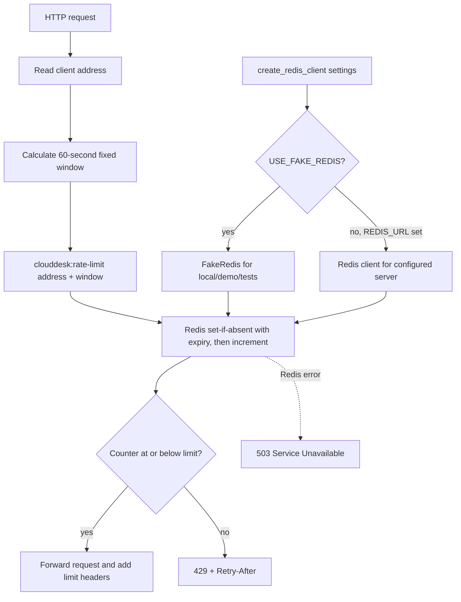
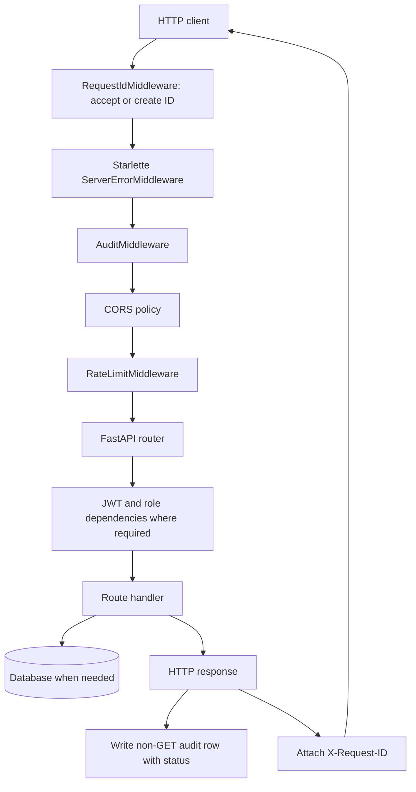
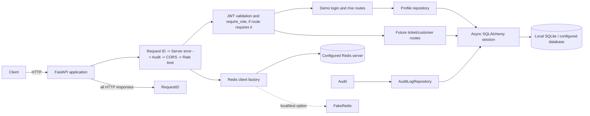

# Phase 3 — Infrastructure and Wiring Design Evolution

## Scope: what is actually connected?

Phase 3 wires request protections into the FastAPI process: request IDs,
server-error handling, audit logging, CORS, Redis-based rate limiting, and
route-level JWT and role checks. It also adds demo login endpoints that issue
tokens for configured demo profiles.

**There is no Dockerfile or Docker Compose stack in the Phase 3
implementation.** There is no container network, Redis container, or
production identity provider configured by this phase. The code can connect
to Redis when configured, and can use FakeRedis for local development and
tests. SQLite is the local database default; a live cloud deployment is not
claimed.

## Starting point: application and database without identity guards

At the start of Phase 3, CloudDesk has an HTTP application and a database
foundation. The shared HTTP request path does not yet identify a caller,
check support roles, count client requests, or create audit records for
state-changing methods.



## Milestone P3-1: protect application routes with token validation

The shared security dependency runs inside FastAPI's dependency system for
routes that request it. It reads the bearer token from the HTTP header,
validates it using the configured secret, requires the subject and expiration
claims, and extracts a supported role.



The role dependency is application code; it is not a separate network service
or database lookup on every route.

## Milestone P3-2: issue demo tokens through the API

The demo login route reads the profile from the application database. The
route checks demo mode, a configured signing secret, a fixed list of demo
emails, and an active profile before signing a token.



`GET /api/v1/auth/me` uses the common JWT verification path, then looks up the
profile by token subject and confirms that it is still active. The demo login
does not validate passwords; it is for controlled local/demo use only.

## Milestone P3-3: attach a rate limiter and Redis client

The rate limiter is an ASGI middleware around the FastAPI router. It builds a
fixed-window key from the client address and current time window, then uses a
Redis pipeline to initialize and increment the counter.



The default configured limit is 120 requests per minute. Responses include
limit, remaining, and reset headers. A blocked request also gets
`Retry-After`. Redis errors produce `503` so the rate-limit requirement is not
silently bypassed.

## Milestone P3-4: order audit, CORS, limiter, and request IDs

The effective stack around HTTP requests is:

```text
RequestIdMiddleware
  -> Starlette ServerErrorMiddleware
    -> AuditMiddleware
      -> CORSMiddleware
        -> RateLimitMiddleware
          -> FastAPI router and route dependencies
```

The application adds the audit middleware outside CORS and the rate limiter,
then wraps the fully built stack with request-ID middleware. The request ID
therefore appears even on middleware-generated responses. Audit can see
non-GET requests rejected by the rate limiter.



For non-GET requests, audit records include the request ID, actor ID when
available, route path, HTTP method, and response status. Query strings and
request bodies are not put into audit details. GET requests bypass the
audit write. If an unhandled exception occurs before a response, the audit
middleware uses a server-error status and re-raises the exception.

## End-of-Phase-3 wiring



## Network and component reference

| Component | Phase 3 connection | Network exposure |
|---|---|---|
| API client | HTTP to the FastAPI listener. Protected routes use an Authorization bearer token. | Talks to the application, not directly to storage. |
| JWT validation | In-process FastAPI dependency. | No separate identity service is required for local demo verification. |
| Demo login | `POST /api/v1/auth/login`; returns a bearer token for an allow-listed active profile. | Application route; demo-only and no password check. |
| `/me` | `GET /api/v1/auth/me`; validates the token and reads the active profile. | Application route requiring a valid token. |
| Rate limiter | Middleware calls a Redis-compatible client. | Real Redis needs a configured URL; FakeRedis is in-process for local/test use. |
| Audit middleware | Writes non-GET request summaries through the audit repository and database session factory. | In-process; no separate audit server. |
| SQLite | Local file-backed DB or in-memory DB for tests. | SQLite file is not a network service. |
| PostgreSQL | Optional database URL target from earlier data-layer work. | Backend-to-database connection when configured; not provisioned here. |
| Docker network | Not implemented in Phase 3. | No container DNS, published ports, or Compose service wiring. |
| Production identity | Not implemented by demo login. | Requires a proper production auth integration and secret management. |

## Honest infrastructure status

- Phase 3 middleware and auth routes are assembled in the FastAPI process.
- The default development configuration can use FakeRedis; tests exercise
  behavior without a running Redis server.
- A real Redis client can be created from a configured URL, but no Redis
  deployment is claimed.
- Local test databases use isolated in-memory SQLite. No production database
  or cloud credentials were provisioned for this phase.
- No Dockerfile, Compose file, or container network exists in this phase.
- Demo login accepts a demo identity and must not be described as production
  password authentication.

## Related files

- [Phase 3 system design evolution](../design_evolution/Phase3_Project_System_Design_Evolution.md)
- [Phase 3 codebase explanation](../explain_codebase/phase3_explained.md)
- [Application startup and middleware wiring](../../backend/app/main.py)
- [Settings](../../backend/app/core/config.py)
- [JWT and role checks](../../backend/app/core/security.py)
- [Demo auth routes](../../backend/app/api/auth.py)
- [Redis client factory](../../backend/app/core/redis.py)
- [Rate-limit middleware](../../backend/app/middleware/rate_limit.py)
- [Audit middleware](../../backend/app/middleware/audit.py)
- [Request ID middleware](../../backend/app/middleware/request_id.py)
- [Phase 3 tests](../../tests/api/)
