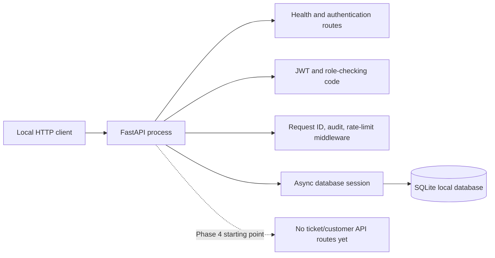
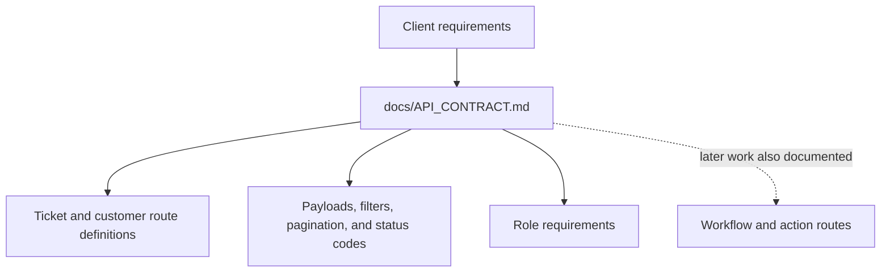
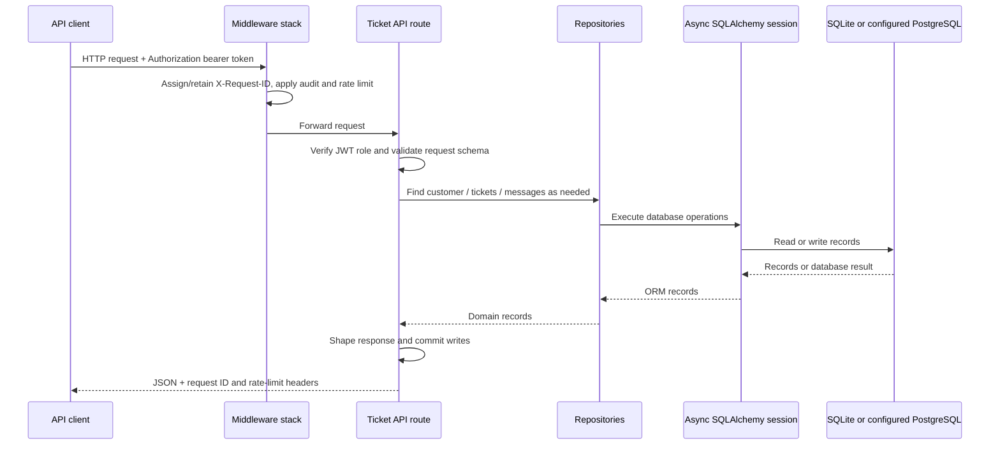
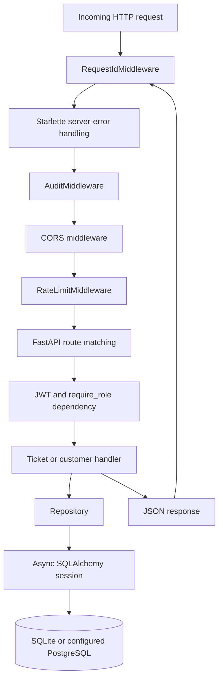

# Phase 4 — Infrastructure and Wiring Design Evolution

## Scope: what is connected, and what is not?

Phase 4 wires HTTP ticket and customer routes into the existing FastAPI
application, authentication, middleware, repositories, and database session.
The local database is SQLite by default; a configured PostgreSQL-compatible
database is an available deployment option.

**There is no Dockerfile or Docker Compose stack in the Phase 4 implementation.**
There is no container network, frontend container, Redis container, or live
cloud database deployment to diagram as an existing service. The diagrams
below show the real in-process and database wiring, not a fictional Docker
deployment. Containerization is a later delivery concern.

## Starting point: runtime and data services without support routes

Phase 4 begins with a running FastAPI foundation, database sessions and
repositories, JWT authentication, and request guards. The support models are
available, but ticket and customer HTTP routers have not yet been registered.



SQLite is a local file and does not listen on a network port. Tests can use
in-memory SQLite. PostgreSQL uses a database URL and is a separate server
connection if configured.

## Milestone P4-1: define the HTTP wiring contract

The contract sets the route paths, request/response formats, role requirements,
and status codes. It tells clients what to send over HTTP and what they can
expect back. It does not create a network service or make every documented
route operational by itself.



## Milestone P4-2: wire ticket requests to the database

The client sends a bearer token in the `Authorization` header. The
application's authentication dependency verifies the token and extracts its
role. The route validates the request and calls the required repositories
using an async database session.



For ticket creation, the server verifies the customer, checks for a duplicate
external ID, creates the ticket and initial customer message, then commits.
List and detail requests are reads. Patch is an agent-only update to fields
allowed by the request schema.

## Milestone P4-3: wire customer views using the same path

Customer routes use the same HTTP entry point, middleware, authentication, and
database session as ticket routes. The detail route calls customer,
subscription, workspace, and ticket repositories with the same customer ID,
then builds a bounded response.

```mermaid
flowchart LR
    Client[Authenticated API client] -->|GET /api/v1/customers| App[FastAPI]
    Client -->|GET /api/v1/customers/{id}| App
    App --> Middleware[Request ID, errors, audit, CORS, rate limit]
    Middleware --> RoleCheck[JWT: any authenticated role]
    RoleCheck --> CustomerRoute[Customer router]
    CustomerRoute --> CustomerRepo[CustomerRepository]
    CustomerRoute --> SubscriptionRepo[SubscriptionRepository]
    CustomerRoute --> WorkspaceRepo[WorkspaceRepository]
    CustomerRoute --> TicketRepo[TicketRepository: most recent 20]
    CustomerRepo --> Session[Async SQLAlchemy session]
    SubscriptionRepo --> Session
    WorkspaceRepo --> Session
    TicketRepo --> Session
    Session --> DB[(Configured support database)]
    CustomerRoute --> Response[Explicit customer response schemas]
    Response --> Client
```

The response schemas include only the documented customer fields, related
subscription/workspace fields, and up to 20 ticket summaries. They do not
include customer-memory notes or ticket messages.

## End-of-Phase-4 request routing

The effective middleware order is:

```text
RequestIdMiddleware
  -> Starlette server-error handling
    -> AuditMiddleware
      -> CORS
        -> RateLimitMiddleware
          -> FastAPI router
```

The request-ID middleware wraps the whole application stack so even generated
error responses can carry `X-Request-ID`. The audit middleware records
non-GET HTTP requests. The rate limiter uses the configured Redis client (or
the project's local fake Redis configuration); if that operation fails, the
middleware returns a service error rather than silently skipping protection.
Health routes are outside the `/api/v1` prefix; ticket and customer routes
are under `/api/v1`.



## Local and configured network paths

| Component | Phase 4 connection | Network exposure |
|---|---|---|
| API client | HTTP request to FastAPI; protected routes include a bearer token. | Reaches the API listener; not a direct database client. |
| FastAPI app | In-process route handling and middleware. | HTTP entry point; `/api/v1/tickets` and `/api/v1/customers` are the Phase 4 support paths. |
| JWT and role checks | In-process dependency called by protected routes. | No separate network service in this phase. |
| Repositories | In-process async calls from routes. | No HTTP port; they use the provided database session. |
| SQLite | Local file or in-memory database for tests. | No network listener for the SQLite file. |
| PostgreSQL | Optional database URL target. | Backend-to-database connection when configured; not provisioned by this phase. |
| Redis/fake Redis | Rate-limit client selected by settings. | Redis is an external dependency when configured; no Phase 4 Compose service is present. |
| Docker network | Not implemented in Phase 4. | No container DNS names, port mappings, or Compose routing exist yet. |
| Frontend | Not implemented in Phase 4. | API contract is available to future clients; no frontend container is wired here. |

## Honest infrastructure status

- The application has server-side routes, database access, auth dependencies,
  request IDs, audit middleware, and rate-limit middleware.
- Tests use isolated in-memory SQLite sessions and local test settings.
- The local application can use file-backed SQLite.
- PostgreSQL schema assets and settings support the future configured
  connection, but this phase does not provision or validate a live cloud
  database.
- Docker/Compose configuration and container-to-container routing are not
  present in this phase.
- A production deployment still needs environment-specific secrets, database
  setup, network policy, and deployment validation.

## Related files

- [Phase 4 system design evolution](../design_evolution/Phase4_Project_System_Design_Evolution.md)
- [Application startup and router registration](../../backend/app/main.py)
- [Ticket routes](../../backend/app/api/tickets.py)
- [Customer routes](../../backend/app/api/customers.py)
- [Database session setup](../../backend/app/core/database.py)
- [JWT and role checks](../../backend/app/core/security.py)
- [Request ID middleware](../../backend/app/middleware/request_id.py)
- [Audit middleware](../../backend/app/middleware/audit.py)
- [Rate-limit middleware](../../backend/app/middleware/rate_limit.py)
- [Phase 4 task tracker](../../TASKS.md)
