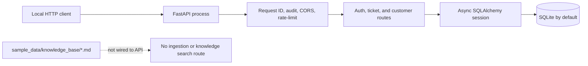
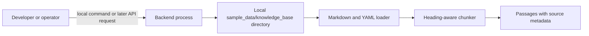
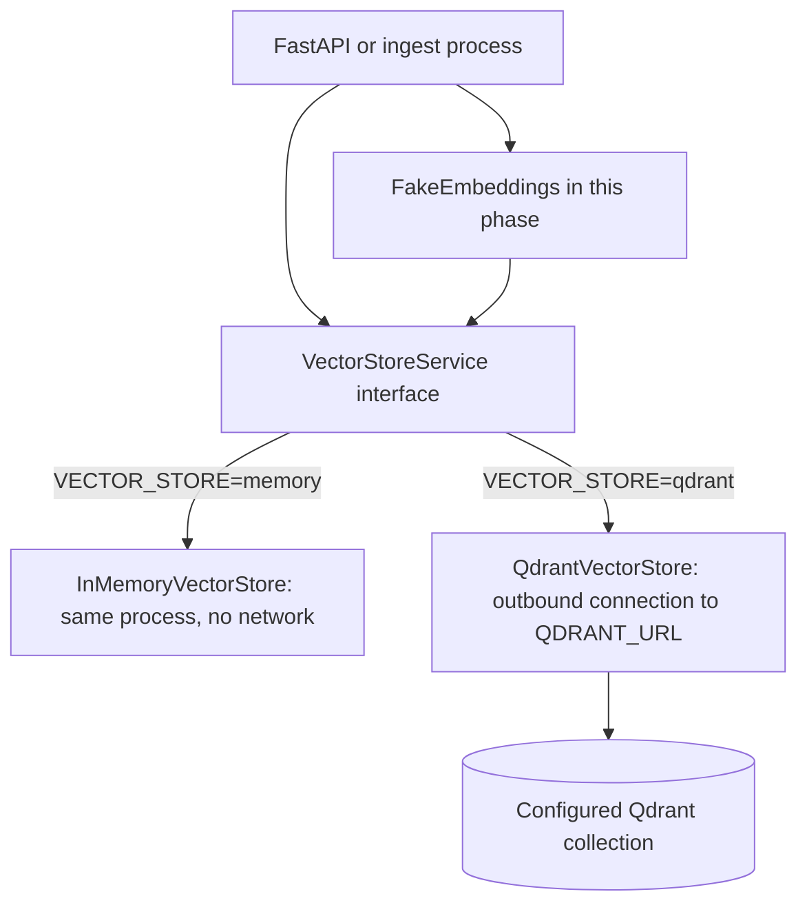
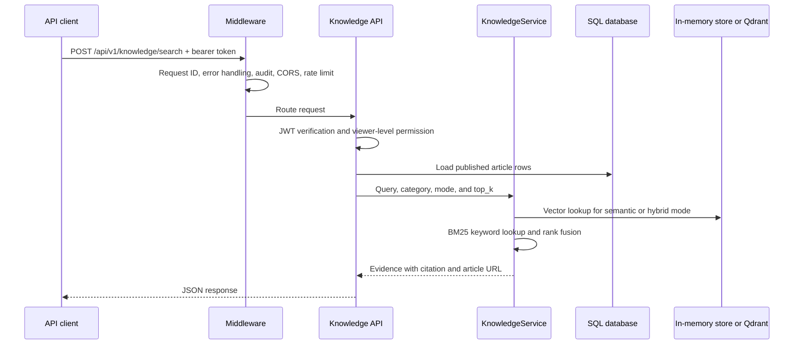
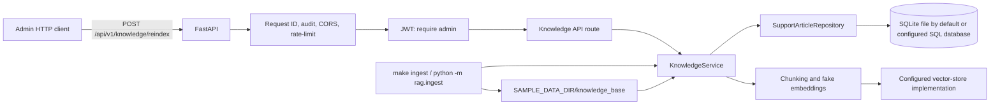
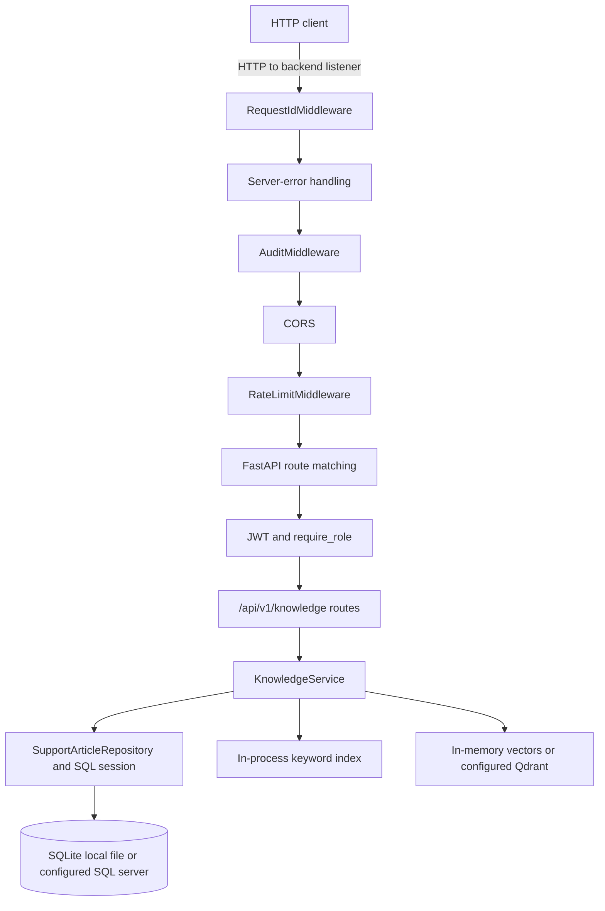

# Phase 5 — Infrastructure and Wiring Design Evolution

## Scope: what is connected, and what is not?

Phase 5 wires knowledge articles into the existing FastAPI and SQLAlchemy
application. It adds a local ingestion command, a knowledge service, a
replaceable vector-store connection, and authenticated HTTP routes.

**Phase 5 does not add Dockerfiles, a Compose stack, container networks, a
frontend, or a cloud deployment.** The diagrams below show the actual
in-process routes and configured service connections. A Qdrant connection is
optional; the default in-memory vector store does not listen on a network port.

## Starting point: an API and database, but no knowledge traffic

Phase 4 already has HTTP routing, middleware, JWT authentication, database
sessions, and ticket/customer APIs. At the start of Phase 5, there is no
registered knowledge router and no path from article files to searchable
evidence.



SQLite is a local file and does not have a network listener. Tests can use
in-memory SQLite. A configured PostgreSQL database is reached through the
backend's database URL, but it is not provisioned by Phase 5.

## Milestone P5-1: source files and local processing

Markdown articles are read by the process running the loader. No file server
or separate ingestion service is introduced. YAML front matter is parsed and
validated, and article content is split into heading-aware chunks.



The source directory is selected from `SAMPLE_DATA_DIR`; the default is
`sample_data`. Chunking happens inside the backend process. It does not send
the article text to an external model or service.

## Milestone P5-2: connect a vector-store implementation

The code uses a `VectorStoreService` protocol to keep the application
independent of the storage backend. `VECTOR_STORE=memory` is the local default.
When `VECTOR_STORE=qdrant`, the backend uses `QDRANT_URL`, the configured
collection name, dimensions, and optional server-side API key.



The in-memory store is lost when the process ends. Qdrant is a separate
network service only when configured and reachable. The Qdrant URL and
credential are backend-side settings; they are not exposed through the
knowledge response.

## Milestone P5-3: route search through the application

A client sends an HTTP request to FastAPI. The application middleware handles
request IDs, server errors, auditing, CORS, and rate limiting before the
router and shared JWT role dependency run.



The BM25 keyword index is built in process from the published article chunks.
Keyword-only search does not need to call the vector backend. Semantic and
hybrid modes use the selected vector-store implementation.

## Milestone P5-4: ingestion and API wiring

The CLI and admin reindex route use the same service. The CLI starts as a
separate Python process; the API route runs within the FastAPI process. Both
read the same Markdown source directory, persist article records, chunk
published text, and rebuild the configured vector collection.



The normal ingest command updates the database and performs indexing. With
the default memory store, the command's vector data disappears when that
process exits, but the article rows remain; the API builds its in-memory
index from those rows when it first searches. With Qdrant configured, the
vector collection is external to the process.

## End-of-Phase-5 routing and network boundaries



Current knowledge routes are:

| Route | Authorization | Backend work |
|---|---|---|
| `GET /api/v1/knowledge` | Any authenticated role | Read a page of published article rows. |
| `GET /api/v1/knowledge/{article_id}` | Any authenticated role | Read a published article by slug or database ID. |
| `POST /api/v1/knowledge/search` | Any authenticated role | Load published articles and use the knowledge service to return cited evidence. |
| `POST /api/v1/knowledge/reindex` | Admin | Read source Markdown, synchronize article rows, and replace the configured index. |

The effective middleware order from outermost to innermost is:

```text
RequestIdMiddleware
  -> Starlette server-error handling
    -> AuditMiddleware
      -> CORS
        -> RateLimitMiddleware
          -> FastAPI route and dependencies
```

The route is the HTTP entry point, not a direct database or Qdrant endpoint.
Clients do not connect to SQLite or Qdrant to retrieve evidence.

## Component connection reference

| Component | Phase 5 connection | Network exposure |
|---|---|---|
| Ingest command | Reads local Markdown, opens the configured SQL session, and initializes the vector store. | Runs as a local process; no listener is opened by the command. |
| FastAPI knowledge router | Registered in `backend/app/main.py`; validates and authorizes HTTP requests. | Served by the existing backend HTTP listener (default Makefile host `127.0.0.1`, port `8000`). |
| Knowledge service | Orchestrates the article repository, chunker, embeddings, vector store, and retriever. | In-process; no independent service or port. |
| SQLite | Default database for article records and other app data. | File-based; not a network service. |
| PostgreSQL | Optional database URL target. | Backend-to-database connection when configured; not provisioned here. |
| In-memory vector store | Default vector index. | Same process only; no port; not durable across process restarts. |
| Qdrant | Optional vector backend selected through settings. | Backend makes an outbound connection to `QDRANT_URL`; deployment/network setup is external to Phase 5. |
| Keyword search | BM25 index built from article chunks. | Runs in the backend process; no separate server. |
| Frontend | Not implemented in this phase. | No browser bundle or frontend-to-backend container route exists yet. |
| Docker/Compose | Not implemented in this phase. | No container network, service DNS names, port mappings, or volumes to claim. |

## Honest infrastructure status

- The API and ingestion paths are implemented and covered by offline tests.
- Local development can use a SQLite file, fake Redis, fake embeddings, and an
  in-memory vector store without external credentials.
- `VECTOR_STORE=qdrant` is a supported code path, but it still needs a
  reachable Qdrant endpoint and appropriately managed settings.
- The default vector index is ephemeral. Article text is stored in SQL so the
  API can rebuild the local index.
- Phase 5 does not add Dockerfiles, Docker Compose, a container network, cloud
  resources, or deployment evidence.
- The API contract is not itself a deployment. The API must run and be
  reachable for clients to use the routes.

## Related files

- [Phase 5 system design evolution](../design_evolution/Phase5_Project_System_Design_Evolution.md)
- [Phase 5 codebase explanation](../explain_codebase/phase5_explained.md)
- [Knowledge API contract](../../docs/API_CONTRACT.md)
- [Application startup and router registration](../../backend/app/main.py)
- [Knowledge routes](../../backend/app/api/knowledge.py)
- [Knowledge service](../../backend/app/services/knowledge_service.py)
- [Database session setup](../../backend/app/core/database.py)
- [Vector-store interface and implementations](../../rag/vector_store.py)
- [Ingestion command](../../rag/ingest.py)
- [Configuration](../../backend/app/core/config.py)
- [Task tracker](../../TASKS.md)
