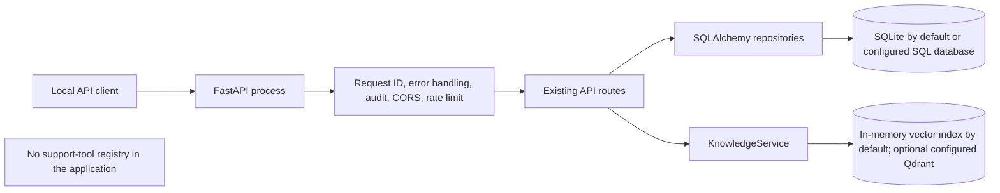
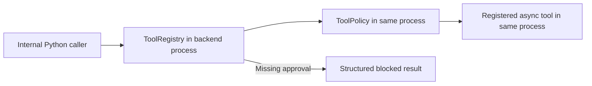
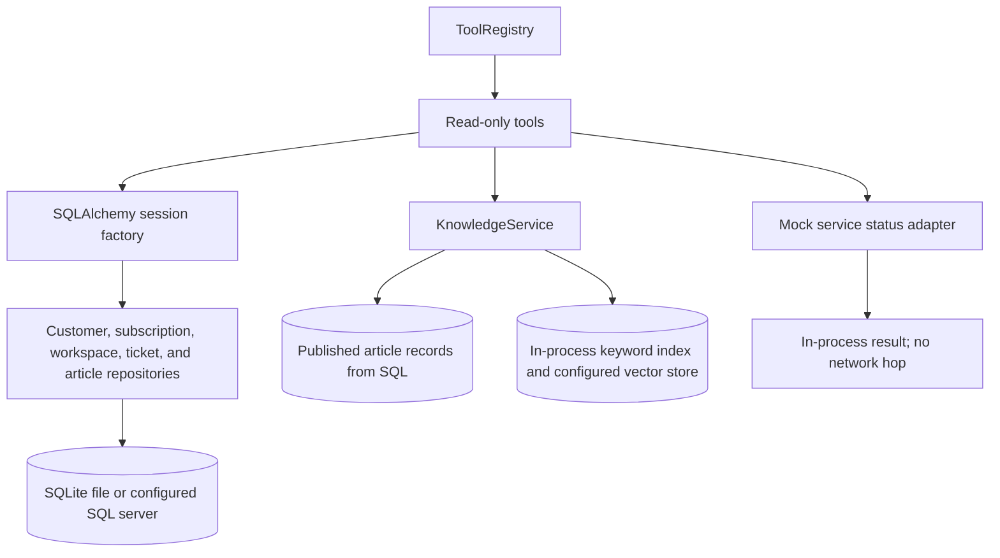
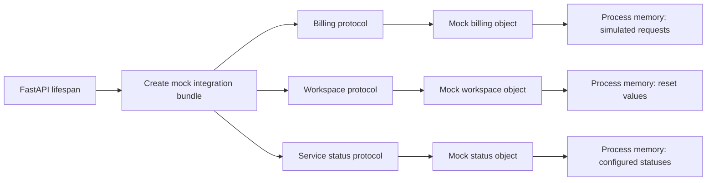
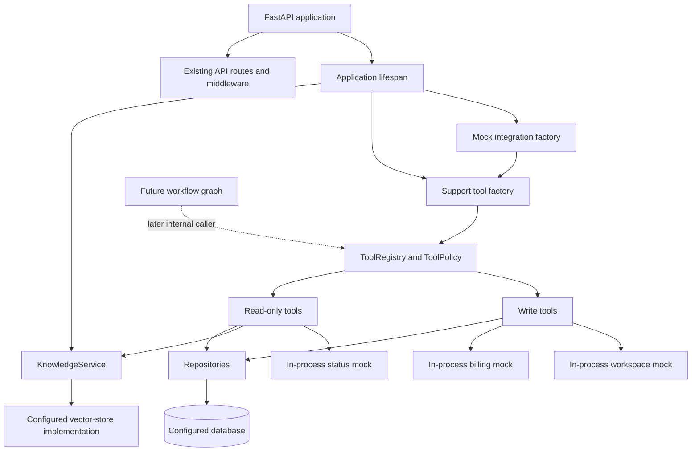

# Phase 6 — Infrastructure and Wiring Design Evolution

## Scope: application wiring, not a new network service

Phase 6 adds tool and integration components inside the existing backend
process. It does **not** add Dockerfiles, Docker Compose, a container network,
new ports, a frontend, a workflow worker, or cloud resources.

The backend's configured database and vector-store settings still determine
where data and search indexes live. The new billing, workspace, and status
adapters are local mocks; they do not open network connections.

## Starting point: backend routes and data stores

At the start of Phase 6, API routes already use middleware, role checks,
repositories, and the knowledge service. No internal support-tool registry
is wired into application startup.



SQLite is a local database file, not a listening network service. If a
PostgreSQL URL is configured, the backend makes the database connection.
Qdrant is only contacted if the vector store is configured for it.

## Milestone P6-1: define the in-process execution route

The registry is ordinary backend code, not a service with its own address.
An internal caller passes a tool name and arguments to the registry; the
registry applies the allow-list, policy, and timeout before invocation.



No HTTP route or socket is added. Network clients cannot directly select
internal functions through a Phase 6 endpoint.

## Milestone P6-2: route reads through established data connections

Read tools open short-lived SQLAlchemy sessions using the configured session
factory. Repositories perform database queries. Article search loads published
article records through a repository and calls the existing knowledge
service. The mock status adapter is in the same process.



The search index uses the configured backend. With the default in-memory
vector store, vector data stays inside the backend process. With Qdrant
configured, the knowledge service makes its already-supported outbound
connection to the configured Qdrant endpoint. Phase 6 does not create or
provision that endpoint.

## Milestone P6-3: route writes and enforce the approval gate

Ticket updates and escalations write through repositories to the configured
database. Refund requests and workspace resets pass from the registry to
local mock adapters only after approval is supplied.

```mermaid
sequenceDiagram
    participant C as Internal caller
    participant R as ToolRegistry
    participant P as ToolPolicy
    participant T as Support tool
    participant D as SQL database
    participant M as In-process mock adapter
    C->>R: Execute tool name and arguments
    R->>P: Evaluate deterministic approval policy
    alt Consequential action without approval
        P-->>R: Approval required
        R-->>C: Blocked result; tool was not invoked
    else Safe path or approval supplied
        P-->>R: Permit execution
        R->>T: Invoke with configured timeout
        alt Ticket update or escalation
            T->>D: Use repository to persist record
            D-->>T: Persisted result
        else Refund request or workspace reset
            T->>M: Call protocol implemented by mock
            M-->>T: Simulated, explicitly marked result
        end
        T-->>R: Tool result
        R-->>C: Structured success or failure
    end
```

The approval signal here is an input to the internal registry. This phase
does not itself provide the human-facing approval route or persistence of the
decision; that belongs to the approval/workflow phase. Thus, there is no
separate approval database connection initiated by these tool functions.

## Milestone P6-4: replaceable interfaces without network routing

The factory builds `SupportIntegrations` using mock implementations. These
adapters are normal Python objects with in-memory state, not containers,
servers, or third-party API clients.



The tool factory builds the read and write tool objects from a session factory,
knowledge-service instance, and integration bundle. `main.py` stores the
resulting registry in `app.state.tool_registry` during the existing FastAPI
lifespan. No extra listener or route is registered.

## End-of-Phase-6 wiring



## Component connection reference

| Component | Phase 6 connection | Network exposure |
|---|---|---|
| Tool registry and policy | Created during the existing FastAPI lifespan and kept in app state. | No separate listener or route. |
| Read and write tools | Invoked through the registry; use repository sessions, knowledge service, or integration protocols. | In-process only. |
| SQL repositories | Read customer, subscription, workspace, article, and ticket data; persist ticket and escalation changes. | SQLite is a local file; configured server databases use backend-to-database connections. |
| Knowledge service | Searches published article records and provides cited evidence. | In-process; optional outbound Qdrant connection only if configured. |
| Billing mock | Records simulated refund requests in process memory. | No external billing call; no money moves. |
| Workspace mock | Stores supported reset values in process memory. | No external workspace call and no persisted workspace mutation. |
| Status mock | Returns a configured local status or an explicit `unknown`. | No monitoring-provider connection. |
| HTTP API | Existing routes remain unchanged; tool registry is not exposed as an endpoint. | Existing backend HTTP port only. |
| Docker/Compose | Not implemented in this phase. | No container DNS, service ports, or container volumes added. |

## Honest infrastructure status

- Tool and integration wiring is created inside the backend application.
- Offline tests use SQLite and an in-memory vector store.
- The mock billing and workspace adapters do not call real services.
- A configured SQL database or Qdrant endpoint is an existing optional
  connection, not a Phase 6 deployment.
- Phase 6 does not add a Docker network, a worker service, cloud
  infrastructure, or a live deployment.

## Related files

- [Phase 6 system design evolution](../design_evolution/Phase6_Project_System_Design_Evolution.md)
- [Phase 6 codebase explanation](../explain_codebase/phase6_explained.md)
- [Phase 6 interview Q&A](../QnA/Phase6_Interview_QnA.md)
- [Application startup and lifecycle](../../backend/app/main.py)
- [Tool factory and registry](../../backend/app/tools/)
- [Integration protocols and mock adapters](../../integrations/)
- [Database session setup](../../backend/app/core/database.py)
- [Knowledge service](../../backend/app/services/knowledge_service.py)
- [Phase 6 tests](../../tests/unit/test_support_tools.py)
- [Task tracker](../../TASKS.md)
