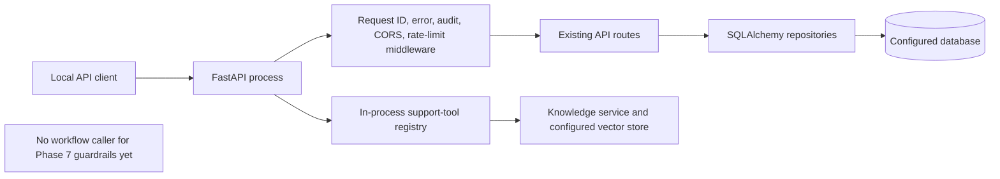
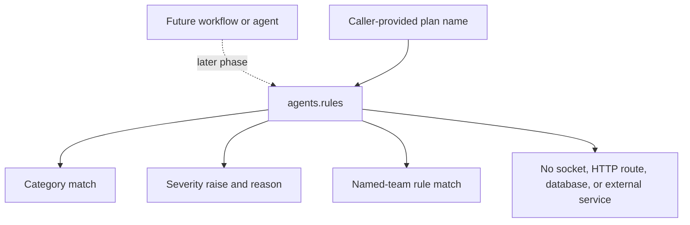
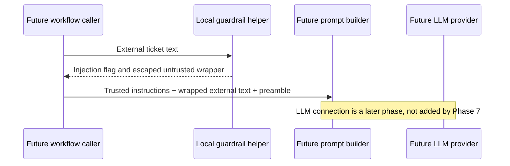
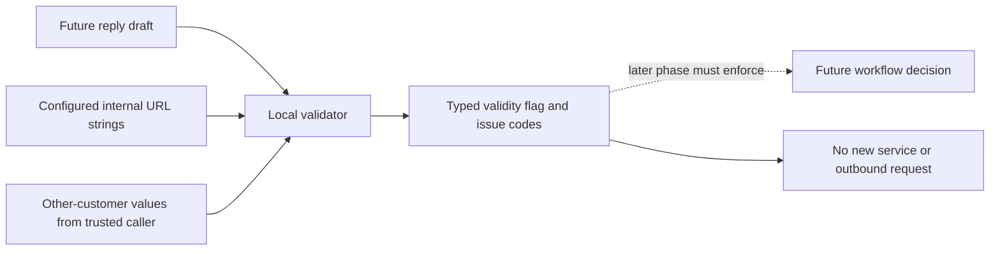
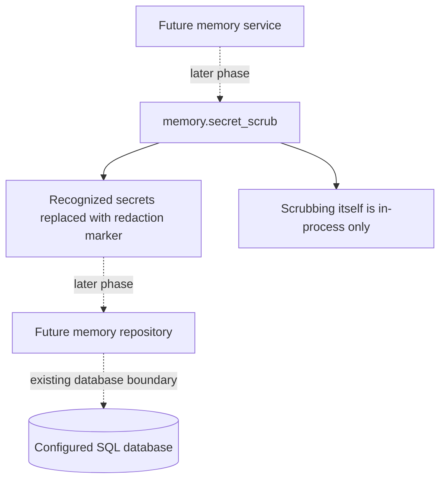
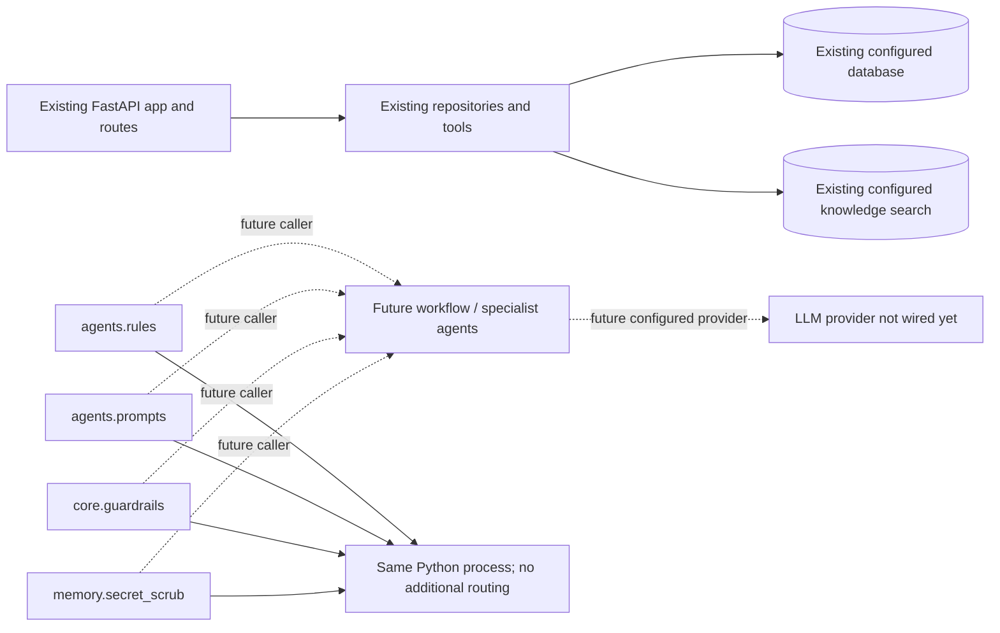

# Phase 7 — Infrastructure and Wiring Design Evolution

## Scope: in-process safety helpers, no new network components

Phase 7 adds Python code that runs inside the existing application process
when a caller invokes it. It adds no Dockerfile, Compose service, container
network, port, HTTP route, database table, external API, or cloud resource.
The app's existing HTTP and data-store wiring is unchanged.

## Starting point: existing backend connections

The backend already hosts FastAPI routes and middleware. Its lifecycle
initializes the configured database, knowledge service, mock integrations,
and tool registry. Ticket data continues to use the existing configured SQL
connection. There is no workflow graph in the app startup path.

SQLite is a local file rather than a network listener. If a server database
or Qdrant is configured, the existing application connects to that configured
service. Phase 7 does not provision or alter those services.

## Milestone P7-1: policy runs locally in the caller's process

The category, severity, and escalation functions are synchronous local
Python functions. They make no network call and do not read or write the
database. The Enterprise outage rule receives a plan name from its caller;
the rule does not query subscription data itself.

The helper stays outside API routes and repositories. A future specialist
agent or workflow node can call it without moving policy into SQL or HTTP
handlers.

## Milestone P7-2: prepare text before a future model request

The scanner, HTML escaping, wrapper, and preamble are local string operations.
The future prompt builder must call them before sending any external content
to a model provider. Phase 7 itself makes no model request.

The delimiters and scanner do not create a network security boundary. The
existing tool registry and later workflow policy remain responsible for
controlling actions.

## Milestone P7-3: validate replies before a later caller uses them

Validation uses local pattern checks and values explicitly supplied by its
caller. It neither sends a reply nor looks up customer data on its own.

The check can compare only with the values it is given. Customer context
loading and the decision to stop or escalate belong to later workflow code.

## Milestone P7-4: scrub before future memory persistence

The scrubber does not open a database session or perform a write. It returns
redacted text for a future memory service to process. No new container,
network route, or persistence dependency is introduced.

Although the schema contains customer-memory storage, Phase 7 does not
implement or invoke the memory repository path.

## End-of-Phase-7 component wiring

The dashed edges mean that a future phase is expected to add the call sites.
They must not be interpreted as currently active runtime connections.

## Component connection reference

| Component | Phase 7 connection | Network exposure |
|---|---|---|
| Rules and escalation policy | Called as local Python functions; no repositories. | None |
| Injection scanner and wrapper | Operates on text passed by a future caller. | None |
| `SECURITY_PREAMBLE` | A constant for future prompt assembly. | None |
| Customer-output validator | Checks draft text, explicit internal URLs, and caller-provided forbidden values. | None |
| Memory secret scrubber | Returns redacted text; does not persist it. | None |
| FastAPI routes and middleware | Unchanged; guardrail functions are not registered as routes. | Existing API listener only |
| Database and vector store | Existing configured connections remain unchanged. | No Phase 7 resource or connection |
| Docker and Compose | No files or services are added. | No container wiring or ports added |

## Honest infrastructure status

- Phase 7's code is local and can be tested offline.
- The new helpers are not connected to the existing ticket endpoints or
  application startup.
- No LLM, memory write, public guardrail endpoint, Docker network, or cloud
  deployment is claimed.
- Phase 8/9 work must add the callers and must enforce failed output
  validation as a risk/stop decision.

## Related files

- [Phase 7 system design evolution](../design_evolution/Phase7_Project_System_Design_Evolution.md)
- [Phase 7 codebase explanation](../explain_codebase/phase7_explained.md)
- [Phase 7 interview Q&A](../QnA/Phase7_Interview_QnA.md)
- [Application startup and existing wiring](../../backend/app/main.py)
- [Rules and escalation policy](../../agents/rules.py)
- [Prompt components](../../agents/prompts.py)
- [Guardrails](../../backend/app/core/guardrails.py)
- [Memory secret scrubber](../../memory/secret_scrub.py)
- [Phase 7 tests](../../tests/unit/test_rules_guardrails.py)
