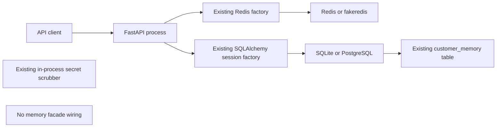
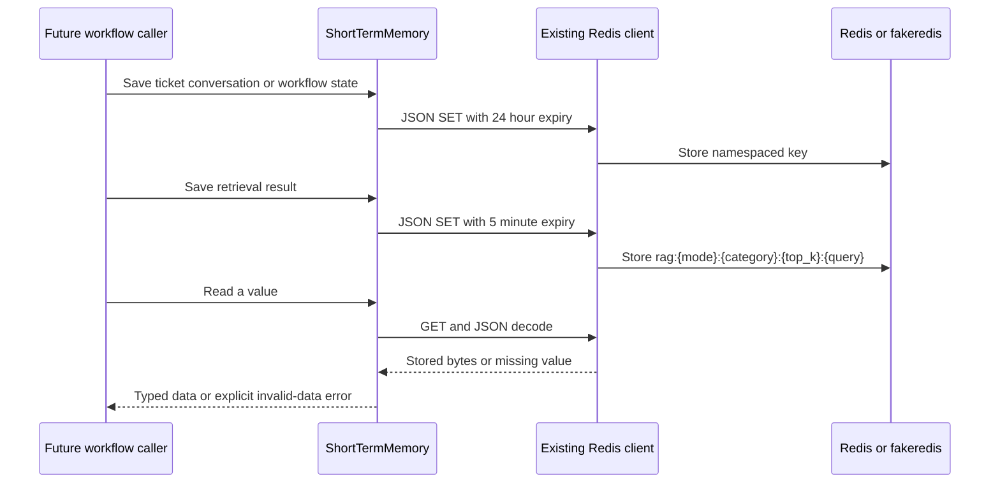
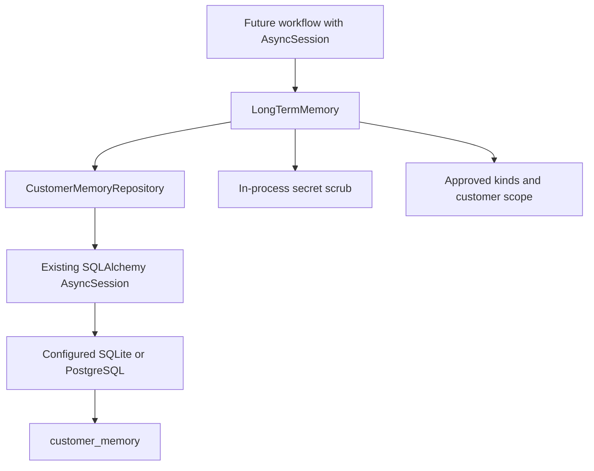
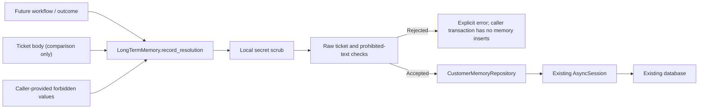
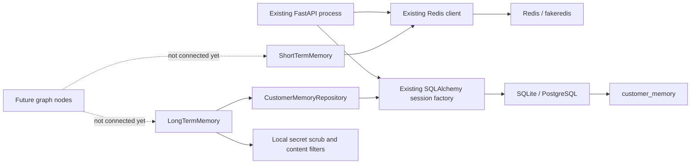

# Phase 8 - Infrastructure and Wiring Design Evolution

## Scope: existing data services, no new containers

Phase 8 adds Python-level memory wiring only. It adds no Dockerfile,
Compose service, network, port, HTTP route, environment variable, or cloud
resource. Redis is already an application dependency for rate limiting, and
the SQL database already contains the `customer_memory` table.

## Starting point: database and Redis already exist

At the start of this phase, FastAPI creates a Redis client through the
existing settings and Redis factory. The application also has a configured
SQLAlchemy engine and session factory. The secret scrubber exists, but no
memory facade uses the infrastructure yet.

In local tests, fakeredis and an in-memory SQLite database keep the tests
offline. A configured deployment can use Redis and PostgreSQL. This phase
does not launch either service.

## Milestone P8-1: route temporary memory through the existing Redis client

`ShortTermMemory` receives an already-created async Redis client. It turns
ticket, workflow, and retrieval-cache operations into JSON Redis reads and
writes. The caller does not need to know Redis command details.

The facade does not own connection lifecycle. The existing application
lifespan remains responsible for closing the Redis client. The memory facade
is not yet called by a workflow node.

## Milestone P8-2: route durable memory through the SQL repository

The long-term facade receives `CustomerMemoryRepository`, which is created
with the caller's `AsyncSession`. SQL remains inside the repository layer.
There is no direct memory-package SQL connection.

The query scopes recall and exact duplicate lookup to one customer. No SQL
migration is needed because the entity and table were created in an earlier
persistence phase.

## Milestone P8-3: check content in the application before repository writes

The resolution recorder assembles only curated note fields. It compares
these fields with the original ticket body and caller-provided prohibited
values before any insert. The body is a filter input, not a destination.

Only the first three troubleshooting steps enter the SQL path. The source
ticket ID provides traceability, while the ticket body itself is not stored.
The caller still controls the SQL transaction commit.

## End-of-Phase-8 component wiring

The dotted lines are planned workflow integration. The memory facades can
already be instantiated with the existing infrastructure objects, but this
phase does not claim that a real ticket workflow invokes them.

## Component connection reference

| Component | Phase 8 responsibility | Network exposure |
|---|---|---|
| FastAPI lifecycle | Creates and closes the configured Redis client as before. | Existing API listener only |
| `ShortTermMemory` | Namespaced JSON operations with 24-hour or 5-minute TTL. | No listener; uses existing Redis connection |
| Redis / fakeredis | Stores temporary conversation, state, and cache values. | Existing configured service; fakeredis is in-process |
| `LongTermMemory` | Validates and prepares customer notes; requests repository operations. | No listener |
| `CustomerMemoryRepository` | Reads and writes customer memory using the supplied SQL session. | Existing database connection |
| Secret scrub and filters | Operate in the backend process before insertion. | None |
| Docker and Compose | Unchanged by Phase 8. | No container or port added |

## Honest infrastructure status

- The code uses the configured Redis and SQL abstractions and is tested with
  fakeredis and in-memory SQLite.
- The app's existing Redis client creation is unchanged.
- No new Docker, Compose, network, database schema, cloud resource, or public
  endpoint was added.
- Workflow nodes that would invoke recall and recording are later work.
- No real Redis, PostgreSQL, container, or cloud deployment is claimed.

## Related files

- [Phase 8 system design evolution](../design_evolution/Phase8_Project_System_Design_Evolution.md)
- [Phase 8 codebase explanation](../explain_codebase/phase8_explained.md)
- [Phase 8 interview Q&A](../QnA/Phase8_Interview_QnA.md)
- [Application startup and Redis lifecycle](../../backend/app/main.py)
- [Redis client factory](../../backend/app/core/redis.py)
- [Database session factory](../../backend/app/core/database.py)
- [Short-term memory facade](../../memory/short_term.py)
- [Long-term memory facade](../../memory/long_term.py)
- [Phase 8 tests](../../tests/unit/test_memory.py)
