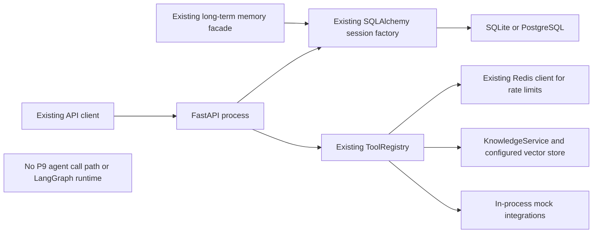
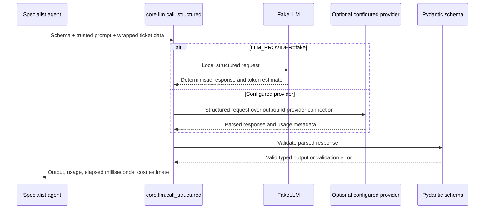
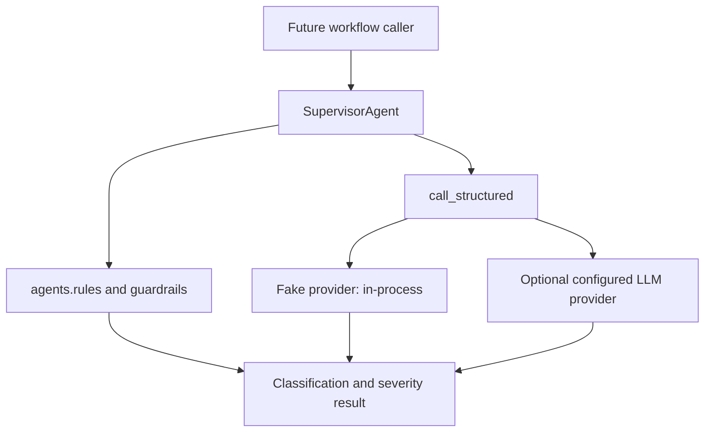
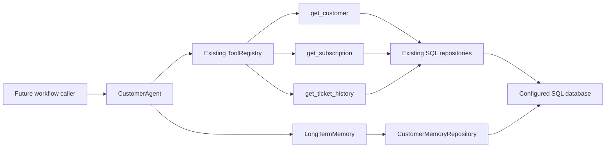
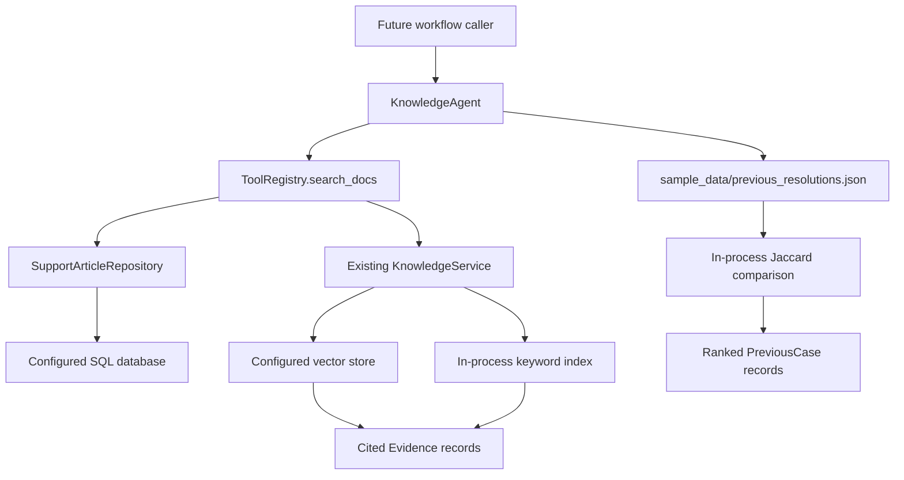
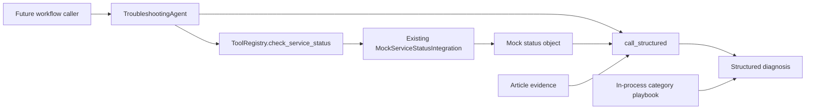
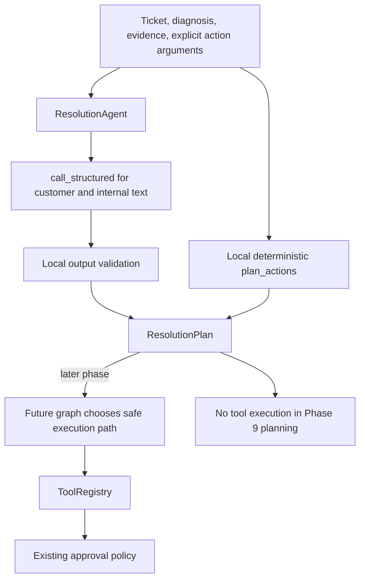
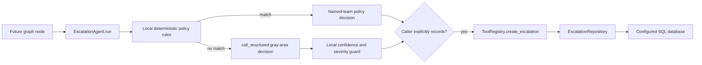
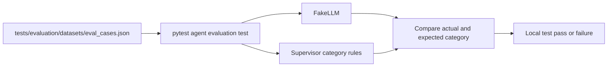
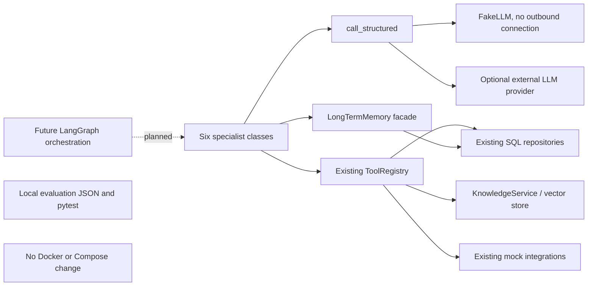

# Phase 9 - Infrastructure and Wiring Design Evolution

## Scope: in-process specialists and existing service connections

Phase 9 adds Python classes and schemas inside the existing repository. It
adds no public HTTP route, Dockerfile, Compose service, listening port, Redis
instance, SQL table, or cloud resource. The agents use existing dependencies:
the `ToolRegistry`, repositories behind tools, knowledge service, memory
facade, and mock integrations.

The optional non-fake LLM provider makes an outbound provider connection
when configured and invoked. Offline tests select the fake provider and do
not require an API key or network request.

## Starting point: existing backend infrastructure, no specialist wiring

Before Phase 9, the backend can create its Redis and SQL dependencies,
register support tools, retrieve knowledge, and use mock service adapters.
There is no specialist layer and no workflow graph calling these components.

## Milestone P9-1: structured model boundary

The core helper receives a Pydantic response class and prompt strings. In
fake mode the provider returns local deterministic data. In configured real
provider mode, LangChain's structured-output adapter calls the selected
provider. Neither path adds a new inbound network route.

The API key is passed from settings to the configured LangChain model; it is
not included in logs or in the specialist's public result. A real provider's
package and credentials are optional dependencies for deployment, not for
offline tests.

## Milestone P9-2: supervisor stays local except for an optional LLM call

Category matching, injection scanning, severity ordering, and policy
overrides execute in the backend process. Ticket content is escaped and
wrapped before a model request. The supervisor does not call SQL or tools.

The optional outbound model connection is the only new potential network
boundary introduced by the specialist code. Policy enforcement itself does
not depend on an LLM network connection.

## Milestone P9-3: customer context reuses registered read tools and memory

The customer agent makes concurrent calls to the existing registry tools.
Each read tool opens its own SQL session through the configured
`session_factory`. Long-term memory uses the injected
`CustomerMemoryRepository` facade. The agent does not connect directly to
the database.

There is no new database table or network port. Tool timeouts and
error-shaped results remain enforced by the existing registry.

## Milestone P9-4: knowledge agent routes search through existing service wiring

The knowledge agent calls only `search_docs` in the tool registry. That tool
reads published SQL articles and calls the existing knowledge service,
which uses the configured vector store and in-process keyword retriever.
Similar-case examples come from a local JSON fixture.

The vector-store selection is not exposed to the agent. The existing
`KnowledgeService` remains responsible for vector and keyword retrieval.

## Milestone P9-5: troubleshooting uses the mock status tool

For categories with a service mapping, the agent invokes
`check_service_status` through the registry. The existing service-status
mock handles that request locally. Diagnosis is generated through
`call_structured`, and category playbooks are local constants.

No production status API is contacted by the mock. A configured real
language-model provider is optional; the status integration remains mocked
in v1.

## Milestone P9-6: resolution creates a plan but does not execute it

The resolution specialist returns structured text plus deterministic action
objects. The refund and setting-reset actions are marked for approval. They
are not sent to the registry in this phase, so no account or billing state
changes occur during planning.

The dashed future connection is not active. The shared tool registry and
approval policy remain the authority when a later workflow executes a plan.

## Milestone P9-7: escalation recording uses the existing registry

The policy match is local and synchronous. Only a separate, explicit
`record_escalation` call reaches `create_escalation` through the registry.
That write tool uses the existing SQL session and does not call an external
service.

The agent does not create an escalation as a hidden side effect of `run()`.
The later graph will own routing and tracing.

## Milestone P9-8: evaluation data is a repository fixture

The evaluation cases are read by offline tests from the repository. This
does not add an evaluator service, scheduled job, API route, or runtime
database dependency.

The Phase 14 threshold-based evaluation suite is not added here.

## End-of-Phase-9 component wiring

## Component connection reference

| Component | Connection in Phase 9 | Network exposure |
|---|---|---|
| Workflow schemas | Imported as Python models by agents and structured calls. | None |
| `FakeLLM` | In-process deterministic provider. | None |
| Configured real LLM | Lazy LangChain provider client when selected and called. | Outbound only |
| `ToolRegistry` | Existing allow-listed calls from customer, knowledge, troubleshooting, and explicit escalation recording. | No new listener |
| SQL repositories | Existing SQL sessions used behind tools and memory. | Existing database connection |
| Knowledge service/vector store | Existing service configuration; search is invoked through `search_docs`. | Existing configured connection |
| Mock integrations | Existing in-process status/billing/workspace adapters. | None |
| Eval dataset | Local JSON loaded by tests. | None |
| Docker/Compose | Unchanged. | No containers or ports added |

## Honest infrastructure status

- Agent behavior is covered by offline tests with fake LLM responses and
  mock tools.
- A live external model, Redis, PostgreSQL, vector store, or cloud resource
  was not used for Phase 9 validation.
- The graph, trace persistence, public routes, and Docker wiring remain
  future tasks.
- Configuring `LLM_PROVIDER` other than `fake` requires a matching
  LangChain provider integration and an API key.

## Related files

- [Phase 9 system design evolution](../design_evolution/Phase9_Project_System_Design_Evolution.md)
- [Phase 9 codebase explanation](../explain_codebase/phase9_explained.md)
- [Phase 9 interview Q&A](../QnA/Phase9_Interview_QnA.md)
- [Application settings](../../backend/app/core/config.py)
- [Redis and database wiring](../../backend/app/main.py)
- [Tool registry](../../backend/app/tools/registry.py)
- [Specialist agents](../../agents/specialists/)
- [Workflow schemas](../../backend/app/schemas/workflow.py)
- [Evaluation cases](../../tests/evaluation/datasets/eval_cases.json)
