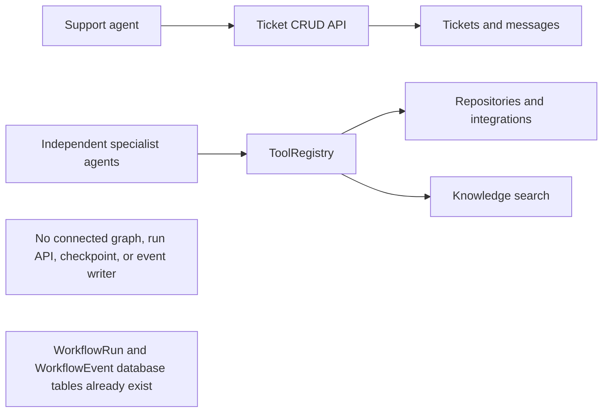
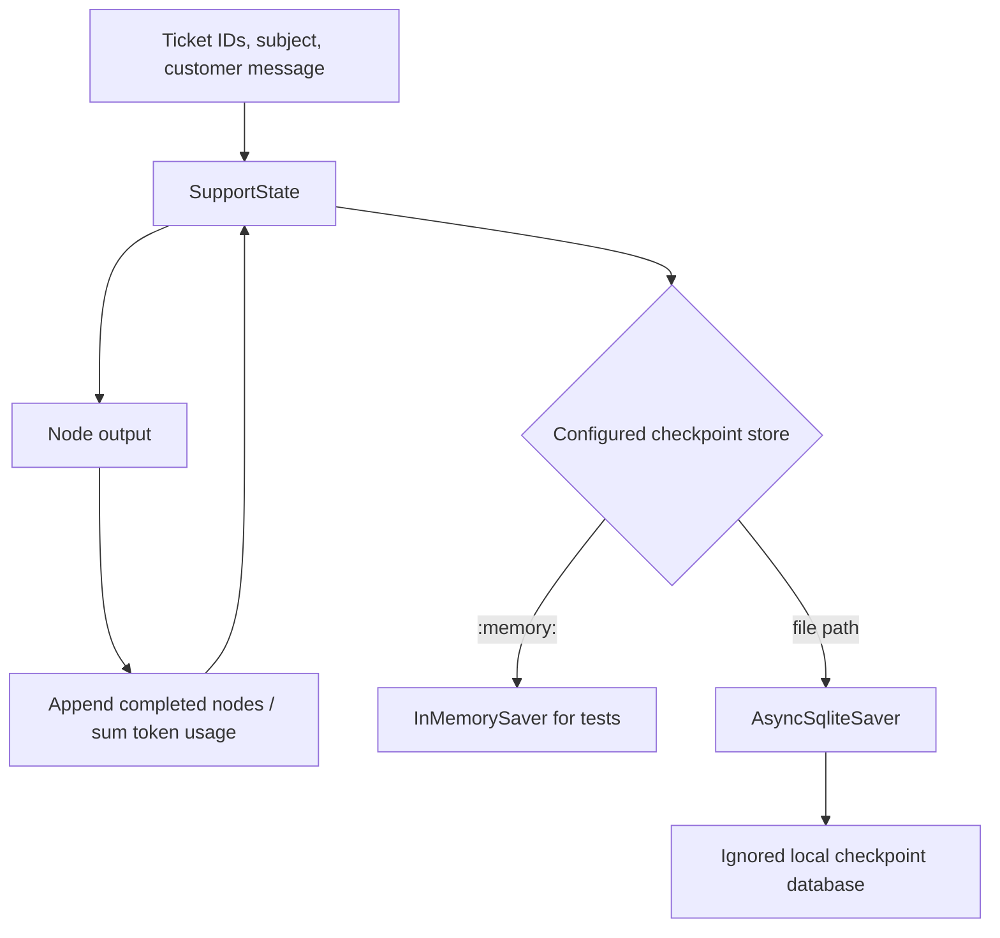
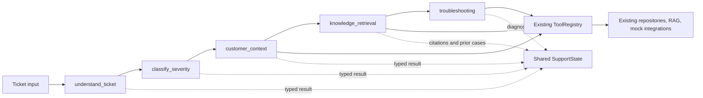
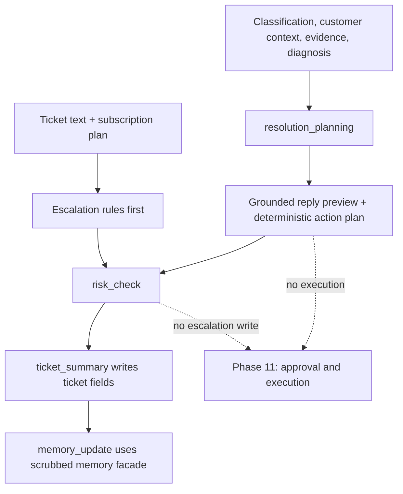
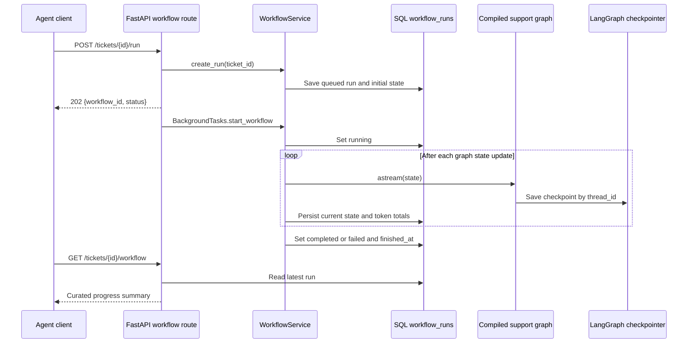
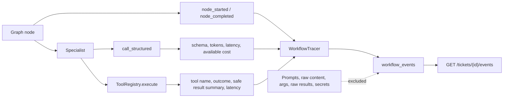
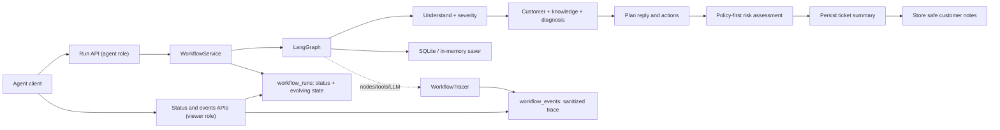

# Phase 10 - Project System Design Evolution

## Scope and phase numbering

This document follows **Phase 10 in `TASKS.md`**: Workflow graph and trace.
`PLAN_PHASE.md` numbers this product stage Phase 9. Phase 10 connects the
Phase 9 specialist agents, adds run/status/events routes, persists workflow
progress, and records sanitized operational telemetry.

Approval interrupts, durable approval decisions, escalation writes, and
execution of planned actions remain Phase 11 work.

## Starting point: useful specialists, no coordinated run

At the start of this phase, each specialist could be invoked independently.
The API could create and read tickets, and the database already had workflow
run and event tables. But no graph coordinated the specialists, created a
run, checkpointed progress, or exposed trace events.

## P10-1: define the shared state and checkpoint lifecycle

`SupportState` is a typed shared record. The graph stores node outputs in
named fields. Reducers append completed-node/error entries and sum token
usage instead of replacing earlier results. The checkpointer uses
`InMemorySaver` for `:memory:` configurations and `AsyncSqliteSaver` for a
configured local SQLite file.

The checkpoint contains graph state so execution can be continued by later
workflow features. The status route deliberately returns a curated summary,
not the entire checkpoint or customer message.

## P10-2 and P10-3: connect the supervisor and investigation specialists

The supervisor's understanding and severity work becomes the first pair of
nodes. Then customer context, cited knowledge retrieval, and troubleshooting
run in order. Each node returns only its part of the shared state.

Tools are still invoked through `ToolRegistry`; specialists do not make SQL
queries. The same service dependencies used in the existing application are
injected into the graph at construction time.

## P10-4: add resolution, risk, summary, and memory nodes

The resolution node produces a grounded reply preview and deterministic
planned actions. The risk node applies the existing policy-first escalation
assessment and marks high-risk conditions. The last nodes save a concise
ticket summary and safe, de-duplicated customer-memory notes.

This phase makes an escalation decision visible in state but does not record
an escalation. It can identify a risk, but it does not pause for approval or
execute a tool action.

## P10-5: expose a run and polling flow

`POST /api/v1/tickets/{ticket_id}/run` checks the ticket and for an existing
active run, creates a queued `WorkflowRun`, and returns `202 Accepted`. The
FastAPI background task starts the graph in-process. The service persists
the state after every graph update, then records completion or a sanitized
failure status.

The current worker runs inside the API process. A separate durable task
queue/worker is a production scaling option, not part of this phase.

## P10-6: trace safe events

The `WorkflowTracer` writes start/completion events for nodes and captures
tool and structured-model activity from the existing registry and
`call_structured` boundary. Each event stores only safe operational
metadata: event type, schema/tool name, timing, outcome, token counts, and
cost availability. Tool events may contain allow-listed result summaries;
they never store prompt text, arguments, or raw results.

Telemetry writes are best-effort: a database event-write failure is logged
without changing whether the support node succeeds. Workflow errors
themselves remain visible through failed status and sanitized error events.

## End-of-Phase-10 design

## Design choices and trade-offs

| Concern | Phase 10 starting point | Phase 10 end state |
|---|---|---|
| Specialist execution | Independent classes and tests. | Ordered graph nodes with typed shared state. |
| State handoff | No persistent run state. | Reducers preserve completed nodes and accumulate tokens. |
| Restart support | No graph checkpoint. | SQLite saver for persistent local checkpoints; memory saver for tests. |
| Run API | Ticket CRUD only. | Agent-only asynchronous `202` start plus viewer status polling. |
| Trace detail | Event tables existed without graph integration. | Node, tool, and LLM events recorded and queryable. |
| Privacy | Agent outputs existed individually. | API status and event responses are curated and omit prompts/arguments/raw bodies. |
| Actions | Resolution agent created plans. | Actions remain plans; no write execution or approval pause occurs. |

## Boundaries and next steps

- Phase 11 adds the human approval interrupt, decision API, named-team
  escalation writes, and shared execution path.
- The graph currently follows a sequential route so all analysis and memory
  updates complete. Phase 11 can add conditional routing at `risk_check`.
- The LangGraph SQLite checkpointer stores workflow checkpoints separately
  from SQL run/event records.
- SQLite persistence and fake-model behavior are tested locally. No cloud
  deployment or live provider execution is claimed.

## Related files

- [Phase 10 codebase explanation](../explain_codebase/phase10_explained.md)
- [Phase 10 infrastructure and wiring](../Infra_design_evolution/Phase10_Infra_design_evolution.md)
- [Phase 10 interview Q&A](../QnA/Phase10_Interview_QnA.md)
- [Workflow state and reducers](../../agents/state.py)
- [Graph construction](../../agents/graph.py)
- [Checkpointer lifecycle](../../agents/checkpointer.py)
- [Workflow service](../../backend/app/services/workflow_service.py)
- [Workflow tracer](../../backend/app/services/workflow_tracer.py)
- [Workflow API](../../backend/app/api/workflow.py)
- [API contract](../../docs/API_CONTRACT.md)
- [Workflow tests](../../tests/workflow/)
- [Task tracker](../../TASKS.md)
