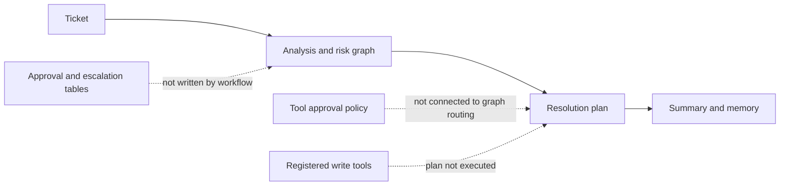
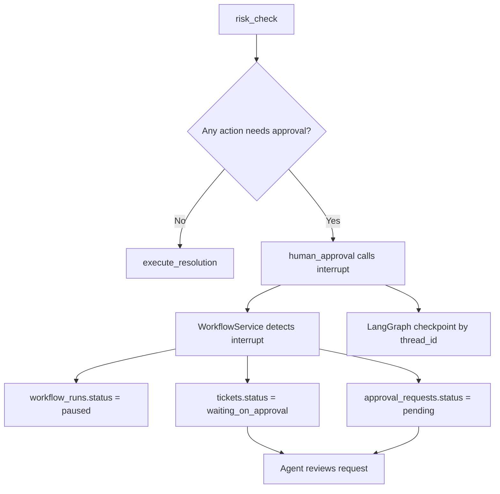
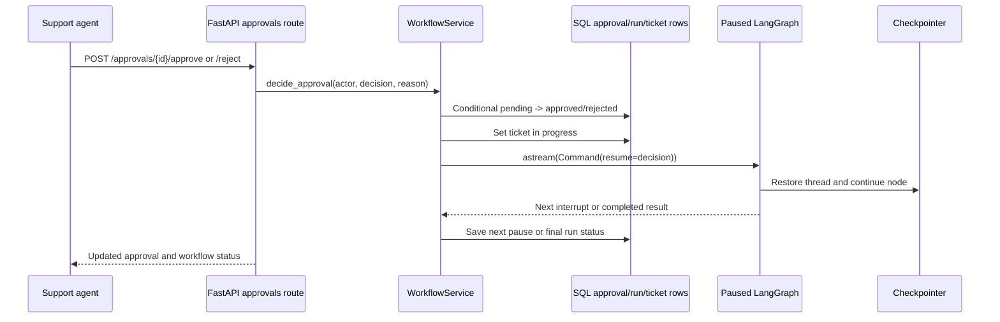
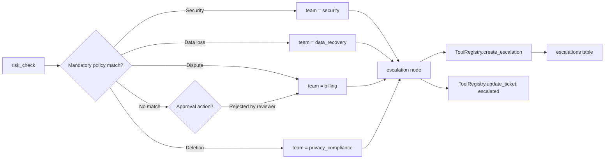
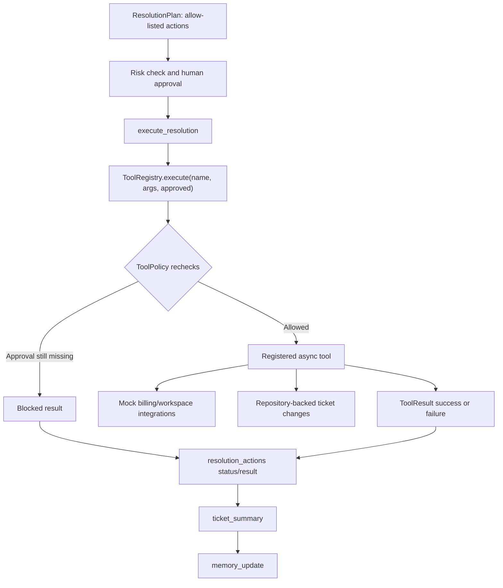
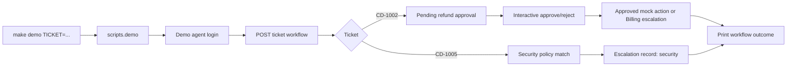
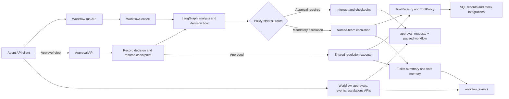

# Phase 11 - Project System Design Evolution

## Scope and phase numbering

This document follows Phase 11 in `TASKS.md`: Approval and escalation.
`PLAN_PHASE.md` maps this to its Phase 10 approval-and-escalation stage.
Phase 11 reuses the workflow graph, approval/escalation tables, policy rules,
and registered tools that already exist. It adds pause/resume behavior,
conditional routing, and execution of approved plans.

## Starting point: decisions existed, but did not change the route

At the start of this phase, the application could produce a resolution plan
and assess risk. The database already had approval and escalation records,
and `ToolRegistry` already knew which tools needed approval. However, the
graph was still one straight line: it did not stop for approval, write an
escalation, or execute the planned actions.

## P11-1: interrupt and store the pending approval

The risk node asks the same policy used by `ToolRegistry` whether each
planned action needs approval. If any action does, the graph routes to
`human_approval`. That node uses LangGraph's interrupt mechanism, yielding
the action and a short explanation instead of proceeding.

The workflow service reads the interrupt, stores an `ApprovalRequest`, marks
the run `paused`, and marks the ticket `waiting_on_approval`. The LangGraph
checkpointer holds the node position under the run's thread ID. Interrupt
resume data is intentionally small: it carries the decision and optional
reason, not tool arguments.

The interrupt node does no business writes before calling `interrupt`.
LangGraph can rerun code before an interrupt when resumed, so the node's
pre-interrupt work is limited to building the review prompt.

## P11-2: make the decision durable and resume the graph

The approval endpoints require the `agent` role. The list route is paginated.
Approve/reject writes a decision, actor, timestamp, and optional reason before
resuming the graph with a `Command(resume=...)`. The repository uses a
conditional update from `pending`, which prevents two concurrent requests
from deciding the same approval.

If a graph contains more than one approval-required action, it asks about one
action at a time. The current approval is decided before the next pending
approval is created. Already decided requests and workflows that are no
longer paused return `409 Conflict`.

## P11-3: add policy-first escalation routing

The risk decision branches to escalation before approval or action execution
when a mandatory policy rule matches. Examples include suspected security
incidents, data loss, payment disputes, legal matters, and account deletion.
The existing rules supply the named team; model judgment cannot cancel a
matched policy.

A rejected approval also produces an escalation decision. A refund request
routes to Billing; a workspace reset routes to Workspace Admin. The
escalation node records the case through the registered `create_escalation`
tool and updates the ticket status through `update_ticket`.

The new read endpoints expose a paginated list with optional `status`,
`team`, and `ticket_id` filters and a detail view. They require an
authenticated viewer or higher.

## P11-4: execute plans through the shared tool path

After risk checks and any required approvals, `execute_resolution` walks the
deterministically planned actions. It calls `ToolRegistry.execute` for every
action; it does not call tool functions directly. The registry performs its
policy check again at execution time. Approved action indices are passed as
approval context only after the graph has resumed from a recorded decision.

Each action receives a durable `ResolutionAction` record with its status and
result. A failed or still-blocked tool is recorded as such; it is not shown
as a success. The graph then continues to ticket summary and memory nodes.

The fixture's claimed refund amount is only a request value. Its mock billing
adapter records a simulated request and explicitly moves no funds.

## P11-5: exercise the safety paths with demo tickets

`scripts/demo.py` uses the in-process FastAPI test client and the same routes
as the application. It runs one selected demo ticket. CD-1002 pauses and
prompts for approve/reject; CD-1005 routes directly to the Security team.
The `make demo` target defaults to CD-1002 and accepts `TICKET=CD-1005`.

## End-of-Phase-11 design

## Design choices and trade-offs

| Concern | Phase 11 starting point | Phase 11 end state |
|---|---|---|
| Consequential action | A plan and a tool policy existed, but graph execution did not pause. | Conditional graph route pauses and creates a durable approval request. |
| Decision handling | No approve/reject service path. | Agent-only endpoints record actor, time, reason, and decision. |
| Resume | A checkpointer existed but no approval API used it. | `Command(resume=...)` continues the saved graph thread. |
| Escalation | Rules could identify cases but did not create an escalation row. | Rules route to named teams and update ticket status. |
| Tool writes | Tools were registered but plans were not executed by the graph. | All planned actions execute through `ToolRegistry` and `ToolPolicy`. |
| Auditability | Planned actions existed without action outcome records. | Approval, escalation, workflow event, and resolution-action records exist. |
| External effects | Integrations are mocks. | Approved refund is a simulated request; no money is moved. |
| Demo | Make target started the backend only. | Make target demonstrates approval or security escalation offline. |

## Boundaries and next steps

- The current workflow runner remains an in-process background task.
- No real email, refund, or workspace change is performed by mock integrations.
- Approval is per planned action and decisions are not exposed as direct tool
  execution endpoints.
- The action executor stores arguments in the internal action table; API
  workflow/event responses remain curated.
- Phase 12/13 can present these routes and states in the ticket console.
- No cloud deployment, distributed worker, or live LLM integration is
  claimed by this phase.

## Related files

- [Phase 11 codebase explanation](../explain_codebase/phase11_explained.md)
- [Phase 11 infrastructure and wiring](../Infra_design_evolution/Phase11_Infra_design_evolution.md)
- [Phase 11 interview Q&A](../QnA/Phase11_Interview_QnA.md)
- [Workflow graph](../../agents/graph.py)
- [Approval and escalation nodes](../../agents/nodes/)
- [Workflow service](../../backend/app/services/workflow_service.py)
- [Approval and escalation APIs](../../backend/app/api/)
- [Tool registry and policy](../../backend/app/tools/)
- [API contract](../../docs/API_CONTRACT.md)
- [Tests](../../tests/api/test_tickets.py)
- [Task tracker](../../TASKS.md)
