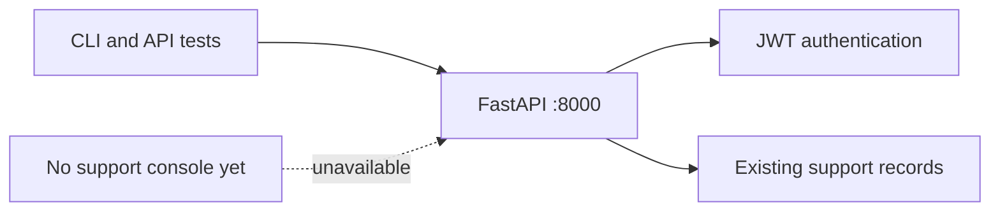
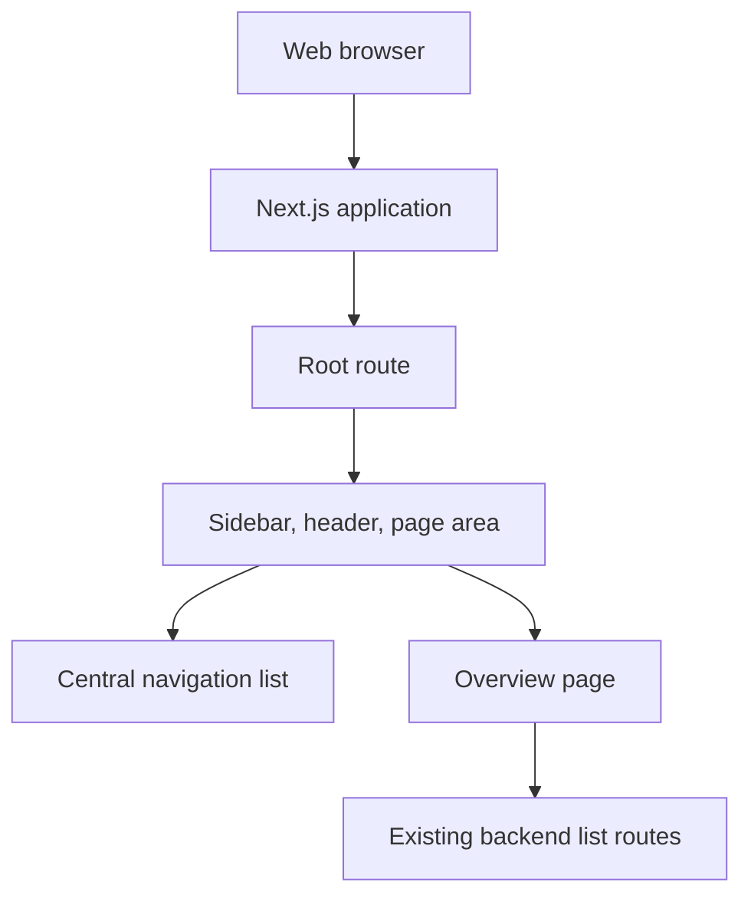
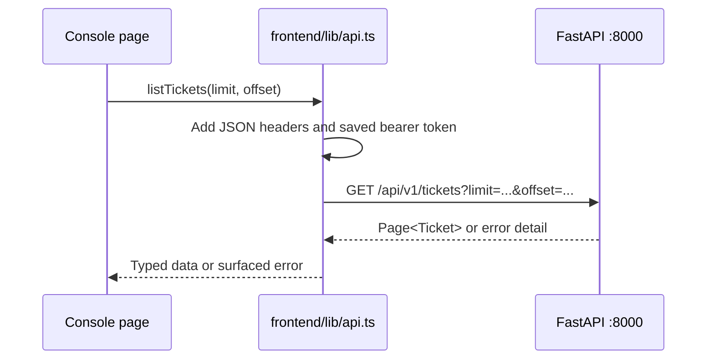
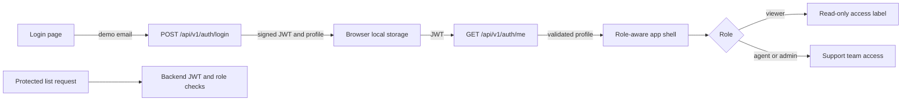
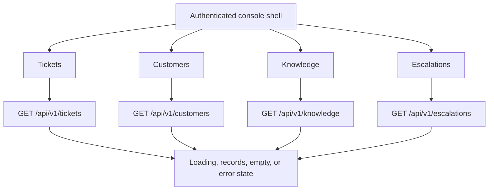
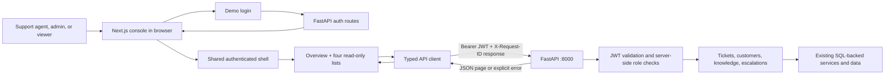

# Phase 12 - Project System Design Evolution

## Scope and phase numbering

This document follows Phase 12 in `TASKS.md`: Console shell. It covers P12-1
through P12-4. `PLAN_PHASE.md` groups the console and the later ticket action
screen under its Phase 12 Agent console goal. This implementation completes
the authenticated shell and read-only data pages; it does not implement the
ticket workflow screen.

## Starting point: backend APIs without a support console

The FastAPI application already provided authentication and read APIs for
tickets, customers, knowledge, and escalations. There was no Next.js
application, browser sign-in, or support-facing list experience.

## P12-1: add the Next.js application shell

The first step adds the Next.js App Router, a shared page frame, and one
navigation definition. The root route sends a user to the overview. The
overview is deliberately assembled from the real list APIs because the
backend does not currently expose a dashboard-summary route.

## P12-2: define a typed API boundary

The frontend now has one `api.ts` module for HTTP access and one `types.ts`
module for the response shapes used by the screens. List requests share a
pagination contract. HTTP errors preserve the server's detail and request ID;
network failures have their own error type.

The frontend models only the JSON shape; TypeScript types do not validate
untrusted JSON at runtime. Backend Pydantic response models remain the
authoritative serialization and validation layer.

## P12-3: authenticate and render role-aware context

The login form calls the existing demo login route. The provider saves the
returned bearer token and profile in browser local storage, then validates
existing sessions through `/auth/me`. The shared console layout shows the
signed-in person's identity and role. A viewer receives a read-only label.

The label is not relied on as the security boundary. Server-side RBAC still
decides whether a request succeeds. Demo login is passwordless and requires
`DEMO_MODE`; it is not a production identity provider.

## P12-4: connect the read-only lists

Each list page calls the corresponding existing endpoint and supports
pagination. Empty records, loading, HTTP failures, and temporary network
failures have visible UI states. Network failures are retried once
automatically and can also be retried manually.

No mutation routes are called from these pages. Approvals, ticket replies,
workflow runs, and case actions remain outside this phase.

## End-of-Phase-12 design

## Design choices and trade-offs

| Concern | Phase 12 starting point | Phase 12 end state |
|---|---|---|
| Human access | No browser console. | Next.js App Router console with centralized shell and navigation. |
| API use | Existing API tested by scripts and clients. | One typed frontend client for the list and auth routes used here. |
| Identity | Backend demo login and JWT already existed. | Browser login stores the token/profile and revalidates the profile with `/auth/me`. |
| Authorization | Server RBAC already existed. | Role is visible in the UI; server remains authoritative. |
| Data presentation | No support-facing list pages. | Paginated read-only tickets, customers, knowledge, and escalations. |
| Dashboard | No dashboard-summary endpoint exists. | Overview displays totals from existing list responses; no new API is invented. |
| Failure handling | API contract returns structured errors and request IDs. | HTTP details and request IDs are shown; connection errors retry once. |
| Writes | Existing server routes can perform actions. | This phase does not expose action controls; ticket-workflow UI is a later phase. |

## Boundaries and next steps

- JWTs are stored in local storage as specified by the existing frontend
  convention. This is convenient for the demo, but it does not protect against
  a successful cross-site scripting attack; production hardening should
  consider a secure, HttpOnly cookie architecture and a threat review.
- The profile cached in local storage is for display only. Protected data
  still requires the server to validate the bearer token.
- The overview makes four small list calls because there is no dashboard
  summary API. A future backend summary route could reduce that fan-out.
- TypeScript describes expected response data but does not perform runtime
  schema validation in the browser.
- No ticket detail/action workflow, real customer mutation, Docker image,
  Compose network, or cloud deployment is included.

## Related files

- [Phase 12 codebase explanation](../explain_codebase/phase12_explained.md)
- [Phase 12 infrastructure and wiring](../Infra_design_evolution/Phase12_Infra_design_evolution.md)
- [Phase 12 interview Q&A](../QnA/Phase12_Interview_QnA.md)
- [Frontend API client](../../frontend/lib/api.ts)
- [Frontend auth provider](../../frontend/lib/auth.tsx)
- [Frontend list pages](<../../frontend/app/(console)/>)
- [Backend auth route](../../backend/app/api/auth.py)
- [Backend list routes](../../backend/app/api/)
- [API contract](../../docs/API_CONTRACT.md)
- [Task tracker](../../TASKS.md)
