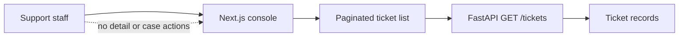
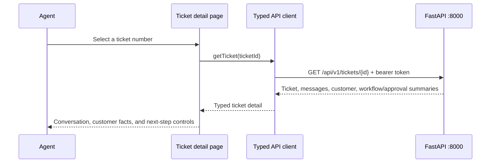
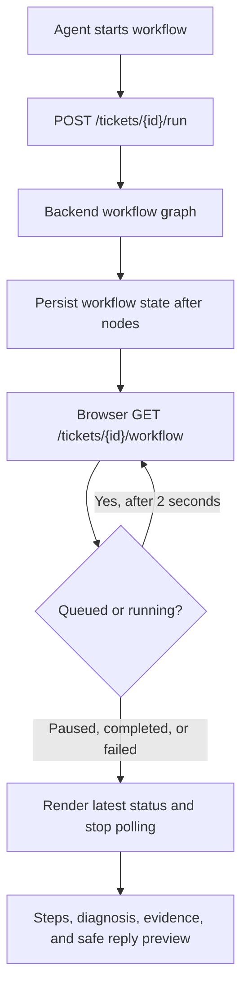
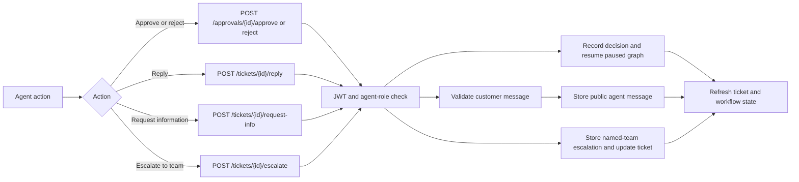
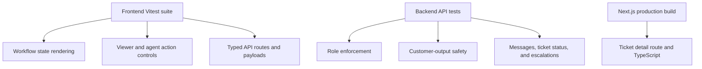
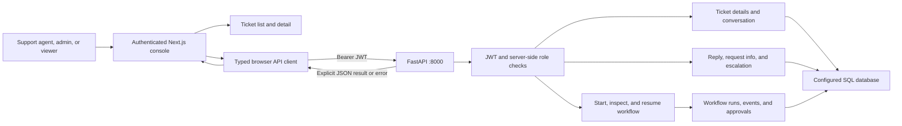

# Phase 13 - Project System Design Evolution

## Scope and phase numbering

This document follows Phase 13 in `TASKS.md`: Ticket workflow screen
(P13-1 through P13-4). `PLAN_PHASE.md` groups the console shell and the ticket
screen under its broader Agent console phase. Phase 13 builds on the Phase 12
Next.js shell and the existing Phase 11 workflow and approval services.

## Starting point: a read-only ticket list

Before this phase, staff could sign in and browse a page of tickets. A ticket
row showed summary fields, but there was no detail route from which to view
the conversation, monitor an investigation, or take an action.

## P13-1: create a ticket detail workspace

The ticket number now links to `/tickets/{id}`. The detail page requests the
ticket, messages, customer summary, workflow summary, and approval summary
from the existing detail endpoint. The page groups the conversation,
customer facts, workflow area, and action area into a responsive workspace.

The frontend types mirror the API payload. The backend response and its
Pydantic schema remain the authoritative data contract.

## P13-2: start and display workflow progress

The agent starts a run with `POST /tickets/{id}/run`. The page then reads
`GET /tickets/{id}/workflow` and repeats the read every two seconds while the
workflow is queued or running. A single shared step definition maps backend
node names to human-readable labels.

The page does not infer a successful run from a start response. It renders
the latest state supplied by the backend, exposes errors, and allows a
manual retry. Paused workflows stop polling until an agent takes action.

The 12 visible workflow steps correspond to the backend graph. Some paths
are conditional: for example, approval is shown as skipped when the run
completed without needing approval. A paused approval is not treated as
completed.

## P13-3: connect agent actions to backend policies

The workflow panel and ticket actions use the existing protected approval
routes. For completeness, the documented reply, request-information, and
manual escalation routes were implemented in the ticket API. Those routes
store the resulting state and use the project's role and output-safety rules.

The browser never executes a refund or account change by sending an
`approved` flag. It calls the approval endpoint, which records an auditable
decision and resumes the saved workflow through its existing policy path.
Reply content is checked for secrets, internal URLs, and known contact
details belonging to other customers. Requesting more information records a
public agent message and sets the ticket to `waiting_on_customer`. Manual
escalation records a team and reason and sets the ticket to `escalated`.

## P13-4: test the experience and API boundary

Frontend tests cover workflow-step states, viewer action restrictions, and
the request paths and payloads used by ticket actions. API tests cover saved
reply and escalation outcomes, output rejection, status changes, and
agent-only writes.

## End-of-Phase-13 design

## Design choices and trade-offs

| Concern | Starting point | Phase 13 end state |
|---|---|---|
| Ticket access | Read-only paginated list. | Detail route with conversation and customer context. |
| Workflow visibility | No browser workflow view. | 12 named steps, current/completed state, evidence, diagnosis, and safe reply preview. |
| Progress refresh | No ticket-level polling. | Two-second refresh while a run is queued or running; polling stops at a pause or terminal state. |
| Human approval | Backend approval flow existed without ticket-screen controls. | Pending approval can be accepted or rejected from the case screen; backend records and resumes it. |
| Customer communication | No action from the ticket page. | Agent replies and information requests are recorded as public messages after output checks. No email is sent in demo mode. |
| Manual escalation | Escalation list was view-only. | Agent can name a team and reason; backend stores the escalation and updates ticket status. |
| Permissions | Server-side RBAC existed. | Viewers see disabled controls, while API role checks remain the security boundary. |
| Validation | Existing API and UI tests covered Phase 12 reads. | Focused frontend and backend tests cover workflow steps, action requests, access, and reply safety. |

## Boundaries and next steps

- Replies and ticket actions are demo records. No real email, refund, or
  external team notification is sent.
- Polling is browser-driven and uses the existing API. It is not a websocket,
  message queue, or background-worker change.
- A page refresh can restore the latest ticket/workflow summaries from the
  backend; local component state only holds form input and current display
  state.
- The API contract is updated with the action payloads and status effects.
- Docker, cloud deployment, and production identity/session hardening remain
  outside Phase 13.

## Related files

- [Phase 13 codebase explanation](../explain_codebase/phase13_explained.md)
- [Phase 13 infrastructure and wiring](../Infra_design_evolution/Phase13_Infra_design_evolution.md)
- [Phase 13 interview Q&A](../QnA/Phase13_Interview_QnA.md)
- [Ticket detail page](<../../frontend/app/(console)/tickets/[id]/page.tsx>)
- [Ticket actions](../../frontend/components/tickets/ticket-actions.tsx)
- [Workflow steps](../../frontend/lib/workflow-steps.ts)
- [Frontend API client](../../frontend/lib/api.ts)
- [Ticket API routes](../../backend/app/api/tickets.py)
- [Ticket action service](../../backend/app/services/ticket_actions.py)
- [API contract](../../docs/API_CONTRACT.md)
- [Task tracker](../../TASKS.md)
