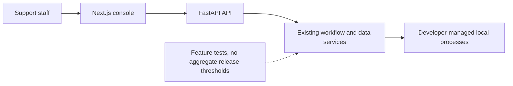
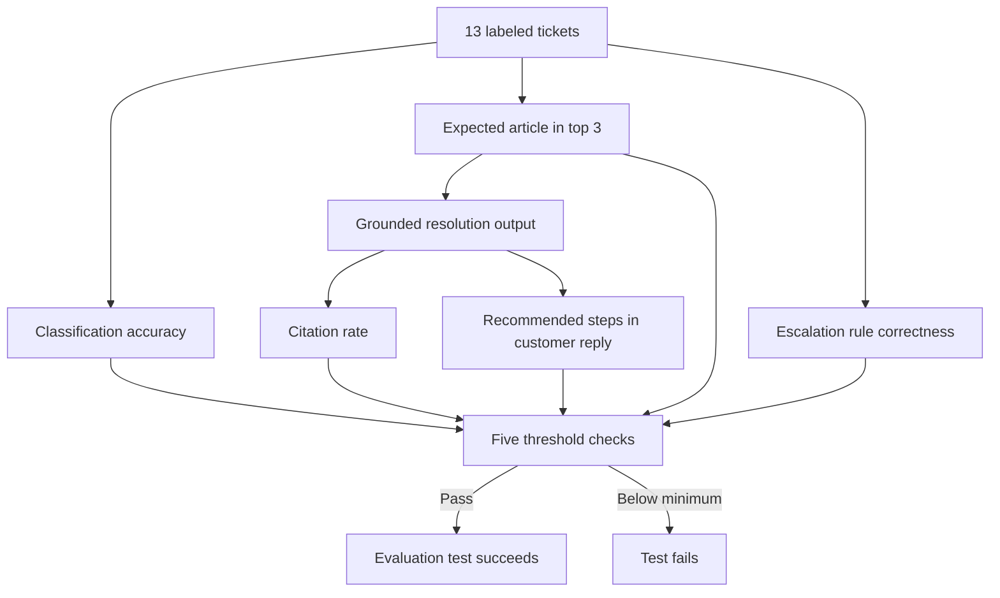
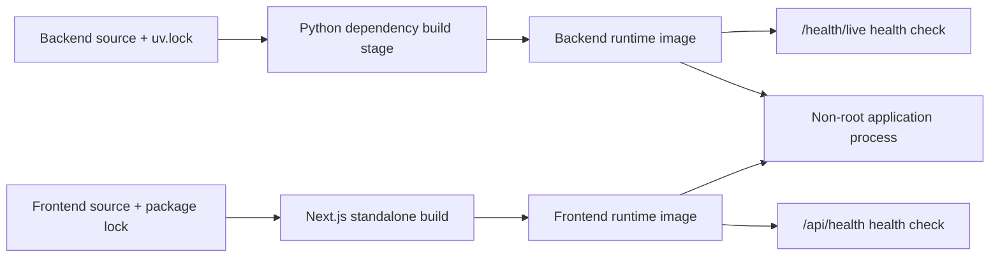
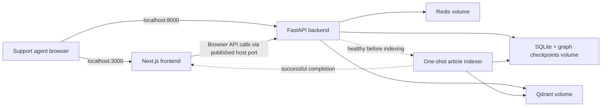
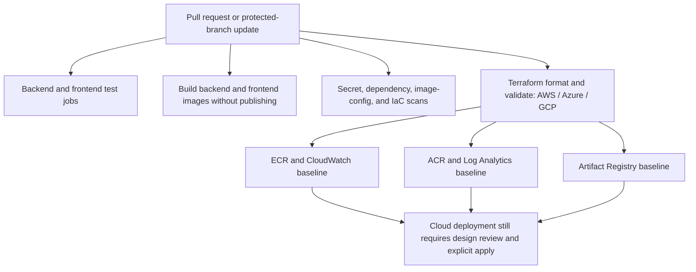
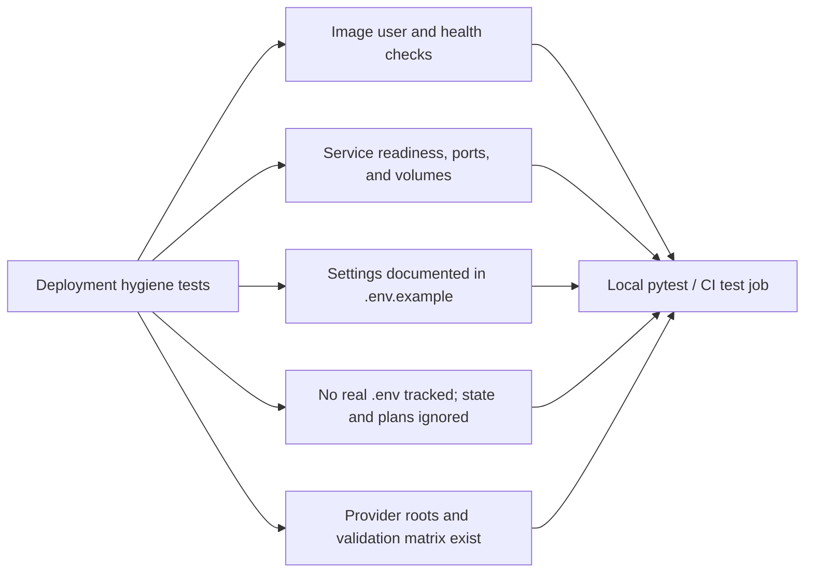
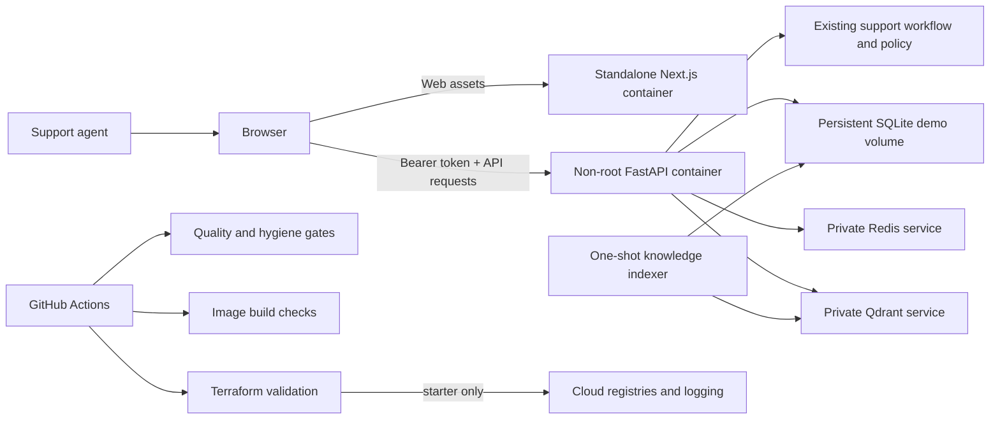

# Phase 14 - Project System Design Evolution

## Scope and phase numbering

This document follows Phase 14 in `TASKS.md`: Evaluation and delivery
(P14-1 through P14-5). `PLAN_PHASE.md` groups evaluation and delivery as its
broader Phase 13. Phase 14 builds on the agent workflow and ticket console
from the preceding tracker phases.

## Starting point: a working application without a release gate

Before Phase 14, support staff could use the frontend and backend locally.
There were labeled tickets and tests for individual features, but no
threshold-based quality scorecard, production container images, or composed
local service topology.

## P14-1: add a measurable quality gate

The labeled evaluation set now identifies expected ticket categories,
relevant knowledge articles where available, and whether policy requires
escalation. The scorecard runs the real offline classifier, hybrid retriever,
escalation rules, and response grounding path against those labels.

The thresholds are classification accuracy 0.80, retrieval hit-rate@3 0.75,
escalation correctness 0.90, citation rate 0.90, and grounding rate 0.90.
The evaluation is offline; it does not depend on a hosted model.

## P14-2: package the applications as separate images

The backend image installs locked dependencies in a build stage, then copies
only the runtime environment and the Python application into a slim runtime
image. The frontend image builds Next.js in standalone mode and copies the
standalone server and static assets into its runtime image. Both runtime
containers use a non-root account.

The frontend API address is a build argument because `NEXT_PUBLIC_API_URL` is
embedded in the generated browser bundle. It must name an API address
reachable by the user's browser, not a Docker-only service name.

## P14-3: describe the local services and their data flow

Compose starts Redis and Qdrant, then the backend. The backend seeds the
demo database before the one-shot knowledge-indexing service runs. The
frontend waits until the API is healthy and the article index has completed.

The Compose stack is intended for a local demonstration. The backend database
is SQLite in this configuration; Redis and Qdrant are private network
services. The API and frontend ports bind to loopback rather than every host
interface.

## P14-4: make delivery checks repeatable

GitHub Actions has separate jobs for backend checks, frontend checks,
container builds, security scans, and Terraform validation. The Terraform
roots start the cloud-specific registry and logging setup for each provider.

The cloud roots are starter configurations, not complete hosted application
stacks. They do not provision compute, ingress, application secrets,
databases, Redis, or Qdrant. CI validation does not authenticate to a cloud
account or apply resources.

## P14-5: protect deployment assumptions with tests

Static hygiene tests check that configuration stays aligned with the runtime:
container users and health checks, Compose networks and persistent storage,
environment-variable documentation, secret-file ignore rules, and expected
Terraform and CI files.

## End-of-Phase-14 design

## Design choices and trade-offs

| Concern | Starting point | Phase 14 end state |
|---|---|---|
| Quality evidence | Individual feature tests and a labeled case list. | Five explicit evaluation metrics with minimum thresholds. |
| Runtime packaging | Developer-managed Python and Node processes. | Separate locked-dependency backend and standalone frontend images. |
| Process privileges | Local process account. | Container runtime uses non-root application accounts and health checks. |
| Local dependencies | Manually launched processes and services. | Compose coordinates backend, frontend, Redis, Qdrant, and indexing. |
| Data retention | Local paths. | Named volumes preserve SQLite/checkpoints, Redis, and Qdrant data. |
| Delivery checks | No CI workflows in this phase. | Workflow definitions validate tests, images, security, and Terraform. |
| Cloud readiness | No provider roots. | Registry/logging starter roots; application compute and service wiring remain future work. |

## Boundaries and next steps

- The Compose stack is not a production deployment template; SQLite and
  loopback ports are demo choices.
- Terraform provisions only the stated registry and logging baseline. Add
  reviewed compute, networking, ingress, secret references, and managed data
  services before a cloud deployment.
- Workflow files have been authored but are not evidence of a successful
  GitHub run.
- No cloud plan or apply has been run from this checkout.
- Docker and Terraform CLIs are not installed in the current environment;
  image and Terraform validation must run in a configured environment or CI.
- Local validation completed: 203 backend tests, Ruff, 9 frontend tests,
  frontend lint and production build, and the CD-1002 demo's rejection path.

## Related files

- [Phase 14 codebase explanation](../explain_codebase/phase14_explained.md)
- [Phase 14 infrastructure and wiring](../Infra_design_evolution/Phase14_Infra_design_evolution.md)
- [Phase 14 interview Q&A](../QnA/Phase14_Interview_QnA.md)
- [Evaluation threshold tests](../../tests/evaluation/test_thresholds.py)
- [Backend image](../../backend/Dockerfile)
- [Frontend image and standalone configuration](../../frontend/Dockerfile)
- [Compose stack](../../docker-compose.yml)
- [Terraform roots](../../deployment/)
- [Deployment documentation](../../docs/DEPLOYMENT.md)
- [GitHub Actions workflows](../../.github/workflows/)
- [Task tracker](../../TASKS.md)
