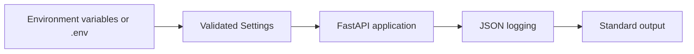
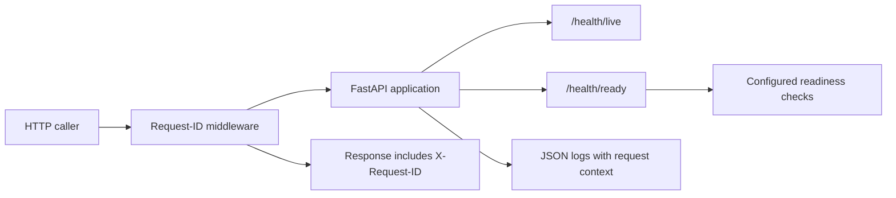
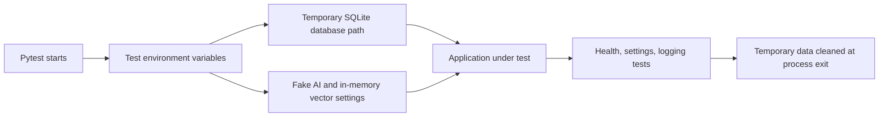
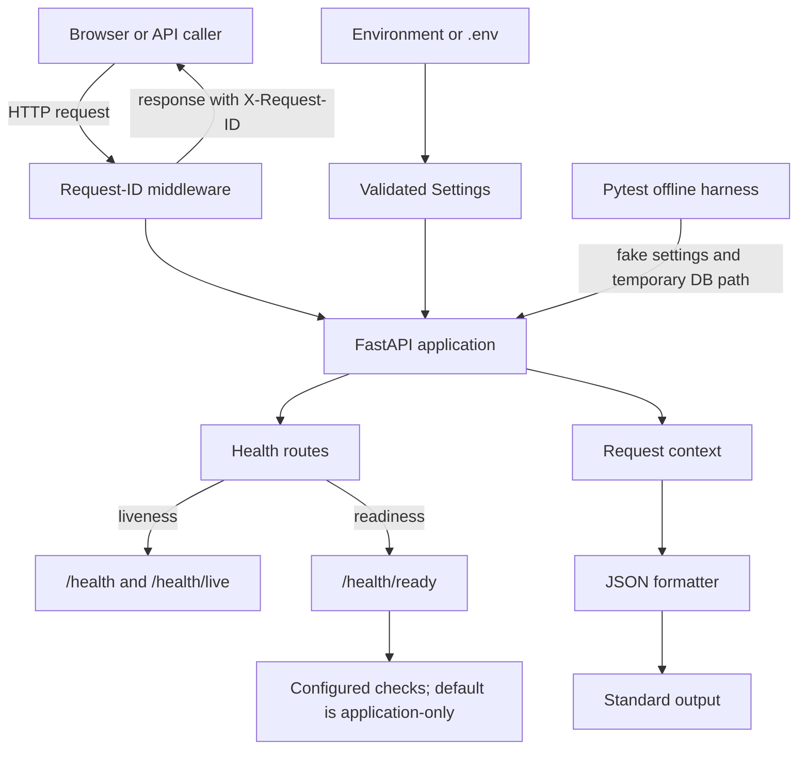

# Phase 1 — Project System Design Evolution

## Scope and status

Phase 1 is the **runtime skeleton**: settings, structured logging, health
endpoints, request IDs, an offline test harness, and developer commands. The
task tracker marks its four tasks complete. The later ticket, identity, data,
agent, and workflow components are outside this phase.

The diagrams below show the progression from a minimal web process to the
implemented Phase 1 foundation. They are design snapshots, not claims that
later-phase components already exist.

## Starting point: one application process

At the beginning, the simplest useful design is just a web application that
can receive a request and return a response. It has no consistent configuration
boundary, operational health signal, or request correlation.

This is enough to demonstrate a web server, but it is hard to operate: a
failure has little context, callers cannot distinguish a live service from a
ready one, and setup can vary from one developer's machine to another.

## Milestone P1-1: settings and structured logging

The first improvement gives the application a validated configuration source
and a consistent log format. The defaults support an offline demo, while
environment variables allow values to be changed without editing source code.

Sensitive configuration uses `SecretStr` for relevant secret settings.
Configuration is loaded through a cached settings factory. JSON log records
include timestamps and can include request and workflow references.

## Milestone P1-2: health routes and request IDs

The next improvement makes the service easier to operate. Health routes report
whether the process responds and whether configured readiness checks pass.
Request IDs connect a caller's response to server-side context and logs.

In the current implementation, liveness does not test external dependencies.
Readiness runs the checks supplied to the app; the default check confirms the
application is available. Future phases can supply real database, Redis, or
vector-store checks without changing the meaning of liveness.

## Milestone P1-3: offline test harness

The test runner must not depend on a developer's real database or paid AI
credentials. Pytest sets test-specific values before importing the application
and points database state to a temporary directory.

This harness makes core runtime behavior reproducible and helps avoid
accidentally relying on credentials or a developer's local data.

## End-of-phase design

By the end of Phase 1, those pieces are connected into a small but operable
runtime. The request boundary provides correlation, the app exposes health
routes, and configuration and logs are consistent. The test harness provides
an offline validation path.

## What changed in system-design terms

| Concern | Initial design | End-of-Phase-1 design |
|---|---|---|
| Configuration | Values are implicit or scattered. | Central validated settings with environment overrides and offline-safe defaults. |
| Operations | Only a basic web response. | Separate liveness and readiness signals. |
| Troubleshooting | Requests are difficult to correlate. | A request reference is returned to the caller and is available in logs. |
| Logging | Output format is unspecified. | Consistent JSON log records. |
| Testing | May depend on local state or external providers. | Temporary test database path and fake providers. |
| Product behavior | No support case processing. | Still no support case processing; this phase prepares the runtime only. |

## Explicit non-goals and next dependency

There is no ticket persistence, login/RBAC, rate limiter, real dependency
health-check wiring, AI workflow, frontend, Dockerfile, or container network
implemented as part of this phase. Later components can build on this runtime;
they should not be represented as part of the Phase 1 deployed design.

## Related files

- [Phase 1 runtime](../../backend/app/main.py)
- [Settings](../../backend/app/core/config.py)
- [Logging](../../backend/app/core/logging.py)
- [Health routes](../../backend/app/api/health.py)
- [Request-ID middleware](../../backend/app/middleware/request_id.py)
- [Offline test harness](../../tests/conftest.py)
- [Phase plan](../../PLAN_PHASE.md)
- [Task tracker](../../TASKS.md)
