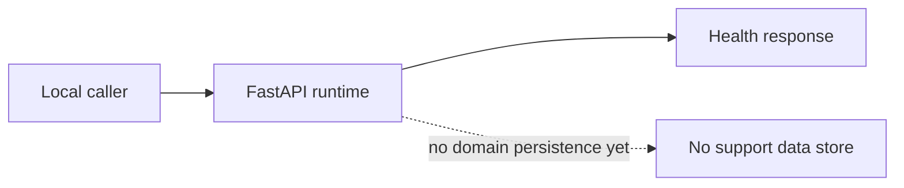
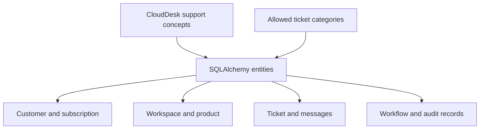
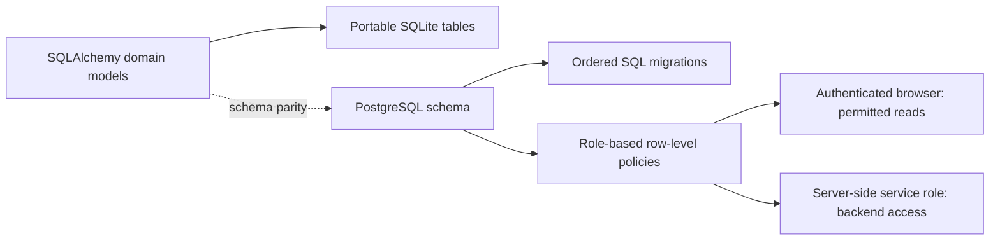
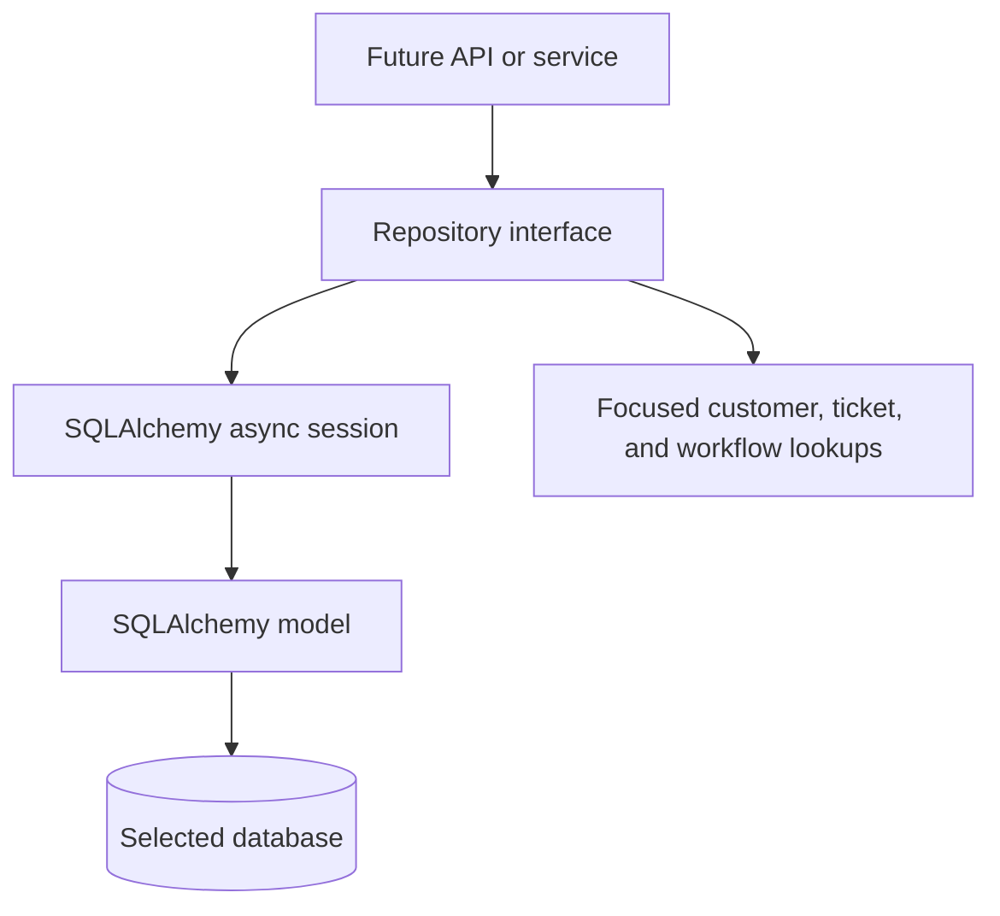
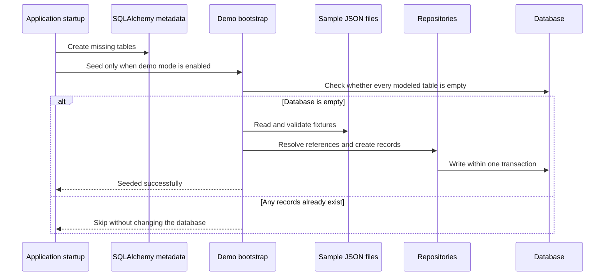
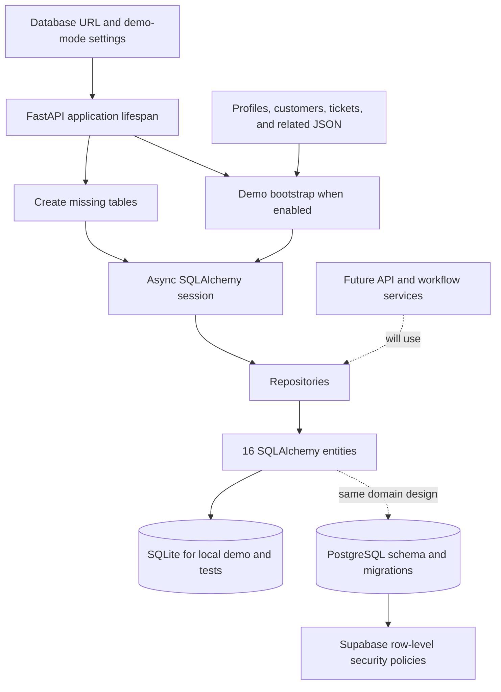

# Phase 2 — Project System Design Evolution

## Scope and status

Phase 2 is **persistence and demo data**. All four Phase 2 tasks are marked
complete in the task table: data models, PostgreSQL schema and policies,
repositories, and demo bootstrap. The progress-summary table in `TASKS.md` was
stale and has been updated to agree with those task rows.

This document follows the design from the simplest Phase 2 starting point to
the implemented end-of-phase data foundation. The support API, authentication,
agent workflow, frontend, and container deployment are not part of this phase.

## Starting point: application runtime with no domain records

At the end of Phase 1, CloudDesk can run and answer health requests, but it has
no durable support-domain model. A basic process can respond, but it has no
defined way to remember which customer owns a ticket or how a ticket's
messages relate to it.

## Milestone P2-1: define the data language

The first step defines the records and the rules that connect them. SQLAlchemy
models describe the same business concepts regardless of whether the selected
database is SQLite or PostgreSQL. A category enum and database constraints
prevent unsupported categories and invalid relationships from silently
becoming ordinary data.

The 16 models include both current support data and storage shapes required by
later phases. Defining a future workflow table is only preparation; the
workflow itself is not implemented here.

## Milestone P2-2: prepare the PostgreSQL schema and access boundaries

The portable application model is paired with SQL scripts for PostgreSQL.
Numbered migrations provide a repeatable application order. The Supabase
row-level security policies grant authenticated users role-based read access,
including the special rule that viewers cannot read internal ticket messages.

The scripts prepare a PostgreSQL/Supabase setup; this phase does not provision
a live cloud database. Local SQLite does not provide PostgreSQL's row-level
security behavior.

## Milestone P2-3: put database operations behind repositories

Repositories separate the work of finding and changing records from the code
that will later handle HTTP requests or business workflows. A shared base
repository supplies common CRUD, counting, pagination checks, and protected
field rules. Focused repositories add lookups such as tickets by ticket
number, tickets for a customer, and messages for a ticket.

This boundary gives the rest of the application one consistent way to access
data and gives tests a direct place to check query behavior.

## Milestone P2-4: make a clean demo database useful

The last step adds sample fixtures and a startup bootstrap. On a clean
database, the loader validates fixture shape, connects related records by
their references, and imports the data in a transaction. If the database
already contains any modeled records, the loader skips seeding instead of
overwriting or mixing in the demo dataset.

## End-of-phase design

By the end of Phase 2, the application has a defined data model, an
application-level repository boundary, a local SQLite path, PostgreSQL
schema/access-control assets, and a safe demo bootstrap. These elements are
connected during application startup, but the public support API and business
workflow are still future work.

## What changed in system-design terms

| Concern | Phase 2 starting point | End-of-Phase-2 design |
|---|---|---|
| Business data | No durable support-domain model. | Typed models for support and future workflow records. |
| Database access | No shared persistence boundary. | Async SQLAlchemy sessions with repositories. |
| Database choices | No domain schema to reuse. | SQLite for local use and matching PostgreSQL setup assets. |
| Data quality | Relationships and allowed values are unspecified. | Foreign keys, uniqueness, indexes, checks, and ticket-category constraints. |
| Demo setup | No durable demo records. | Fixture loader for an empty database, with a transaction and repeat-run protection. |
| Access policy | No database role policies. | PostgreSQL/Supabase read policies by role; local SQLite remains a demo/test database. |
| Support behavior | No support-domain actions. | Still no ticket HTTP API or automated resolution workflow in this phase. |

## Boundaries and next dependency

- Application-level database access is in `backend/app/repositories/`; the
  models define the records, and `seed_service.py` orchestrates sample
  bootstrap. This phase does not add ticket APIs.
- PostgreSQL DDL, migrations, and RLS are checked-in setup artifacts, not
  evidence of an already-created cloud account or deployment.
- The runtime calls table creation at startup. A production rollout should
  follow the documented migration process and deployment practices rather
  than relying on demo seeding.
- Later work can use this data layer for authentication, support APIs, memory,
  and workflows. Those components are not part of the Phase 2 end state.

## Related files

- [Phase 2 codebase explanation](../explain_codebase/phase2_explained.md)
- [SQLAlchemy entities](../../backend/app/models/entities.py)
- [Database connection](../../backend/app/core/database.py)
- [Repository layer](../../backend/app/repositories/)
- [Demo bootstrap](../../backend/app/services/seed_service.py)
- [PostgreSQL schema and migrations](../../database/)
- [Phase 2 task tracker](../../TASKS.md)
