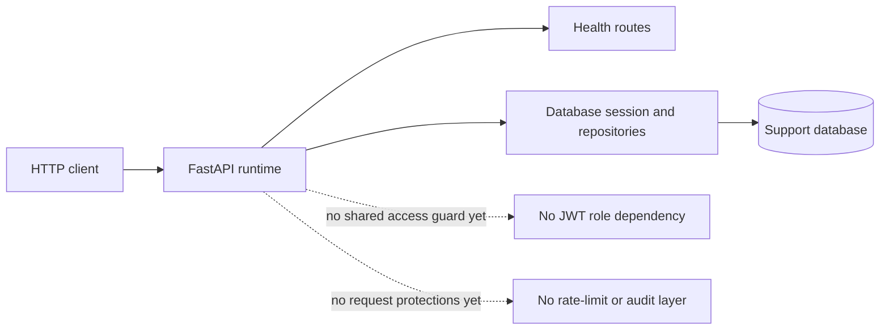
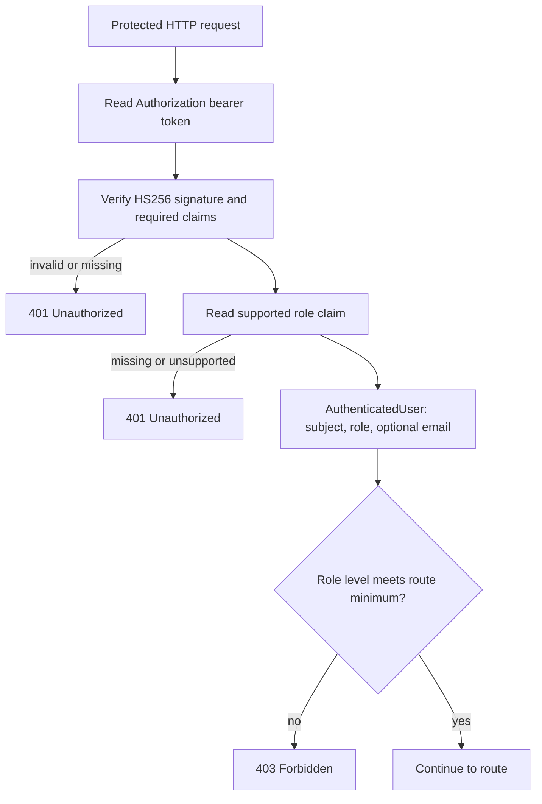
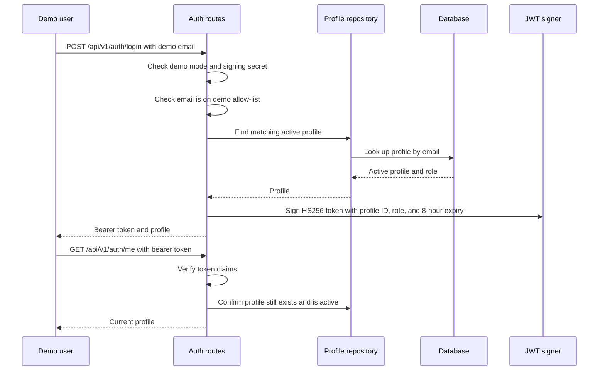
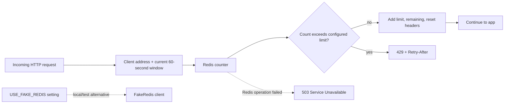
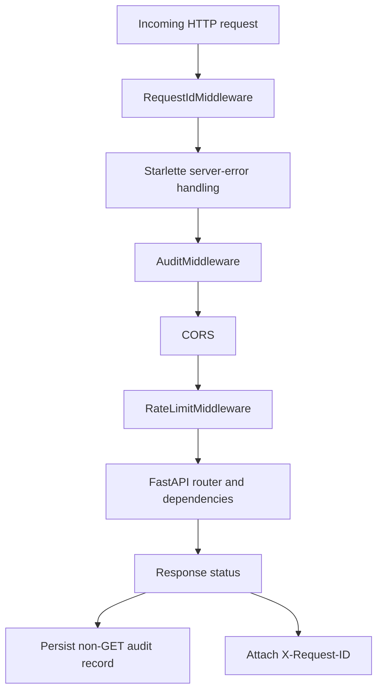
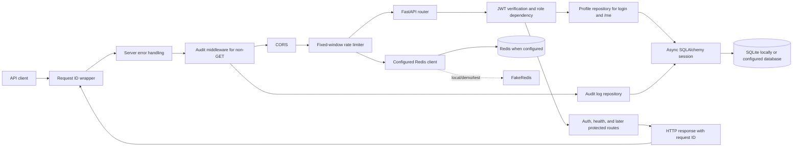

# Phase 3 — Project System Design Evolution

## Scope and status

Phase 3 adds identity and request guards on top of the runtime and data
foundation from Phases 1 and 2. All four Phase 3 tasks are marked complete:
JWT and role checks, demo authentication routes, Redis rate limiting, and
audit middleware with explicit middleware ordering.

The diagrams describe the code in this repository. Demo tokens, fake Redis,
and test databases make the system usable offline; they are not evidence of
production identity or Redis infrastructure.

## Starting point: application and data, without request identity

Before Phase 3, the application can start, answer health requests, create
database sessions, and store support records. It does not yet have a shared
mechanism for identifying the person making a protected request or applying
the viewer-agent-admin role hierarchy.

## Milestone P3-1: standardize token validation and roles

P3-1 introduces a shared security dependency. It reads a bearer token,
verifies its HS256 signature using the configured JWT secret, requires
`sub` and `exp`, and extracts a supported role from recognized claim
locations. Routes can depend on `get_current_user` or ask for a minimum role
through `require_role`.

The shared role order is `viewer` < `agent` < `admin`. It lets an admin
satisfy a route's agent requirement without separate special cases.

## Milestone P3-2: add safe demo login and profile lookup

P3-2 provides a local demonstration entry point. The login route is only
enabled when demo mode and a signing secret are configured. It accepts a
configured demo email only when the matching profile exists and is active,
then returns an eight-hour bearer token. `/me` validates the token and looks
up the active profile to return its current profile information.

This is deliberately a demo identity flow, not password login. Password
verification or an external production identity provider is outside this
subtask.

## Milestone P3-3: protect capacity with rate limiting

P3-3 adds a fixed-window counter per client address. Redis performs the
counter initialization and increment atomically in a pipeline. The default
window is 60 seconds; the configured application limit defaults to 120
requests per minute.

The application selects a fake Redis client when `USE_FAKE_REDIS` is enabled.
Otherwise, it requires `REDIS_URL` and constructs a real Redis client. A
Redis error fails the request with `503`; this implementation does not
silently disable the configured protection.

## Milestone P3-4: audit changing requests and establish order

P3-4 adds an audit record for non-GET HTTP requests. It captures the method,
route path, status, request ID, and actor ID when the authentication
dependency has populated one. An unhandled exception is recorded with status
500 before it is re-raised. Request bodies and query-string values are not
written into the audit details.

The order is intentional. Request ID wraps the whole built middleware stack.
Audit sits outside CORS and rate limiting, allowing it to observe non-GET
requests that are rejected by the limiter. GET requests are passed through
without audit rows.

## End-of-Phase-3 system design

Phase 3 supplies reusable protections around the application. Later ticket
and customer routes can declare the minimum role they need instead of
implementing token parsing, rate limiting, and auditing independently.

## System-design changes

| Concern | Phase 3 starting point | Phase 3 end state |
|---|---|---|
| Caller identity | Requests have no shared authenticated-user object. | Protected routes can resolve a validated `AuthenticatedUser` from a bearer JWT. |
| Permissions | Routes have no common role hierarchy. | `viewer`, `agent`, and `admin` levels are checked by reusable `require_role`. |
| Demo access | No API demo token issuer. | Allow-listed active demo profiles can receive an eight-hour token when demo mode is enabled. |
| Request volume | No shared request counter. | Fixed-window counters are applied through Redis or FakeRedis middleware. |
| State-change accountability | No common HTTP audit record. | Non-GET requests record actor, request ID, route, method, and status. |
| Middleware behavior | Cross-cutting protections are not yet composed. | Explicit order preserves request IDs and audits rate-limit rejections. |
| Deployment evidence | Local/offline-first foundations. | Still no claim of production identity, live Redis, or cloud deployment. |

## Boundaries and operational notes

- The demo login checks a configured email and active profile; it does not
  verify a password.
- Protected routes trust the role in the signed token until it expires. The
  `/me` endpoint additionally verifies that the profile still exists and is
  active.
- Tokens expire after eight hours. This phase does not implement a token
  revocation list.
- Rate limiting is a fixed-window counter keyed by client address; it is not
  user-account throttling or distributed abuse detection.
- The audit middleware skips GET requests and records no request body.
- FakeRedis and in-memory SQLite support offline tests. They do not prove
  availability or performance of production Redis or PostgreSQL.
- Docker, container routing, and cloud deployment are outside Phase 3.

## Related files

- [Phase 3 codebase explanation](../explain_codebase/phase3_explained.md)
- [Phase 3 infrastructure and wiring](../Infra_design_evolution/Phase3_Infra_design_evolution.md)
- [Security dependencies](../../backend/app/core/security.py)
- [Demo auth routes](../../backend/app/api/auth.py)
- [Redis client factory](../../backend/app/core/redis.py)
- [Rate-limit middleware](../../backend/app/middleware/rate_limit.py)
- [Audit middleware](../../backend/app/middleware/audit.py)
- [Request ID middleware](../../backend/app/middleware/request_id.py)
- [Application composition](../../backend/app/main.py)
- [Authentication, rate-limit, and audit tests](../../tests/api/)
- [Phase 3 task tracker](../../TASKS.md)
