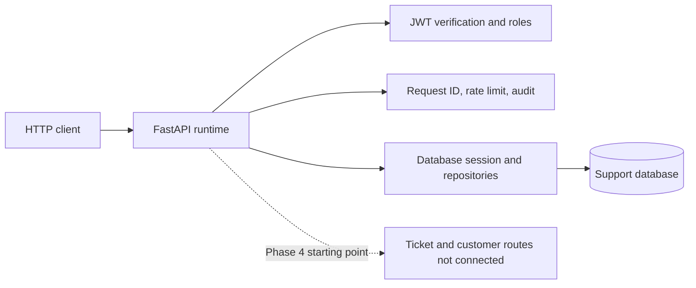
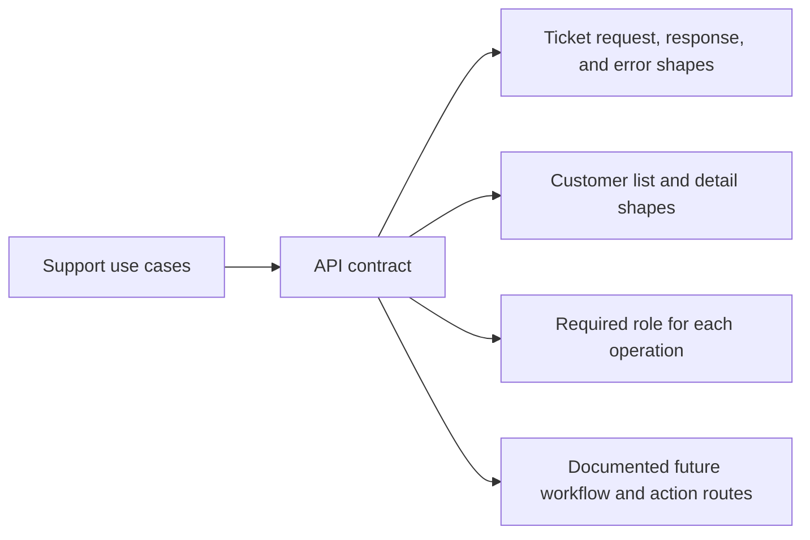
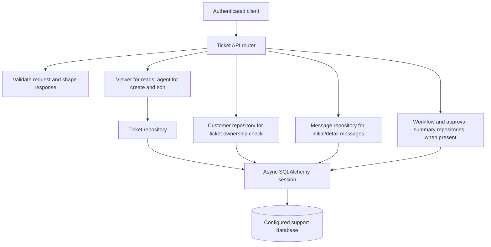
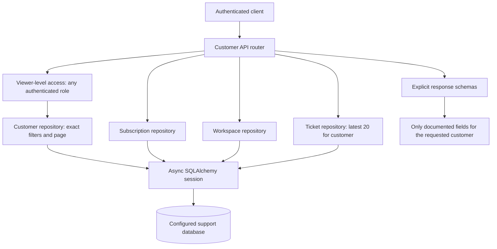
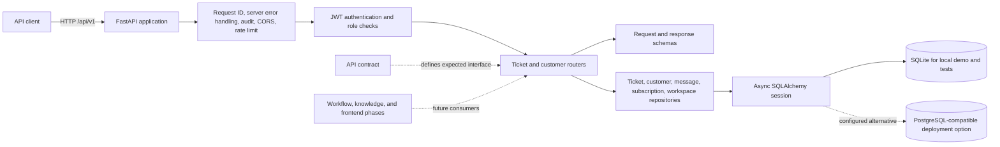

# Phase 4 — Project System Design Evolution

## Scope and implementation status

Phase 4 adds the support API on top of the data layer from Phase 2 and
authentication and request guards from Phase 3. Its three tasks are complete:
P4-1 documents the API agreement, P4-2 implements the core ticket routes, and
P4-3 implements the read-only customer routes.

The end state described here is the **implemented Phase 4 application**. The
API contract also describes routes for later workflow, reply, approval, and
escalation features. Those contract entries do not mean their handlers are
already connected in Phase 4.

## Starting point: data and identity, but no support-domain HTTP routes

At the start of Phase 4, CloudDesk already has SQLAlchemy entities and
repositories, an async database session, JWT authentication, role checks,
rate limiting, request IDs, and auditing. A caller can authenticate, but the
support records are not yet exposed through the ticket and customer API.

## Milestone P4-1: agree on the API before wiring it

The first task describes the request and response formats, route purposes,
role requirements, validation limits, pagination, and expected errors. This
contract is a shared interface: a frontend can be built against it without
guessing how the backend will behave.

The contract describes the wider target API. Implementations are delivered in
subtasks and later phases rather than all being implied by the document.

## Milestone P4-2: expose core ticket operations

The ticket router translates HTTP requests into repository calls. Creation is
agent-only and writes a ticket plus its first message in one transaction.
Listing and detail are available to authenticated users. Editing is
agent-only and limited to supported fields.

Key behavior includes:

- A ticket must refer to an existing customer.
- The server generates the ticket number and initial status.
- `(channel, external_id)` is checked for duplicates when an external ID is
  provided. A conflicting request returns `409`.
- Ticket creation commits the ticket and first message together. An integrity
  error triggers rollback and an explicit HTTP error response.
- List filters and pagination are applied by the ticket repository. The route
  returns both the selected page and total matching count.
- Ticket detail includes messages in creation order, a customer summary, and
  workflow or approval summaries only if those records exist.
- Patch requests reject unsupported fields and cannot edit protected
  relationships or server-generated metadata.

## Milestone P4-3: expose read-only customer views

The customer router adds a paginated, filtered list and a customer detail view.
It reuses the repositories from the existing data layer rather than querying
the database directly in the route.

The detail response is intentionally bounded: ticket history is limited to 20
summaries and does not include messages. Customer-memory notes are not exposed.
There are no customer create or update routes in this phase.

## End-of-Phase-4 architecture

The middleware stack provides request-level cross-cutting behavior. JWT and
role checks apply at protected routes. The route performs HTTP validation and
orchestration; repositories handle SQLAlchemy queries; schemas control the
serialized response. Existing database models and relationships remain the
source of stored records.

## System-design changes

| Concern | Phase 4 starting point | Phase 4 end state |
|---|---|---|
| External interface | Authenticated runtime and persistence exist, but ticket/customer HTTP interfaces are absent. | A written API contract and implemented core ticket/customer routes. |
| Ticket operations | Data can be stored through lower-level application code. | Create, list, detail, and constrained update operations are available through HTTP. |
| Customer operations | Customer records exist in the data model. | Authenticated list and detail views with filters and related records; no mutation endpoints. |
| Access | JWT and role infrastructure is available from Phase 3. | Each route declares a minimum role and relies on shared authentication checks. |
| Database access | Repositories and async sessions exist from Phase 2. | API handlers call repositories rather than issuing SQL directly. |
| Response safety | Domain models contain more information than every client needs. | Pydantic response models choose the fields returned to clients. |
| Future behavior | Workflow-related data structures and broad contract entries exist. | Workflow execution and consequential actions remain outside Phase 4 implementation. |

## Boundaries and next steps

- `docs/API_CONTRACT.md` is the documented interface source of truth; an
  implementation must be checked separately before calling an endpoint live.
- Ticket routes do not execute an AI workflow in this phase.
- The customer API is intentionally read-only and does not return memory
  notes, ticket messages, or another customer's related records.
- SQLite is used for local demonstrations and tests. The configured
  PostgreSQL-compatible path is an option, not evidence of a cloud deployment.
- Docker, Compose networking, and a frontend console are not Phase 4
  deliverables.

## Related files

- [Phase 4 codebase explanation](../explain_codebase/phase4_explained.md)
- [API contract](../../docs/API_CONTRACT.md)
- [Ticket routes](../../backend/app/api/tickets.py)
- [Customer routes](../../backend/app/api/customers.py)
- [Repositories](../../backend/app/repositories/)
- [Phase 4 API tests](../../tests/api/)
- [Phase 4 task tracker](../../TASKS.md)
