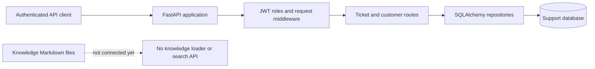
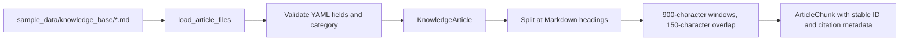
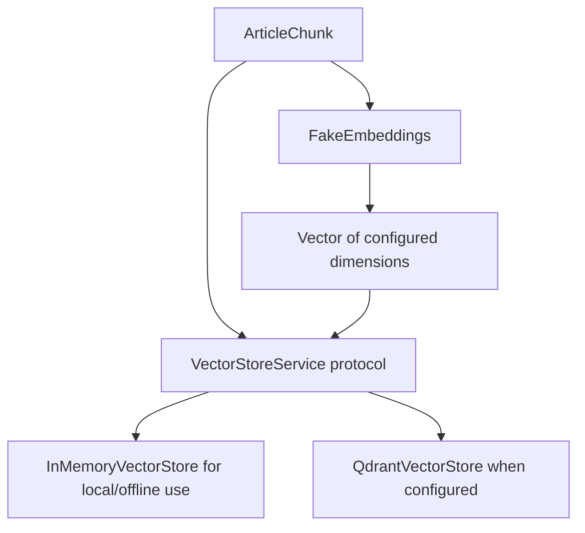
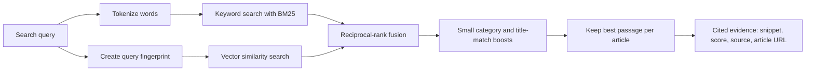
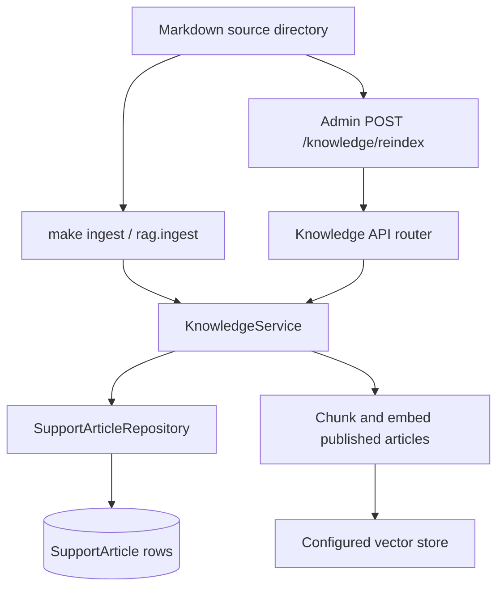
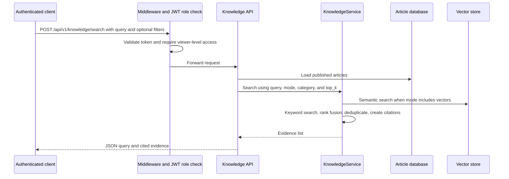
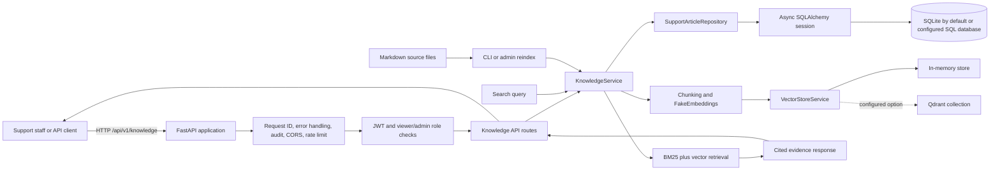

# Phase 5 — Project System Design Evolution

## Scope and implementation status

Phase 5 builds the knowledge pipeline in four dependent steps: article loading
and chunking, vector storage and offline embeddings, hybrid retrieval, then
ingestion and authenticated knowledge API routes. The end state below reflects
the implemented code, not a future AI workflow.

The knowledge API is available to authenticated callers. The task tracker
marks P5-1 through P5-4 complete. The retriever is ready for a later knowledge
agent to call, but this phase does not yet connect it to ticket classification
or an automated resolution workflow.

## Starting point: support data API, but no knowledge path

At the end of Phase 4, CloudDesk has a FastAPI application, JWT role checks,
database repositories, and ticket/customer routes. Knowledge files and a
search pipeline are not yet connected to that application.

The missing design problem is not only “where to put files.” The application
needs a way to validate article metadata, split long text, find useful
passages, retain citations, and expose the results without placing database or
search code directly in HTTP handlers.

## Milestone P5-1: validate articles and create useful passages

The first design step treats each Markdown file as a structured article, not
just a block of text. YAML front matter supplies required title, category,
tags, and summary fields. The loader rejects malformed files and duplicate
slugs. The chunker separates content at headings and then windows long
sections.

Every chunk keeps its article slug, title, category, tags, heading, and a
`kb://slug#section` citation. This keeps provenance attached to the passage
instead of trying to guess its source after search.

## Milestone P5-2: make passages searchable without a paid service

The next step adds an embedding interface and vector-store protocol. An
embedding maps text to a numeric list. The fake embedding implementation uses
a deterministic hashed bag of words, which makes local tests repeatable and
does not require an API key.

The protocol separates retrieval code from the choice of storage. The
in-memory implementation is convenient for offline tests and development.
Qdrant is an optional configured backend. Vector dimensions are validated so
vectors from incompatible configurations fail explicitly rather than being
silently mixed.

**Important boundary:** these fake vectors support development similarity
search; they are not generated by a trained embedding model. Selecting a
production embedding provider and reindexing around that provider are separate
deployment decisions.

## Milestone P5-3: combine word matches and vector matches

Vector similarity can find related wording, while a keyword index can find
exact terminology. The retriever provides each mode separately and a hybrid
mode that combines both ranked result lists.

Reciprocal-rank fusion uses ranks rather than comparing raw BM25 and vector
scores directly. The result is deduplicated by article, optionally passed to a
reranker hook, and limited to the requested top-k count. The reranker is
optional and is not configured to call an external model in this phase.

## Milestone P5-4: persist articles and expose them through the application

The final step adds a knowledge service between API routes, repositories, and
RAG. The service loads and validates the source Markdown, upserts article
records, unpublishes removed source files, chunks published content, and
replaces the vector collection. The `make ingest` command runs the same
ingestion path outside an HTTP request.

The API router is registered with the existing FastAPI app. It has read routes
for article lists and detail, a search route, and an admin-only reindex route.
Request/response schemas and shared JWT role dependencies define the external
boundary.

On the first search or after article changes, the service compares a signature
of the published articles with its indexed signature and rebuilds the vector
index when needed. This is especially important for the in-memory store,
whose contents do not survive an API process restart. The relational database
keeps article content so the local index can be reconstructed.

## End-of-Phase-5 architecture

## System-design choices and trade-offs

| Concern | Phase 5 starting point | Phase 5 end state |
|---|---|---|
| Knowledge source | Articles exist as Markdown, but are not part of the support API flow. | A validated source directory is synchronized to published article records. |
| Long articles | A whole article is too broad for precise retrieval. | Heading-aware chunks retain section and article citations. |
| Embeddings | No offline vector representation or storage boundary. | Deterministic fake embeddings plus a replaceable vector-store protocol. |
| Search | No knowledge search endpoint. | Keyword, vector, and hybrid search return article-linked evidence. |
| Persistence | Article models and repositories exist, but no ingestion/search flow consumes them. | Knowledge service coordinates SQL persistence and vector indexing. |
| Authorization | Shared JWT and role infrastructure is already in place. | Browse/search is viewer-level; destructive collection reindex is admin-only. |
| Runtime behavior | No knowledge API route or app-level search service. | FastAPI owns a lifecycle-scoped service; indexes are refreshed when source article state changes. |
| Offline support | No article retrieval workflow for a local demo. | Fake embeddings and in-memory vectors allow offline testing without API keys or Qdrant. |

## Boundaries and next steps

- `rag/` handles article content, chunks, vector storage, and retrieval; it
  does not know about tickets.
- API routes handle HTTP, request validation, and role checks. The service
  coordinates the repository and retrieval pipeline.
- Article content is persisted in SQL. Vector data is an index, not the
  canonical article record.
- The current fake embeddings are deterministic test/development fingerprints,
  not semantic model embeddings.
- A later knowledge agent can call this retrieval path; no Phase 5 ticket
  workflow integration is claimed.
- The `docs/API_CONTRACT.md` describes the knowledge API. Docker and cloud
  infrastructure are not implemented by this phase.

## Related files

- [Phase 5 codebase explanation](../explain_codebase/phase5_explained.md)
- [Phase 5 infrastructure and wiring](../Infra_design_evolution/Phase5_Infra_design_evolution.md)
- [Phase 5 interview Q&A](../QnA/Phase5_Interview_QnA.md)
- [Knowledge API contract](../../docs/API_CONTRACT.md)
- [Article loader and chunker](../../rag/chunking.py)
- [Embeddings and vector store](../../rag/embeddings.py) · [store implementations](../../rag/vector_store.py)
- [Hybrid retriever](../../rag/retriever.py)
- [Knowledge API and service](../../backend/app/api/knowledge.py) · [service](../../backend/app/services/knowledge_service.py)
- [Ingest command](../../rag/ingest.py)
- [Task tracker](../../TASKS.md)
