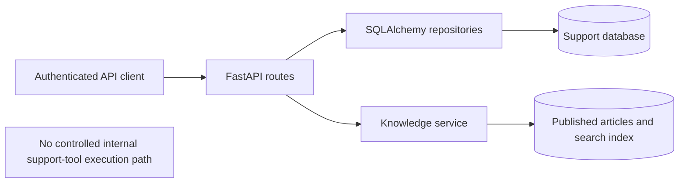
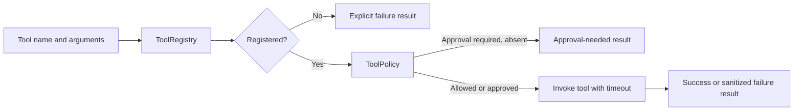
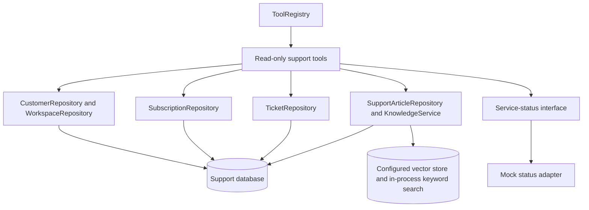
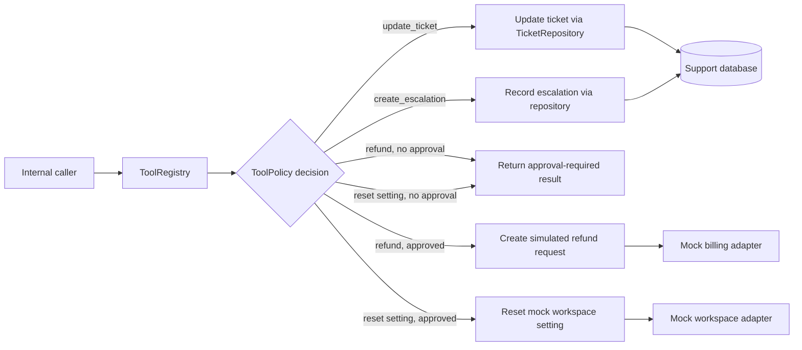
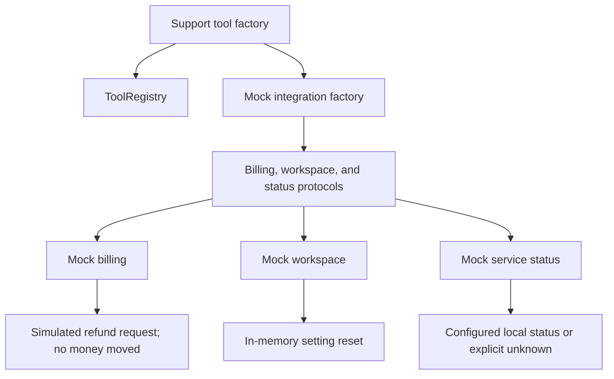
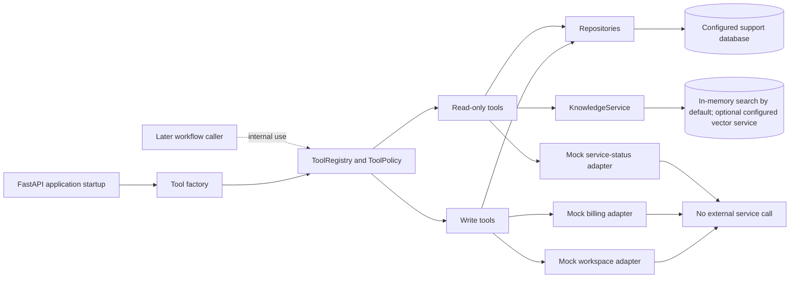

# Phase 6 — Project System Design Evolution

## Scope and implementation status

Phase 6 adds a controlled set of support tools and mock integrations to the
existing API, data, and knowledge foundations. Its end state is an internal
tool registry ready for a later workflow to call. It does not add a workflow
graph, an agent, an approval UI, or a public tool-execution API.

## Starting point: application data, but no support-tool boundary

Before Phase 6, CloudDesk already has authenticated APIs, SQLAlchemy
repositories, and the knowledge search service. There is no shared mechanism
for an internal workflow to select and safely run named support operations.

This design keeps ticket and customer data behind existing repositories, but
does not yet give a later workflow a common way to discover or execute tools.

## Milestone P6-1: establish the policy-enforcing execution point

The registry accepts only registered LangChain tools. It asks a deterministic
policy whether approval is required, returns an approval-needed result without
calling the tool when approval is missing, and places a timeout around tool
execution.

Unknown tools remain blocked even when a caller passes `approved=True`.
Exceptions become a structured tool failure; exception text is not returned
to the caller.

## Milestone P6-2: add read-only support tools

Read tools are thin, named operations. Customer, subscription, workspace,
and ticket data continue to come from repository classes. Article search
goes through the knowledge service, which returns evidence with source
citations. Service status is obtained from a status-provider interface.

The ticket-history tool is bounded to at most 50 tickets per request. Search
is bounded to 20 results and only uses published articles. The tool layer
does not put SQL statements into a prompt or return uncited generated claims.

## Milestone P6-3: add writes with explicit approval rules

The write tools separate low-risk support operations from consequential
account and money actions. Ticket updates and escalation records use the
application repositories. Refund requests and workspace resets go through
the integration interfaces and are blocked by the policy unless an approval
signal is supplied.

The policy is fail-closed for refund amounts: an invalid or missing amount
does not qualify for an approval-free exception. The default configuration
requires approval for refunds. A caller-provided approval signal is a gate at
this layer; recording and deciding approval requests is implemented in the
later approval/workflow phase.

## Milestone P6-4: make external-system boundaries replaceable

The billing, workspace, and service-status operations are described by
protocols. The factory supplies local mock implementations. Tools depend on
the protocols rather than on a vendor SDK or remote endpoint.

The simulated adapters are deterministic enough for offline tests and do not
perform outbound network calls. Replacing a mock with a real provider is a
separate implementation and production decision.

## End-of-Phase-6 architecture

The registry is created as part of application startup and stored in
`app.state.tool_registry`. It does not open a new listener or expose a new
HTTP route. The future workflow caller shown dashed is intentionally not part
of Phase 6.

## Design choices and trade-offs

| Concern | Phase 6 starting point | Phase 6 end state |
|---|---|---|
| Tool selection | No internal tool execution boundary. | Explicit allow-list in `ToolRegistry`. |
| Policy | No shared tool approval check. | `ToolPolicy` checks known actions; unknown tools fail closed. |
| Data access | Repositories and knowledge search already exist. | Tools call those existing abstractions instead of owning SQL logic. |
| Approval | No tool-specific gate. | Refund and workspace-reset execution requires an approval signal at the registry. |
| Integrations | No support operation adapters. | Protocols with in-process mock implementations and no outbound calls. |
| Errors and timeouts | No common tool result convention. | Registry returns explicit failures, applies a timeout, and avoids exposing exception text. |
| Exposure | No tool route. | Registry is app-internal; Phase 6 does not expose arbitrary tool execution over HTTP. |
| Persistence | Application data uses SQL repositories. | Ticket changes and escalation records persist; mock adapter state is in-process only. |

## Boundaries and next steps

- `backend/app/tools/` owns tool functions, approval policy, and execution.
- `backend/app/repositories/` remains the only SQL access layer.
- `integrations/` defines replaceable interfaces and currently supplies mocks.
- `rag/` and `KnowledgeService` search published support articles and provide
  source-linked evidence.
- The existing approval signal is not a durable approval workflow. A later
  phase owns persisted requests, human decisions, resume behavior, and audit
  context.
- No live billing, workspace, monitoring, Docker, or cloud integration is
  claimed.

## Related files

- [Phase 6 codebase explanation](../explain_codebase/phase6_explained.md)
- [Phase 6 infrastructure and wiring](../Infra_design_evolution/Phase6_Infra_design_evolution.md)
- [Phase 6 interview Q&A](../QnA/Phase6_Interview_QnA.md)
- [Tool registry, policy, and factories](../../backend/app/tools/)
- [Mock integration interfaces and adapters](../../integrations/)
- [Application startup](../../backend/app/main.py)
- [Tool tests](../../tests/unit/test_support_tools.py), [registry tests](../../tests/unit/test_tool_registry.py), and [policy tests](../../tests/unit/test_tool_policy.py)
- [Phase task tracker](../../TASKS.md)
