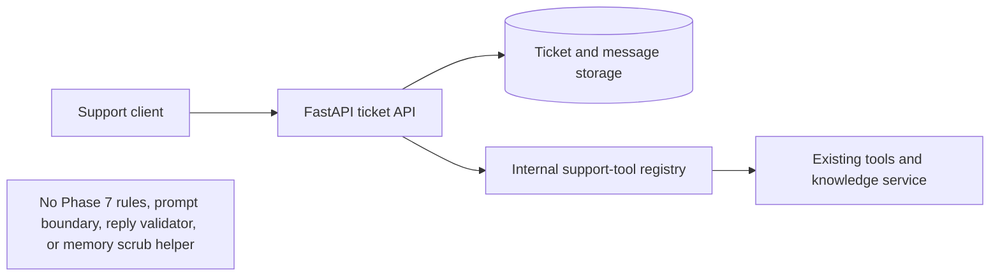
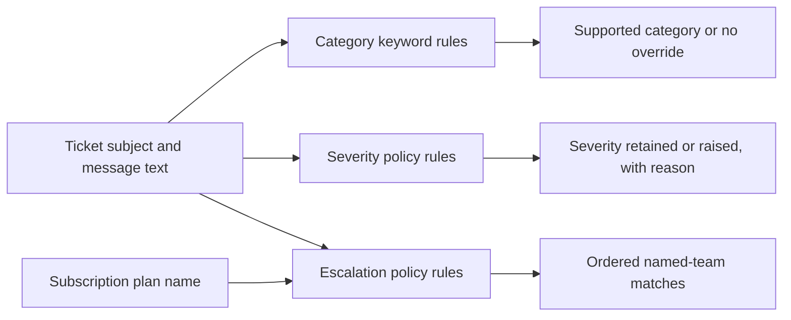
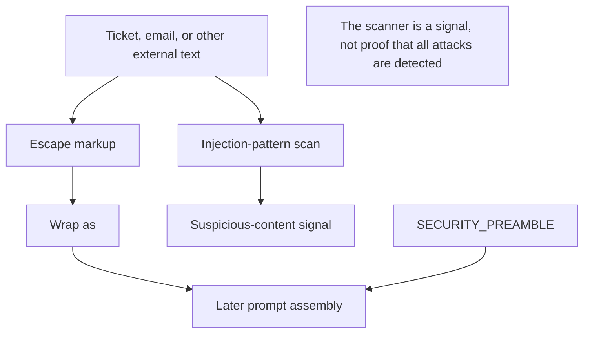
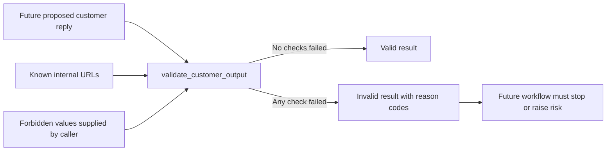
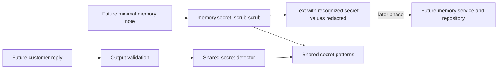
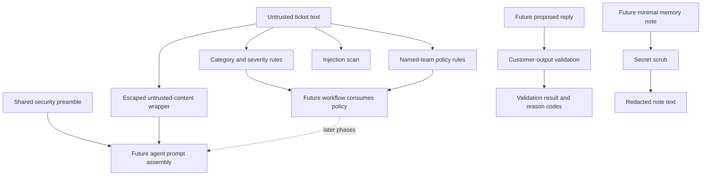

# Phase 7 — Project System Design Evolution

## Scope and implementation status

Phase 7 adds deterministic policy and safety helpers to the CloudDesk
codebase. It does not add a workflow graph, an LLM call, a public endpoint, a
database write path, or a frontend action. The rules and guardrails are
available as Python components for the later agent and workflow phases.

## Starting point: support data and tools, no policy or content-safety layer

At the start of Phase 7, the application already has ticket APIs, data
repositories, knowledge retrieval, and an internal tool registry. Incoming
ticket text can be stored, but there is not yet a shared deterministic
classification/escalation policy or a shared helper for untrusted text,
outgoing reply checks, and secret scrubbing.

## Milestone P7-1: define deterministic category, severity, and escalation policy

Clear category patterns return one of the supported category enum values;
ambiguous text returns no deterministic override. Escalation rules return an
ordered set of named teams and reasons. Severity rules can increase a
proposed level but do not lower an existing one.

The rules cover security incidents, data loss, payment disputes, deletion and
privacy requests, legal matters, and broad Enterprise outages. They are
deterministic and independently testable; an LLM disagreement cannot lower a
policy severity or remove a matched escalation.

## Milestone P7-2: identify suspicious instruction text and delimit it

The scanner flags common instruction-override and unauthorized-export
patterns. The wrapper escapes markup before placing the text between
`<untrusted_content>` tags, and `SECURITY_PREAMBLE` establishes that the
delimited content is data rather than instructions.

The security preamble and wrapper are not a permissions boundary. The future
workflow still needs tool allow-lists, approval policy, and deterministic
business rules.

## Milestone P7-3: check customer-facing output

The output validator returns a typed result containing a validity flag and
reason codes. It checks recognized secrets, local/private service URLs,
configured internal URL strings, and forbidden customer-specific values
provided by its caller.

The helper does not publish or edit a reply. This keeps policy enforcement
and workflow routing in their eventual owner rather than introducing an API
side effect in this phase.

## Milestone P7-4: scrub secrets from text intended for memory

The memory helper redacts supported secret formats before later memory
storage. The output validator shares the same secret detector, so both places
use a common definition of recognized credential formats.

The helper only redacts recognizable secrets. It does not authorize storing
raw ticket text or data belonging to another customer.

## End-of-Phase-7 design

The diagram shows prepared connections, not current runtime execution. Current
API and tool behavior remains unchanged because no workflow graph or
specialist-agent call site exists yet.

## Design choices and trade-offs

| Concern | Phase 7 starting point | Phase 7 end state |
|---|---|---|
| Category overrides | No shared deterministic rules. | Clear keyword matches return a supported category; ambiguity returns no override. |
| Severity | No rule helper to protect a proposed level. | Rules can raise severity with a reason and never lower it. |
| Escalation | No named-team policy table. | Matched policy cases return ordered, named-team rules. |
| Prompt input | No shared delimiter/preamble helper. | External text can be escaped and wrapped; common injections can be flagged. |
| Customer reply | No reusable output-check result. | A typed result reports detected issues and caller-supplied forbidden values. |
| Memory secrets | No reusable scrub helper. | Recognized credential values can be redacted before future memory use. |
| Runtime wiring | Existing app exposes APIs and tools only. | New components are importable and unit-tested; later phases will connect them. |

## Boundaries and next steps

- `agents/rules.py` owns category, severity, and escalation decisions and
  re-exports the injection scanner for the future supervisor component.
- `agents/prompts.py` provides the shared preamble and untrusted wrapper.
- `backend/app/core/guardrails.py` owns injection scanning and customer-output
  validation.
- `memory/secret_scrub.py` owns redaction for future memory callers.
- No rule, prompt, validation result, or scrubbed text is currently consumed
  by a workflow because the workflow is a later phase.
- The checker is deterministic but intentionally pattern-based. A production
  deployment would need ongoing false-positive/false-negative evaluation.

## Related files

- [Phase 7 codebase explanation](../explain_codebase/phase7_explained.md)
- [Phase 7 infrastructure and wiring](../Infra_design_evolution/Phase7_Infra_design_evolution.md)
- [Phase 7 interview Q&A](../QnA/Phase7_Interview_QnA.md)
- [Rules and escalation policy](../../agents/rules.py)
- [Prompts and untrusted wrapper](../../agents/prompts.py)
- [Guardrail helpers](../../backend/app/core/guardrails.py)
- [Secret scrubber](../../memory/secret_scrub.py)
- [Phase 7 tests](../../tests/unit/test_rules_guardrails.py)
- [Task tracker](../../TASKS.md)
