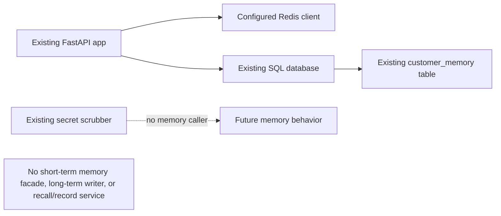
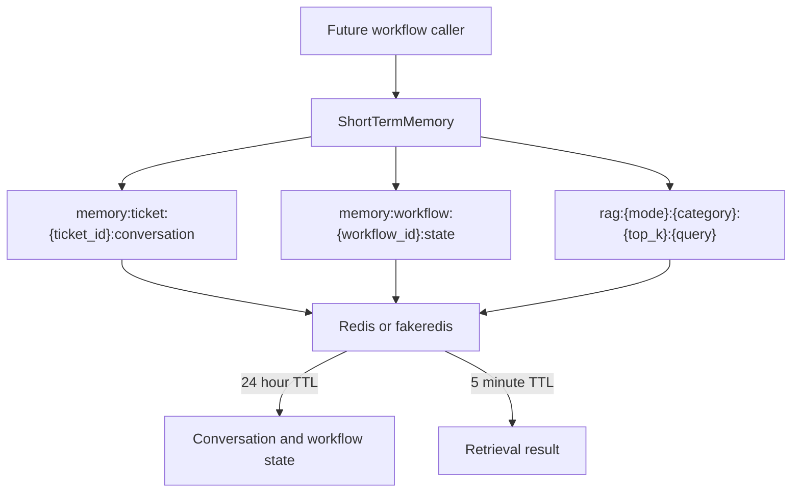
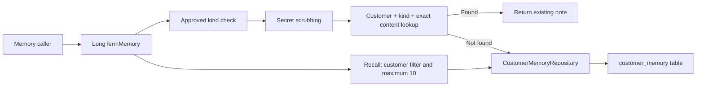
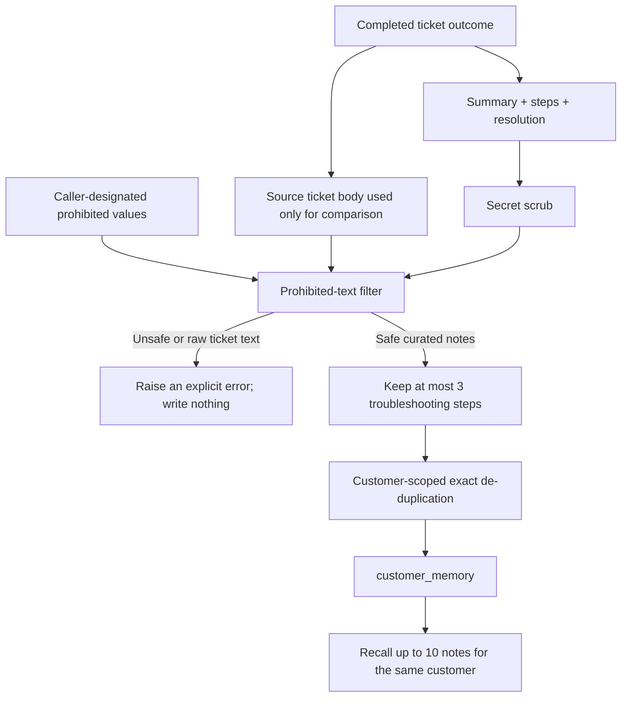
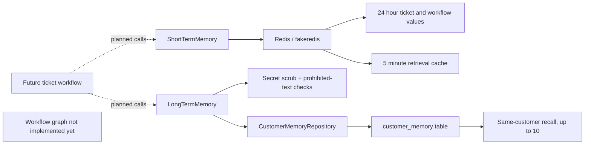

# Phase 8 - Project System Design Evolution

## Scope and implementation status

In the execution tracker, Phase 8 is the Memory phase (P8-1 through P8-3).
`PLAN_PHASE.md` calls the same product stage Phase 11 because the tracker
pulls memory forward before the specialist-agent and graph phases.

This phase adds two memory facades and the SQL repository operation needed
for safe, customer-scoped recall and recording. It does not add workflow
nodes, API routes, a database table, or an automated connection to a ticket
run.

## Starting point: a scrubber and storage building blocks

Before Phase 8, a secret scrub helper existed, the SQLAlchemy
`customer_memory` model and table existed, and a Redis client could be created
by the application. There was no unified memory facade for expiring runtime
data, nor a safe service for recalling and writing curated customer notes.

## Milestone P8-1: add a short-term Redis facade

The facade owns namespaced JSON keys rather than exposing Redis key details
to future callers. Ticket conversations and workflow state live for 24 hours.
Retrieval results use the documented `rag:{mode}:{category}:{top_k}:{query}`
key and expire after five minutes. Redis errors and invalid stored shapes are
reported to the caller rather than silently replaced with empty data.

The interface uses JSON so values can be represented consistently by real
Redis and fakeredis. No startup code or HTTP route is added: the existing app
already owns the Redis connection and future workflow code will own calls.

## Milestone P8-2: add safe long-term customer memory

The memory facade uses `CustomerMemoryRepository` for SQL access. Recall is
always filtered by customer ID and capped at ten notes. Writes accept only
the four approved kinds. Before inserting, the facade scrubs secrets and
queries for an exact match within the same customer and note kind.

The model and table remain unchanged. The repository adds an exact lookup,
while the facade enforces application-level note policy without moving SQL
into the memory package.

## Milestone P8-3: coordinate recall and resolution recording

The resolution service accepts a short summary, troubleshooting steps, a
resolution note, the source ticket body for comparison, and any prohibited
values identified by the caller. It uses no more than the first three steps.
Every candidate is checked before writes begin, then saved as the appropriate
note type. The ticket body is never selected as a note to save.

Preparing and validating the candidates before inserting them prevents a
known prohibited value in a later candidate from leaving earlier notes
partially written. Database transaction commit or rollback remains the
responsibility of the caller's SQL session.

## End-of-Phase-8 design

The dashed edges are future integrations, not active graph calls. The
implemented facades are independently testable and use the application's
configured Redis client and SQL session/repository boundaries.

## Design choices and trade-offs

| Concern | Phase 8 starting point | Phase 8 end state |
|---|---|---|
| Temporary values | No reusable facade. | Ticket and workflow JSON values expire after 24 hours. |
| Retrieval cache | No shared memory facade contract. | Mode/category/top-k/query keys expire after 5 minutes. |
| Durable customer notes | SQL table existed without memory service behavior. | Approved note kinds, customer-scoped recall, and duplicate lookup. |
| Privacy | Secret scrub existed but was not part of a write service. | Scrub before storage; reject known ticket text and caller-provided forbidden values. |
| Resolution recording | No common recall/record service. | Summary, up to three steps, and resolution note use one checked path. |
| Workflow connection | No memory graph nodes. | Facades are ready but remain unconnected until the graph phase. |

## Boundaries and next steps

- `memory/short_term.py` uses a Redis client but does not create, close, or
  configure that client.
- `memory/long_term.py` calls a repository; it does not issue SQL directly.
- The SQL schema remains portable and unchanged.
- To compare against unrelated customer information, callers must pass the
  values to exclude. Memory cannot infer which values belong to other people.
- Exact duplicate suppression is customer- and kind-scoped; the current
  database schema does not enforce a cross-process unique constraint.
- The next agent/workflow phase should call recall before generating support
  context and record safe notes after a completed resolution.

## Related files

- [Phase 8 codebase explanation](../explain_codebase/phase8_explained.md)
- [Phase 8 infrastructure and wiring](../Infra_design_evolution/Phase8_Infra_design_evolution.md)
- [Phase 8 interview Q&A](../QnA/Phase8_Interview_QnA.md)
- [Short-term memory facade](../../memory/short_term.py)
- [Long-term memory facade](../../memory/long_term.py)
- [Customer-memory repository](../../backend/app/repositories/workflow.py)
- [Phase 8 tests](../../tests/unit/test_memory.py)
- [Task tracker](../../TASKS.md)
