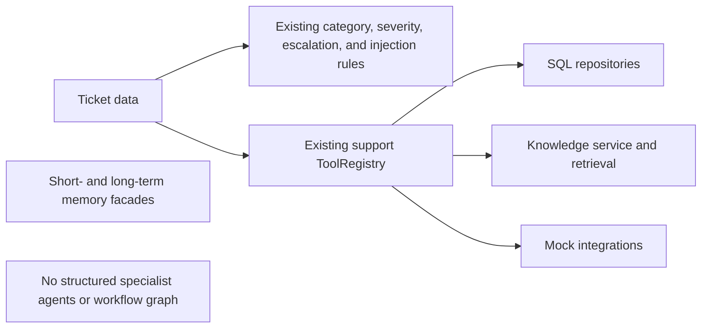
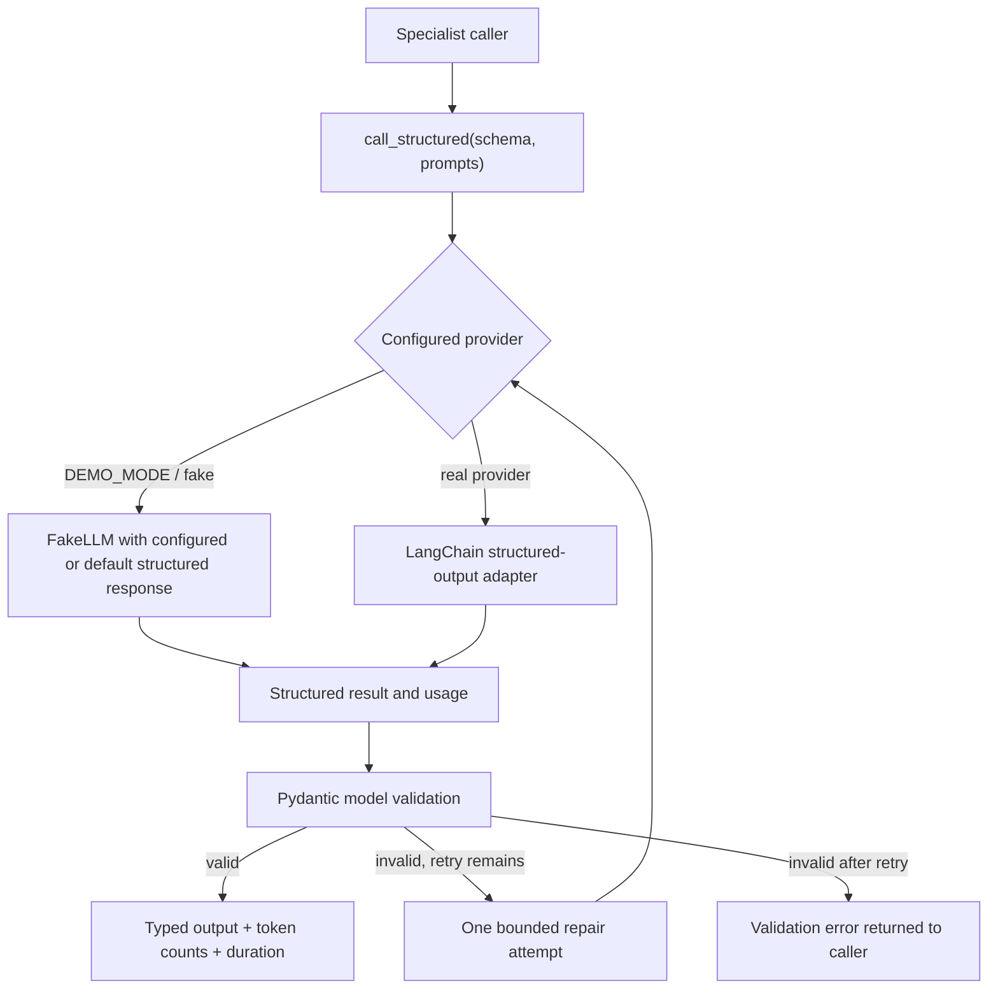
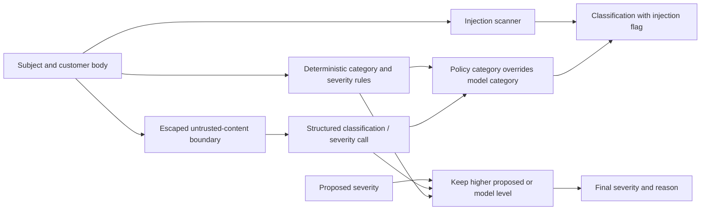
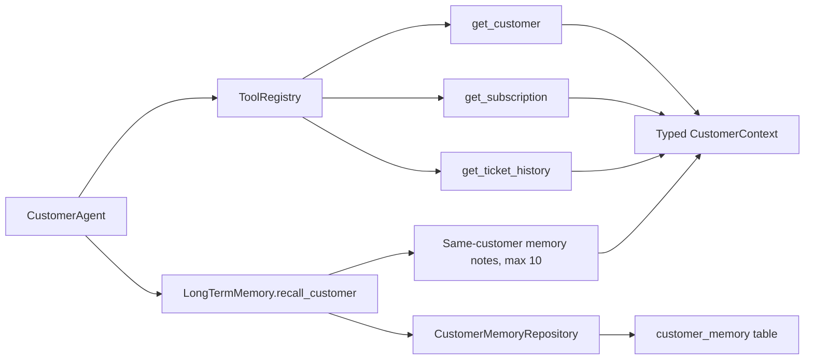
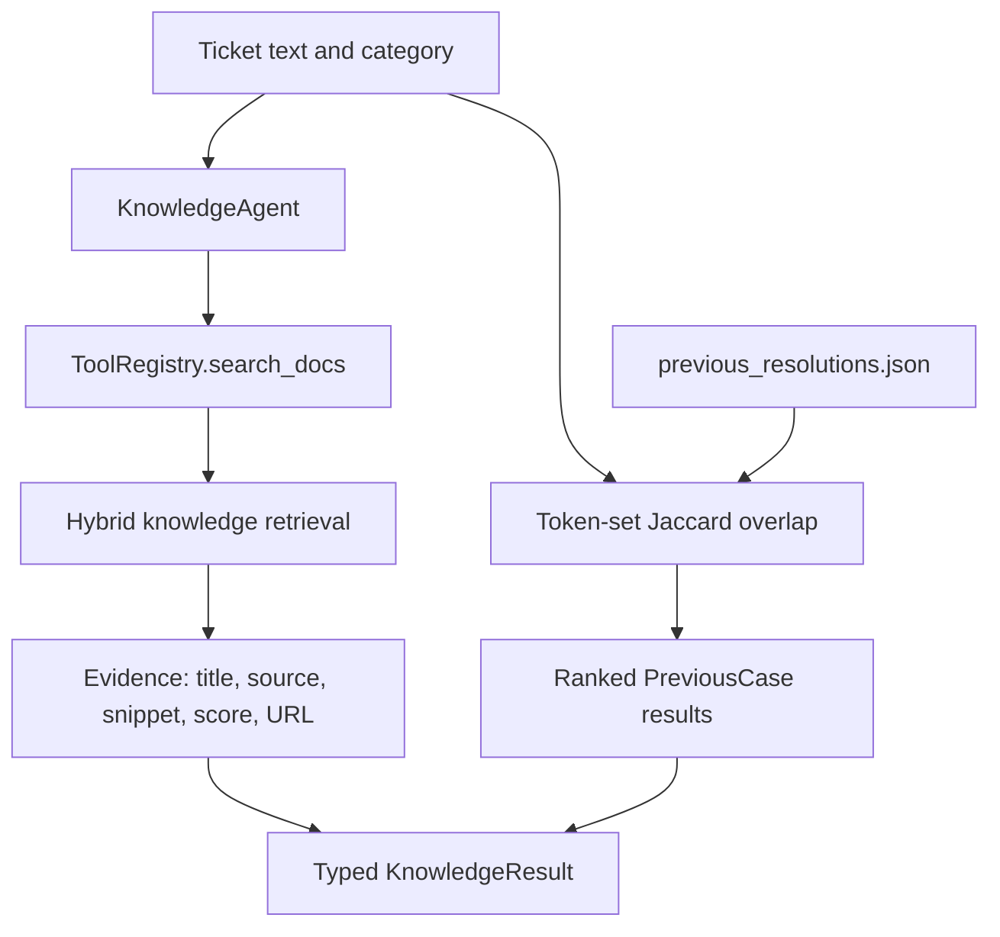
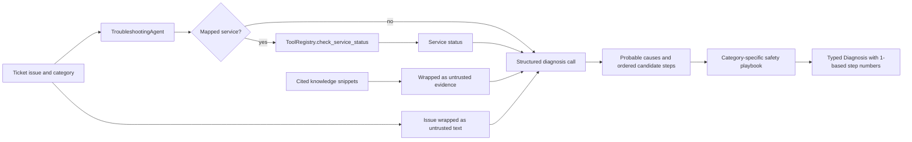
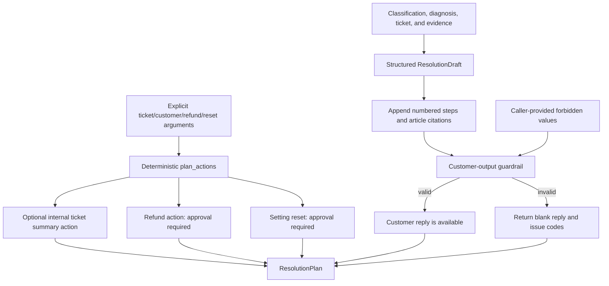
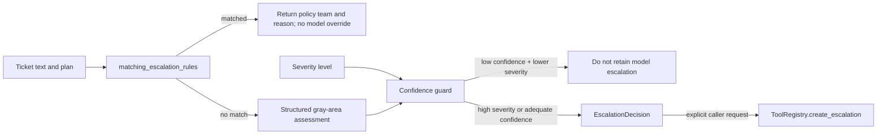
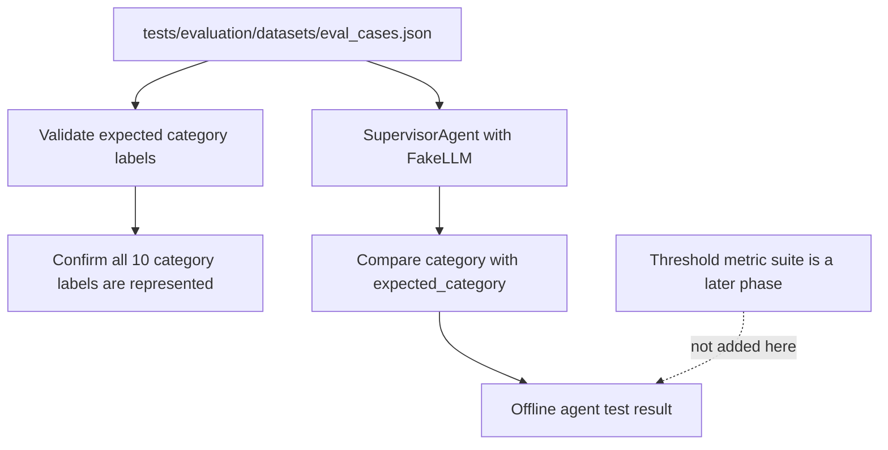
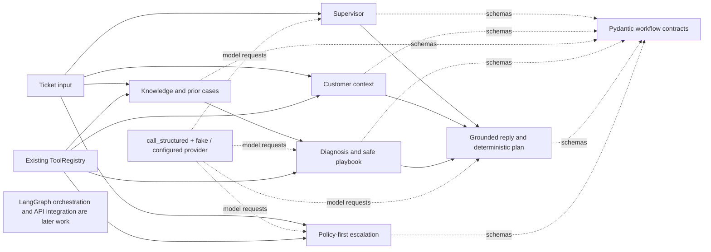

# Phase 9 - Project System Design Evolution

## Scope and implementation status

In `TASKS.md`, Phase 9 is the Specialist Agents phase (P9-1 through P9-8).
`PLAN_PHASE.md` numbers this product stage Phase 8. This phase implements
typed specialist components and an offline evaluation dataset. It does not
wire them into a LangGraph, API endpoint, or application route; those belong
to the next workflow phase.

## Starting point: policies, data, RAG, tools, and memory, but no agents

At the start of this phase, CloudDesk has deterministic rules and guardrails,
SQL repositories, a permissioned tool registry, knowledge retrieval, mock
integrations, and short-/long-term memory facades. There is no set of
specialist classes coordinating those pieces.

## Milestone P9-1: define schemas and a structured LLM boundary

Workflow Pydantic models make the expected result explicit. `call_structured`
is the only model-call helper: it uses the configured LangChain chat model or
the deterministic fake provider, validates the result, measures elapsed time,
and returns token usage. A schema-validation failure gets one bounded retry
by default; provider and validation errors remain visible.

The fake provider uses no API key or external service. Its configured test
responses allow tests to exercise both valid and malformed output paths.

## Milestone P9-2: add the supervisor

The supervisor wraps the ticket's subject and body as untrusted text before
asking for structured classification. Deterministic category rules override
the model when a known pattern matches. The injection scanner supplies a
separate safety flag. Severity is the greater of the proposed and model
levels, after which policy rules may raise it further.

This keeps untrusted ticket text as data. It does not grant model output tool
permissions or change a ticket.

## Milestone P9-3: add the customer-context specialist

The customer specialist makes no LLM call and has no SQL in the agent
module. It gathers the customer, subscription, and ticket history through
the registered read tools, and recalls the customer's memory through the
long-term-memory facade.

Each tool failure is surfaced as an error. Empty records for a valid customer
are valid empty context, rather than fabricated data.

## Milestone P9-4: add the knowledge specialist

The knowledge specialist uses `search_docs` through the tool registry and
validates the returned citation fields as `Evidence`. It compares the
request's words with prior resolution text and steps using Jaccard overlap.
The three sample resolved cases are read from the existing JSON fixture.

The similar-case result is a signal for the caller; it is not asserted to be
a guaranteed solution for a new customer.

## Milestone P9-5: add the troubleshooting specialist

The troubleshooter checks the mock status service for categories with a
known service mapping. It asks for structured probable causes and steps,
then adds category-specific playbook checks. Step numbers are assigned
deterministically and in order.

The mock status can report `unknown`; it does not contact a production
service.

## Milestone P9-6: add the resolution specialist

The specialist requests a structured draft for the summary, customer reply,
and internal notes. It grounds the reply with the supplied numbered steps
and article references. A deterministic planner separately creates
allow-listed update/refund/reset actions from explicit arguments. Refunds
and workspace-setting resets are marked as requiring approval. The agent
does not execute these actions.

Model output cannot select a tool name or invent action arguments. Execution
will be handled by the later workflow through the shared registry path.

## Milestone P9-7: add the escalation specialist

The escalation specialist checks deterministic policy rules before calling
the LLM. A matched security, data-loss, dispute, deletion, legal, or
Enterprise-outage rule directly returns its named team and reason. Otherwise
the model may recommend escalation; a low-confidence recommendation is
discarded unless severity is high or critical. Recording an accepted
decision is a separate explicit method that calls `create_escalation`
through the registry.

The caller controls when to record a decision, which avoids an implicit
database write during policy analysis.

## Milestone P9-8: add the evaluation cases

The evaluation file captures 13 demo scenarios with a valid expected
category, including prompt-injection text that must remain classified as
ordinary support data. An offline test checks category coverage and runs
each case through the supervisor rules with the fake provider.

This dataset and test are not a claim that the later evaluation thresholds
have been implemented or reached.

## End-of-Phase-9 design

## Design choices and trade-offs

| Concern | Phase 9 starting point | Phase 9 end state |
|---|---|---|
| Agent outputs | No specialist contracts. | Pydantic output models reject malformed or extra fields. |
| Offline model behavior | No fake structured provider. | Deterministic fake model supports defaults and scenario-specific responses. |
| Category/severity policy | Rule helpers existed without supervisor call sites. | Supervisor applies category and severity rules around model judgment. |
| Customer data reads | Tools and memory existed without an agent composition layer. | Customer agent aggregates registry reads and same-customer memory. |
| Knowledge history | Search existed without a case-similarity specialist. | Cited article results plus deterministic Jaccard case ranking. |
| Resolution actions | Safe tools existed without a deterministic proposal layer. | Tool names and approval flags derive from explicit inputs, not model output. |
| Escalation | Rules existed without an agent decision contract. | Policy matches win; gray-area model decisions have a confidence guard. |
| Runtime wiring | No LangGraph. | Specialists are tested components; graph wiring remains future work. |

## Boundaries and next steps

- Specialist agents never write SQL directly. They use tools or the memory
  facade backed by repositories.
- Tool errors are surfaced; there is no success-shaped fallback for failed
  reads or escalation recording.
- `call_structured` supports the fake provider offline. A configured real
  provider additionally requires its LangChain provider package and API key.
- Resolution actions are proposals. Approval and execution routing belong to
  the later workflow/approval phases.
- Evaluation cases are in place, but classification/retrieval/escalation
  threshold evaluation is later work.
- The workflow graph phase should call these agents, persist their outputs,
  trace tool/model calls, and define retry and error routing.

## Related files

- [Phase 9 codebase explanation](../explain_codebase/phase9_explained.md)
- [Phase 9 infrastructure and wiring](../Infra_design_evolution/Phase9_Infra_design_evolution.md)
- [Phase 9 interview Q&A](../QnA/Phase9_Interview_QnA.md)
- [Specialist implementations](../../agents/specialists/)
- [Workflow schemas](../../backend/app/schemas/workflow.py)
- [Structured LLM helper](../../backend/app/core/llm.py)
- [Evaluation dataset](../../tests/evaluation/datasets/eval_cases.json)
- [Phase 9 tests](../../tests/agents/)
- [Task tracker](../../TASKS.md)
