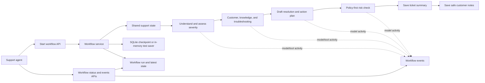

# Phase 10 Explained: From Support Specialists to a Tracked Workflow

## The simple story

Before this phase, CloudDesk had several capable digital support specialists,
but they worked like separate people waiting for someone to coordinate them.
Phase 10 gives them a shared case file and a clear order of work.

When an agent starts a ticket, CloudDesk now:

1. Records that a workflow has started and gives it a unique ID.
2. Understands and classifies the request, then estimates its seriousness.
3. Gathers customer context, searches support guidance, and diagnoses likely
   causes.
4. Drafts a safe reply and a plan, then checks whether the case is risky.
5. Saves a short ticket summary and safe notes for future support.
6. Records what happened at every step so an agent can inspect progress.

Think of the workflow as a well-organized support desk. Each specialist gets
the case only after the previous specialist has finished their part, and each
one adds their result to the shared case file.

## What the six tasks delivered

### P10-1 - Shared support state and checkpoint

The workflow state is the case file shared by the specialists. It carries the
ticket ID, customer ID, classification, evidence, diagnosis, proposed
resolution, risk result, completed steps, and model token totals.

The checkpoint saves the workflow's progress independently of the web request.
The normal local configuration uses a SQLite checkpoint file; tests use an
in-memory checkpoint so they do not depend on a database file.

### P10-2 - Supervisor nodes

The supervisor first labels the issue and summarizes it. It then assesses
severity. Existing deterministic rules remain in charge when a policy rule
requires a certain category or a higher severity. Ticket text is treated as
untrusted customer data, not as instructions to the software.

### P10-3 - Investigation nodes

The customer specialist gathers the account, subscription, prior-ticket, and
safe memory context. The knowledge specialist finds cited support articles
and similar resolved examples. The troubleshooter combines those results
with mock service status and category-specific safety steps.

### P10-4 - Resolution and risk nodes

The resolution specialist prepares a customer-facing reply, internal notes,
and an allow-listed action plan. The risk check applies policy-first
escalation judgment and flags cases with approval-required actions, critical
severity, suspicious instructions, or an unsafe reply.

The workflow also writes a concise summary to the ticket and records a few
scrubbed resolution notes for the same customer. It does not execute planned
actions or record an escalation in this phase.

### P10-5 - Graph wiring and run API

An agent starts a workflow with `POST /api/v1/tickets/{id}/run`. The backend
returns a workflow ID and runs the graph in the background. The graph saves
its latest state after each node. A support console can poll the workflow
route to see which steps are complete.

### P10-6 - Workflow tracer and events API

CloudDesk records when a node starts and ends, how long it took, which
registered tools were called, and which structured model schemas were used.
Token counts, available cost estimates, and allow-listed summaries of tool
results are included. The events API returns operational details only: it
does not reveal prompts, private reasoning, tool arguments, raw tool results,
customer message text, or secrets.

## A simple example

Imagine a customer reports that uploads stopped because storage is full.
The supervisor classifies it as a storage-quota issue. The customer
specialist checks the customer's plan and history. The knowledge specialist
finds any relevant storage guidance, and the troubleshooter adds safe checks
that do not delete customer files. The resolution specialist prepares a
grounded reply. The workflow saves a summary and records its completed steps.

If the ticket instead describes a suspected account breach, the risk check
marks it as high risk and identifies that policy escalation is needed. Phase
10 records this decision; the later approval-and-escalation phase handles
the actual routing or pause.

## How the pieces fit together

## Safety and Phase 11 boundary

- The graph produces a proposal. It does not send an email or issue a refund.
- The deterministic tool registry remains the only route for tools.
- Customer reply text is still validated before being returned as a preview.
- The workflow events omit prompts, raw customer text, tool arguments, and
  raw tool results; only allow-listed result summaries are included.
- A high-risk result is recorded, but approval interrupts, escalation writes,
  and action execution are the next phase.

## What is and is not proven

The run API and graph are exercised offline with the fake language-model
provider, a temporary SQLite database, and mock integrations. The tests
verify that state advances, the SQLite checkpointer restores a checkpoint,
and safe LLM/tool events are returned.

This does not prove that a live model produces accurate support advice or
that a cloud deployment has been completed. No live credentials, cloud
resources, or external services are used by the offline tests.

## A short explanation to say in an interview

> “In Phase 10, I connected the support specialists into one ordered
> workflow. They share typed case data, save progress to a checkpoint, and
> report node, tool, and model activity to an events API. The system can
> prepare and assess a resolution, but it does not perform approval-gated
> actions yet; that safety boundary is handled in the following phase.”

## Phase 10 task-to-test map

| Task | Main component | Focused evidence |
|---|---|---|
| P10-1 | State reducers and checkpointer | Reducer tests and SQLite checkpoint restore |
| P10-2 | Supervisor graph nodes | End-to-end classification and severity in the run API test |
| P10-3 | Investigation nodes | End-to-end registered tool calls and diagnosis |
| P10-4 | Resolution, risk, summary, memory | End-to-end resolution preview and final graph node |
| P10-5 | Graph and run API | Agent-only start route and completed workflow state |
| P10-6 | Tracer and events API | LLM/tool event assertions and prompt/argument redaction checks |

## Repository references

- [Workflow state](../../agents/state.py)
- [Graph and nodes](../../agents/graph.py)
- [Workflow service](../../backend/app/services/workflow_service.py)
- [Workflow tracer](../../backend/app/services/workflow_tracer.py)
- [Workflow API](../../backend/app/api/workflow.py)
- [Workflow schemas](../../backend/app/schemas/workflow.py)
- [Workflow tests](../../tests/workflow/)
- [Ticket API tests](../../tests/api/test_tickets.py)
- [Phase 10 system design evolution](../design_evolution/Phase10_Project_System_Design_Evolution.md)
- [Phase 10 infrastructure and wiring](../Infra_design_evolution/Phase10_Infra_design_evolution.md)
- [Phase 10 interview Q&A](../QnA/Phase10_Interview_QnA.md)
- [Task tracker](../../TASKS.md)
