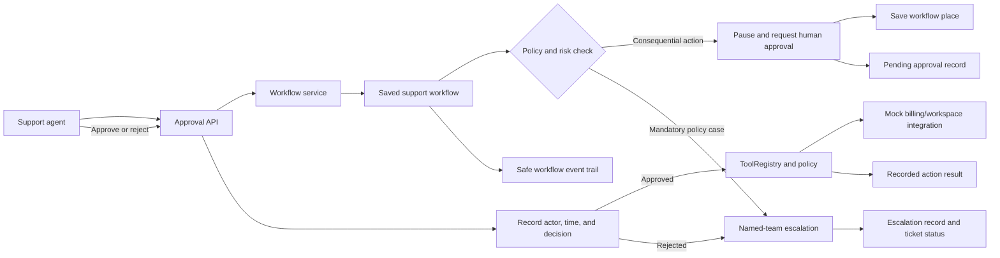

# Phase 11 Explained: A Human at the Right Decision Points

## The simple story

Phase 11 teaches CloudDesk when to stop and ask a person, when to send a
serious case to a specialist team, and how to carry out an approved action
safely.

The important idea is that the AI can investigate and recommend. It cannot
quietly make a consequential change. If a planned action needs approval, the
workflow saves its place, shows the support agent what needs review, and waits.
The agent's decision is recorded. Only an approval lets the workflow continue
to the action.

## What changed in this phase

### P11-1 - Pause at a human approval gate

The workflow checks each planned action against the application rules. When
an action needs approval, it pauses at a named step called `human_approval`.
CloudDesk saves the workflow checkpoint and creates a pending approval record.
The ticket is marked as waiting for a person.

This is like a support specialist putting a case folder on a manager's desk
with a sticky note: "Please review before I continue." The saved folder means
the specialist can resume from that point after a decision.

### P11-2 - Record a decision and resume

An agent can list pending approvals, approve one, or reject it. These actions
require an agent role; a viewer can read but cannot decide.

The decision records who made it, when it happened, and an optional note. An
approval resumes the saved workflow. A rejection takes the safe escalation
route instead of running the declined action. Repeating a decision is refused
so the same request cannot accidentally be approved twice.

### P11-3 - Route serious cases to a named team

Some cases should not wait for an ordinary support answer. Deterministic
policy rules identify issues such as a suspected breach, missing files, a
payment dispute, or a request to erase data. Each rule names the responsible
team.

The workflow records the escalation through the existing registered tool
path and marks the ticket as escalated. The model can help describe a case,
but it cannot overrule a mandatory policy rule.

### P11-4 - Use the same safe path to perform actions

When the workflow is allowed to act, it sends every planned action through
the `ToolRegistry`. The registry checks the action's policy, executes only a
registered tool, and reports success or failure. Each action result is
recorded against the workflow. If an action does not complete, the workflow
status response includes a generic notice and the event trail shows the
sanitized failure; it is not presented as a successful action.

The refund connection is a mock: even after approval, it creates a simulated
refund request and does not move money. The demo ticket states a claimed
amount so the human can review a concrete request; that claim is not treated
as proof that a refund is owed.

### P11-5 - Demonstrate a refund pause and a security escalation

`make demo` runs the CD-1002 refund example and waits for a decision.
`make demo TICKET=CD-1005` runs the suspicious-login example and shows its
named-team escalation. Both examples work offline with demo data and mock
integrations.

## Two examples

### CD-1002: a refund request

The support workflow reads the customer's message and prepares a refund
request using the amount the customer says is on the invoice. The policy
requires approval, so the ticket pauses. A human can approve or reject:

- If approved, CloudDesk calls the registered mock billing tool, records
  the result, and continues the workflow. No money is transferred.
- If rejected, CloudDesk does not call the refund tool. It records an
  escalation for the Billing team so a person can investigate.

### CD-1005: suspected account compromise

The ticket mentions suspicious logins. A deterministic rule recognizes the
security risk and routes it to the Security team. It does not wait for a
model to guess whether a suspected breach is important enough.

## How the pieces fit together

## What is and is not done

- Approval, rejection, and escalation are recorded in the existing SQL data
  model.
- The graph checkpoint lets an approval resume from its pause instead of
  starting the analysis again.
- Every action still goes through the shared tool registry and its policy.
- The customer-facing reply is still a preview; this phase does not send a
  real email.
- Refund and workspace integrations remain local mocks; no money or real
  account settings are changed.
- The API process still runs the workflow in-process. This is not a
  distributed job queue or a deployed cloud service.

## A short explanation to say in an interview

> "In Phase 11, I added a human approval checkpoint for consequential
> actions. The workflow saves its place, records who approved or rejected the
> request, and only runs approved actions through a policy-enforcing tool
> registry. Serious cases are routed by deterministic rules to named teams.
> The refund demo is simulated, so no money is moved."

## Phase 11 task-to-test map

| Task | Main component | Focused evidence |
|---|---|---|
| P11-1 | Interrupt node and checkpoint | Refund workflow remains paused with a pending approval, then resumes. |
| P11-2 | Approval API and service | Agent decision is recorded; viewer and duplicate decisions are refused. |
| P11-3 | Escalation node and routes | Security policy routes to Security; rejected refund routes to Billing. |
| P11-4 | Shared action executor | Approved refund executes through `ToolRegistry` and stores its result. |
| P11-5 | `make demo` script | CD-1002 approval and CD-1005 escalation scenarios. |

## Repository references

- [Approval graph node](../../agents/nodes/approval.py)
- [Escalation graph node](../../agents/nodes/escalation.py)
- [Workflow graph](../../agents/graph.py)
- [Workflow service](../../backend/app/services/workflow_service.py)
- [Approval API](../../backend/app/api/approvals.py)
- [Escalation API](../../backend/app/api/escalations.py)
- [Tool registry](../../backend/app/tools/registry.py)
- [Demo script](../../scripts/demo.py)
- [Approval and escalation tests](../../tests/api/test_tickets.py)
- [Phase 11 system design evolution](../design_evolution/Phase11_Project_System_Design_Evolution.md)
- [Phase 11 infrastructure and wiring](../Infra_design_evolution/Phase11_Infra_design_evolution.md)
- [Phase 11 interview Q&A](../QnA/Phase11_Interview_QnA.md)
- [Task tracker](../../TASKS.md)
