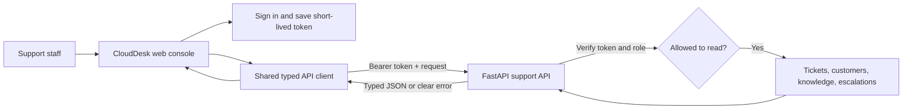

# Phase 12 Explained: The Support Team's Console

## The simple story

Phase 12 gives CloudDesk support staff a secure, easy-to-use place to look at
their work. Before this phase, the support system could answer requests behind
the scenes, but there was no web console for a person to sign in and browse
those records.

Now a team member can sign in, see their access level, and browse tickets,
customers, help articles, and escalations. The pages read information from the
same support API used by the rest of the system. The console does not make
changes to tickets in this phase.

## What was built

### P12-1 - A consistent app shell

The Next.js application provides a shared frame around its pages: CloudDesk
branding, a navigation menu, the signed-in person's name and role, and a sign
out button. The menu is declared in one place so it stays consistent.

The first page is an overview. It shows record totals from the existing API
list endpoints instead of pretending there is a separate dashboard service.

### P12-2 - A typed connection to the support API

The browser uses one API client (`frontend/lib/api.ts`) to contact the FastAPI
backend. The client attaches the saved bearer token, formats list requests,
and converts HTTP and connection failures into clear errors. If the server
rejects an expired token, the console clears it and asks the person to sign in
again.

Shared TypeScript shapes describe the API's tickets, customers, knowledge
articles, and escalations. This helps the screens use the same field names
that the backend returns.

### P12-3 - Sign-in and role-aware presentation

The sign-in screen offers the three seeded demo accounts: administrator,
support agent, and read-only viewer. The backend verifies the account and
returns a signed, time-limited token. On later visits, the console checks the
saved token with the backend before showing the workspace.

The screen displays the person's role and labels a viewer's workspace as
read-only. This is a helpful user interface cue, not a security wall: the
backend remains responsible for deciding whether each request is allowed.
Demo sign-in has no password and is only suitable for a backend explicitly
running in demo mode.

### P12-4 - Read-only record pages

The console has paginated pages for:

- **Tickets:** subject, number, status, category, severity, channel, and date.
- **Customers:** name, email, company, and creation date.
- **Knowledge:** article title, short explanation, category, and tags.
- **Escalations:** assigned team, reason, ticket reference, status, and date.

Empty lists, loading, backend errors, and connection failures are presented
clearly. A connection failure gets one automatic retry and a manual retry
button. The pages do not offer edit, approve, reply, or escalation actions;
those actions belong to the later ticket workflow screen.

## How information travels

## What is and is not included

- The console uses the existing FastAPI routes; Phase 12 adds no backend
  endpoint or database table.
- The list pages are read-only. Ticket actions and workflow inspection are
  part of the next UI phase.
- The token is stored in browser local storage for this demo-oriented client.
  The backend still checks it on protected requests and is the real
  authorization boundary.
- The API base address is configurable as `NEXT_PUBLIC_API_URL`, with
  `http://localhost:8000` as the local default.
- Docker networking and production hosting are not added in this phase.
- Demo login does not verify a password and must not be enabled as a
  production sign-in method.

## A short explanation to say in an interview

> "In Phase 12, I built the first support-team web console. A person can sign
> in with a demo role, browse tickets, customers, help articles, and
> escalations, and see clear loading or connection states. The frontend uses
> one typed API client, while the backend remains responsible for
> authentication and access decisions. This phase is read-only; it does not
> change customer accounts or ticket records."

## Task-to-test map

| Task | Main component | Validation |
|---|---|---|
| P12-1 | Next.js app shell and navigation | Production build includes the console routes. |
| P12-2 | Typed API client | Unit tests cover bearer headers, pagination, API errors, expired-session cleanup, and network failures. |
| P12-3 | Login and role-aware layout | Demo login and `/auth/me` use the existing backend contract; production build validates the app routes and types. |
| P12-4 | Read-only list pages | Ticket, customer, knowledge, and escalation screens call their matching paginated read APIs. |

## Repository references

- [Frontend application](../../frontend/)
- [Typed API client](../../frontend/lib/api.ts)
- [Shared frontend types](../../frontend/lib/types.ts)
- [Authentication provider](../../frontend/lib/auth.tsx)
- [Navigation](../../frontend/components/layout/nav.ts)
- [API contract](../../docs/API_CONTRACT.md)
- [Demo authentication route](../../backend/app/api/auth.py)
- [Task tracker](../../TASKS.md)
- [Phase 12 system design evolution](../design_evolution/Phase12_Project_System_Design_Evolution.md)
- [Phase 12 infrastructure and wiring](../Infra_design_evolution/Phase12_Infra_design_evolution.md)
- [Phase 12 interview Q&A](../QnA/Phase12_Interview_QnA.md)
