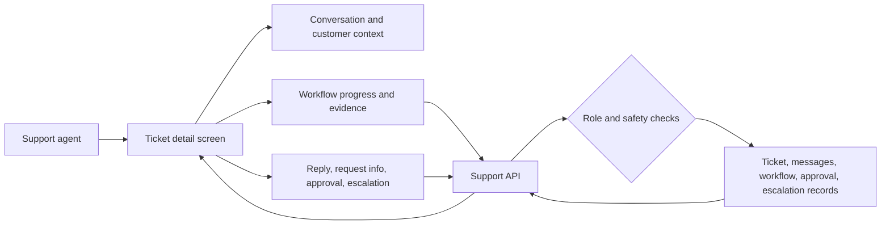

# Phase 13 Explained: Working Through a Support Ticket

## The simple story

Phase 13 turns the ticket list into a place where a support agent can actually
work on a case. The agent opens a ticket and sees the customer's conversation,
basic account information, the automated investigation, and the available
actions together.

Think of it as a shared case file: the computer gathers clues and proposes a
way forward, while a person remains responsible for important decisions. The
system records what happened so the next person can understand the case.

## What changed in this phase

### P13-1 - One screen for the ticket

Selecting a ticket number opens its detail page. The page shows the ticket
conversation, customer details, current status, category, severity, and
summary. The ticket list now links to this page.

The layout keeps those parts visible together instead of making an agent
search through several screens.

### P13-2 - Show the investigation as it happens

An agent can start the support workflow. The system works through a sequence
of steps: understand the request, classify it, check customer context, search
help material, investigate, plan, and check risk. Depending on the case, it
may ask for approval or send the case to a specialist team before completing
the summary and remembering the outcome.

The screen asks the support API for progress every two seconds while work is
queued or running. It shows finished work, the current step, and later steps.
The workflow can also show likely causes, suggested troubleshooting,
knowledge references, and a checked reply draft. If a network request fails,
the screen reports it and offers a retry rather than pretending the workflow
has finished.

### P13-3 - Let an agent take the next step

From the same ticket screen, an agent or administrator can:

- Approve or reject a pending action. The backend records the decision and
  resumes the paused workflow. The browser does not execute the action itself.
- Send a reply or ask the customer for more information. The demo records
  that message; it does not send a real email. Before recording it, the
  backend checks for secrets, internal links, and known contact details for
  other customers.
- Escalate the ticket to a named team with a reason. The case is recorded for
  that team and its status changes to escalated.

Viewers can read the ticket but see the action controls disabled. This is a
convenience in the screen; the backend also checks the user's role and is the
real permission boundary.

### P13-4 - Check the important behavior

Focused frontend tests check the workflow-step display, that viewers cannot
use ticket actions, and that actions call the expected API routes. Backend
tests check that replies are recorded safely, information requests update
ticket status, escalations are saved, and viewers cannot perform agent
actions.

## How information travels

## What is and is not included

- The screen uses the existing ticket, workflow, and approval APIs. Reply,
  request-information, and manual escalation routes were added because those
  documented actions were not yet available in the backend.
- The browser polls for workflow progress; the support workflow itself still
  runs in the backend.
- The demo records replies and escalations locally. It does not send real
  email, issue refunds, or contact a real escalation team.
- Human approval is required for a pending action. Approve and reject are
  available only while the ticket has a pending approval.
- A viewer's disabled controls are not security enforcement. Server-side
  role checks remain authoritative.
- The screen does not add Docker, a cloud deployment, or a customer-facing
  chat experience.

## A short explanation to say in an interview

> "In Phase 13, I built the support agent's case-work screen. It brings the
> customer's messages, account context, automated investigation, and human
> actions into one place. The system can suggest a response and show its
> evidence, but an agent controls approval, replies, and escalation. The demo
> records those choices without sending real email or moving money."

## Task-to-test map

| Task | Main component | Validation |
|---|---|---|
| P13-1 | Ticket detail page and ticket-list link | Frontend production build checks the route and types. |
| P13-2 | Workflow polling and 12-step panel | Workflow step tests check completed, active, and skipped states; the API exposes current and completed nodes. |
| P13-3 | Approval, reply, request-info, and escalation controls | Frontend tests check role-aware controls and API requests; ticket API tests check permissions, safety validation, and saved outcomes. |
| P13-4 | Frontend unit tests | Vitest runs the workflow-step, action, API-client, and shared UI tests. |

## Repository references

- [Ticket detail page](<../../frontend/app/(console)/tickets/[id]/page.tsx>)
- [Ticket action controls](../../frontend/components/tickets/ticket-actions.tsx)
- [Workflow progress panel](../../frontend/components/tickets/workflow-panel.tsx)
- [Workflow step presentation](../../frontend/components/tickets/workflow-steps.tsx)
- [Typed API client](../../frontend/lib/api.ts)
- [Frontend API types](../../frontend/lib/types.ts)
- [Ticket API routes](../../backend/app/api/tickets.py)
- [Ticket action service](../../backend/app/services/ticket_actions.py)
- [Output safety checks](../../backend/app/core/guardrails.py)
- [API contract](../../docs/API_CONTRACT.md)
- [Phase 13 system design evolution](../design_evolution/Phase13_Project_System_Design_Evolution.md)
- [Phase 13 infrastructure and wiring](../Infra_design_evolution/Phase13_Infra_design_evolution.md)
- [Phase 13 interview Q&A](../QnA/Phase13_Interview_QnA.md)
- [Task tracker](../../TASKS.md)
