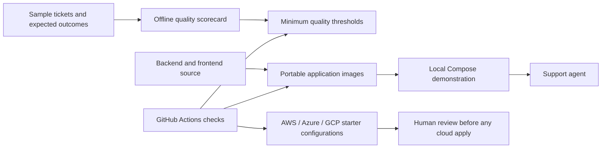

# Phase 14 Explained: Checking Quality and Preparing Delivery

## The simple story

Imagine a support team preparing a new service desk for a busy day. Before
opening it to everyone, the team checks that its answers are dependable,
packs the software so it can be moved consistently, and writes down how the
supporting services connect.

That is Phase 14. It adds a repeatable quality scorecard, portable application
containers, a local demonstration setup, and early cloud and automated-check
scaffolds. Important decisions still belong to people: this phase does not
deploy to a real cloud account or switch on real billing, email, or customer
data services.

## What changed in this phase

### P14-1 - Measure support quality

The project already had sample support tickets. We added expected article
and escalation outcomes so tests can compare what the system actually does
with what the team expects.

The offline scorecard checks five things:

- **Classification:** Is the ticket put in the right support category?
- **Useful search:** Is the expected help article among the first three
  search results?
- **Escalation:** Are policy-sensitive cases escalated, and ordinary cases
  left alone?
- **Citations:** Does a suggested answer identify the help material it used?
- **Grounding:** Are the recommended investigation steps included in the
  suggested customer reply?

Each measure has a minimum score. A test failure means the measured result
fell below its required score, so it can be fixed before release.

### P14-2 - Pack the application consistently

The backend and frontend each get a Docker image. A Docker image is a
packaged copy of an application with the runtime pieces it needs.

The backend image installs locked Python dependencies in a build stage and
runs the API as a non-administrator account. The frontend image creates a
production-only Next.js package and also runs without administrator access.
Both images have a health check, so the surrounding system can tell whether
the application is responding.

The browser-facing frontend address is set when the frontend image is built.
That matters because a browser outside Docker cannot use private Docker
service names such as `backend`.

### P14-3 - Connect a complete local demonstration

Docker Compose describes a small local CloudDesk environment:

- The **frontend** is the support agent's screen.
- The **backend** handles requests, permissions, workflow, and saved records.
- **Redis** supports short-lived coordination and rate limiting.
- **Qdrant** stores searchable knowledge vectors.
- A small Qdrant-derived image adds a readiness probe and runs as a
  non-administrator account for the local Compose stack.
- A one-time **knowledge indexing** step loads the help articles.

The SQLite demo database, Redis, and Qdrant each keep their data in named
storage volumes. Only the web screen and API are exposed on the developer's
own computer. Redis and Qdrant remain private to the Compose network.

The backend is allowed to seed demo tickets before the one-time article
indexing step runs. This order avoids the article records making an empty
demo database appear already initialized.

### P14-4 - Prepare automated checks and cloud starting points

GitHub Actions workflows are added for backend and frontend tests, container
image builds, security scans, and Terraform validation for AWS, Azure, and
Google Cloud.

The Terraform roots are **starting points**, not a complete hosted CloudDesk
deployment. They create container registries and basic logging resources.
They do not yet create the application compute, public ingress, database,
Redis, Qdrant, or external LLM configuration. No workflow in this phase
applies cloud infrastructure.

### P14-5 - Check delivery hygiene

Deployment tests check that images run as non-administrators, health checks
exist, Compose keeps stateful services private and persistent, environment
settings are documented, and real environment files are not tracked in Git.
They also check that the provider roots and validation workflow are present.

## How information travels

## What is and is not included

- Evaluation uses the local fake AI provider and sample support articles; it
  does not call a paid AI service.
- Docker Compose is a local demo setup. Its backend uses SQLite, while
  production database and managed-service choices remain environment work.
- The cloud configurations are validated as Terraform configuration in CI,
  but they are not a full application deployment.
- GitHub Actions files have been added to the repository, but they have not
  been run on GitHub in this checkout.
- No cloud credentials have been used and no real cloud resources have been
  created.
- Real email delivery, refunds, and external team notifications remain out of
  scope.

Local validation in this checkout: all 203 backend tests passed, Ruff passed,
all 9 frontend tests and lint passed, the standalone production build
succeeded, and the CD-1002 demo completed through a recorded rejection. The
Docker and Terraform CLIs were unavailable, so image builds and Terraform
validation remain unverified locally.

## A short explanation to say in an interview

> "In Phase 14, I added a quality scorecard for the support assistant and
> packaged the web screen and API so they can run consistently in containers.
> I connected the demo services with private networks and persistent storage,
> then added automated checks and cloud setup starting points. The checks are
> designed to catch problems early, but I have not claimed a cloud deployment
> or a workflow run that has not actually happened."

## Task-to-test map

| Task | Main component | Validation |
|---|---|---|
| P14-1 | Labeled support evaluation dataset and thresholds | `tests/evaluation/test_thresholds.py` measures all five minimum scores using the offline provider. |
| P14-2 | Backend and standalone frontend images | Hygiene tests check non-root users and health checks; the Next.js production build verifies standalone output. |
| P14-3 | Compose service wiring and volumes | Hygiene tests parse Compose and check service dependencies, local ports, and private stateful services. |
| P14-4 | AWS, Azure, and GCP Terraform roots plus GitHub workflows | Terraform validation is defined in CI; the local Terraform CLI and cloud apply are not available here. |
| P14-5 | Deployment hygiene regression tests | `tests/deployment/test_hygiene.py` checks environment coverage, ignored local state, container configuration, and Terraform scaffolds. |

## Repository references

- [Evaluation thresholds](../../tests/evaluation/test_thresholds.py)
- [Evaluation cases](../../tests/evaluation/datasets/eval_cases.json)
- [Backend Dockerfile](../../backend/Dockerfile)
- [Frontend Dockerfile](../../frontend/Dockerfile)
- [Compose stack](../../docker-compose.yml)
- [Deployment hygiene tests](../../tests/deployment/test_hygiene.py)
- [Deployment documentation](../../docs/DEPLOYMENT.md)
- [Terraform roots](../../deployment/)
- [GitHub Actions workflows](../../.github/workflows/)
- [Phase 14 system design evolution](../design_evolution/Phase14_Project_System_Design_Evolution.md)
- [Phase 14 infrastructure and wiring](../Infra_design_evolution/Phase14_Infra_design_evolution.md)
- [Phase 14 interview Q&A](../QnA/Phase14_Interview_QnA.md)
- [Task tracker](../../TASKS.md)
