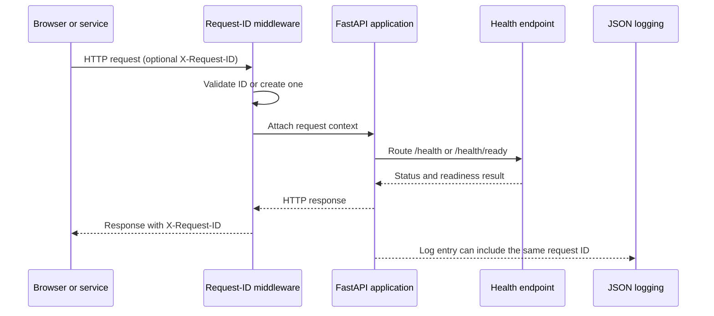

# Phase 1 Explained: CloudDesk's Runtime Foundation

## A simple way to describe this phase

CloudDesk is being built as an AI-assisted support desk. Before it can store
real support tickets or investigate them, it needs a dependable foundation:
the application must start with sensible settings, report whether it is
running, identify each web request, and be testable without paid services.
That foundation is Phase 1.

An everyday analogy is opening a new support office. Phase 1 sets up the
office rules, a status sign on the door, a reference number for every visitor,
and a practice room where the team can rehearse without contacting customers.
It does not yet process real support cases.

## What exists at the end of Phase 1

1. **One place for runtime settings.** The application reads settings such as
   its environment, allowed browser origins, database address, and AI provider.
   The defaults select fake AI and in-memory vector search, so the basic
   application does not need an AI key. Secret values use protected settings
   types, and invalid values such as a zero embedding dimension are rejected.
2. **Readable machine logs.** Log entries are structured as JSON and can include
   a timestamp, severity, message, request reference, workflow reference, and
   error details. This gives an operations team a consistent way to search for
   what happened.
3. **Health-check web addresses.** `/health` and `/health/live` answer whether
   the application process can respond. `/health/ready` checks configured
   dependencies and returns `503` if one is unavailable. At this stage the
   default readiness check only confirms that the application itself is
   available; database, cache, and AI checks are not wired in yet.
4. **A request reference number.** The request middleware accepts a safe
   `X-Request-ID` from a caller, or creates one when it is absent or invalid.
   It returns that ID in the response and makes it available to logs. This
   helps connect a reported error with the corresponding server activity.
5. **A repeatable offline test setup.** Pytest configures a temporary test
   database path and fake providers before the app is imported. This helps the
   tests run without production credentials or external services.
6. **Simple developer commands.** The Makefile offers setup, server, test, lint,
   and demo commands. The Phase 1 demo starts the runtime only; it explicitly
   does not claim that ticket workflows are available.

## How a web request moves through this foundation

In short, the caller gets an answer and a reference number. If something goes
wrong, a developer can use that number to find related log entries.

## What the code components do

| Component | Plain-language purpose |
|---|---|
| `backend/app/core/config.py` | Loads and validates the application's settings from environment variables or `.env`; caches the standard settings object. |
| `backend/app/core/logging.py` | Formats log messages as JSON and carries request context into log entries. |
| `backend/app/middleware/request_id.py` | Creates or validates the request reference and returns it on HTTP responses. |
| `backend/app/api/health.py` | Provides simple liveness and dependency-readiness endpoints. |
| `backend/app/main.py` | Creates the FastAPI application, connects health routes, configures CORS, and installs request-ID handling. |
| `tests/conftest.py` | Selects offline test settings and temporary test data before application imports. |
| `tests/api/` and `tests/unit/` | Check health responses, IDs, settings, and logging behavior. |
| `.env.example` | Shows the names of configuration options with local/demo-safe values and empty secret placeholders. |
| `Makefile` | Gives developers short commands for setup, running, testing, linting, and the limited Phase 1 demo. |

## What this phase does not do

Phase 1 does **not** yet create or save support tickets, authenticate users,
connect to a real database or Redis service, retrieve knowledge articles, call
a real AI provider, or run the support-resolution workflow. Those are later
phases. The configuration file already contains options for some future
components, but the existence of an option is not proof that the component is
implemented or connected.

There is also no Docker or Compose deployment in this phase. The application is
run locally as a web process. The infrastructure design document describes
that current state and labels later container architecture as future work.

## Interview-ready summary

> “In Phase 1, I built the dependable runtime foundation for CloudDesk. The
> service gets its settings from environment configuration, writes structured
> JSON logs, responds to liveness and readiness checks, and gives each HTTP
> request a traceable ID. I also made the test setup offline and repeatable,
> using fake providers and temporary test data. This phase is the platform
> foundation, not yet the ticket-processing or AI workflow.”

## Evidence in the repository

- [Runtime app](../../backend/app/main.py)
- [Settings](../../backend/app/core/config.py)
- [JSON logging](../../backend/app/core/logging.py)
- [Health endpoints](../../backend/app/api/health.py)
- [Request-ID middleware](../../backend/app/middleware/request_id.py)
- [Offline test setup](../../tests/conftest.py)
- [Phase 1 task status](../../TASKS.md)
- [Phase 1 exit criteria](../../PLAN_PHASE.md)
