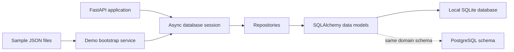

# Phase 2 Explained: CloudDesk's Data Foundation

## A simple way to describe this phase

Phase 1 made CloudDesk start reliably. Phase 2 gave it a dependable way to
remember the information a support team needs: customers, subscriptions,
workspaces, tickets, messages, and the records that later workflow features
will use.

Think of it as setting up the filing system for a support office. The team
defines what information belongs in each folder, creates a safe way to find and
update those folders, and fills a fresh practice office with realistic example
cases. The same filing rules can be used with a local database or a prepared
PostgreSQL database.

## What exists at the end of Phase 2

All four Phase 2 tasks are marked complete in the task list:

1. **A shared data vocabulary.** SQLAlchemy models describe the records and
   connections between them. The category list is fixed and checked rather
   than being arbitrary text.
2. **Database setup for two environments.** The application models can create
   tables in local SQLite. PostgreSQL setup scripts define the corresponding
   schema, migrations, and Supabase row-level access policies.
3. **A dedicated data-access layer.** Repositories provide a consistent place
   to create, find, list, update, and delete records. Ticket and customer
   repositories also provide common filtered lookups.
4. **A realistic, repeatable demo database.** When demo mode starts against a
   completely empty database, the application loads the sample profiles,
   customers, subscriptions, workspaces, products, tickets, incidents, and
   previous resolutions. It does not reload the sample data into a database
   that already contains records.

## The Phase 2 data, in everyday terms

The database has 16 kinds of records. Some describe the support business:

- **People and accounts:** profiles, customers, subscriptions, workspaces,
  products.
- **Support history:** tickets, ticket messages, support articles, incidents.
- **Future workflow records:** workflow runs and events, resolution actions,
  approval requests, escalations, customer memory, and audit logs.

Including workflow-related record types now gives future phases a place to
store their results. It does **not** mean those later AI agents, approval
screens, or workflows are already implemented.

Records have stable IDs and creation/update timestamps. Relationships connect,
for example, a ticket to its customer and a message to its ticket. Database
constraints help prevent invalid or duplicate information, and indexes help
common lookups such as finding tickets by customer or status.

## How information moves through the code

In normal application code, a repository is the doorway to stored records. It
uses the SQLAlchemy models and the database session; callers do not need to
write database-specific SQL for each operation. This keeps database work out
of API handlers and makes the data layer easier to test.

## Demo data: a safe first start

At application startup, the runtime creates any missing tables. If demo mode
is enabled, it then asks the bootstrap service to load sample data. The loader
checks all of the modeled tables first. If it finds any records, it leaves the
database alone. Otherwise, it loads the fixtures in one database transaction.

The loader also connects human-readable references in the fixture files. For
example, a ticket names a customer by email; the loader looks up that customer
and stores the customer's database ID on the ticket. Previous resolutions are
added as internal ticket messages, so they are not confused with customer
messages.

The checked-in tests verify that the demo includes 3 profiles, 8 customers, 8
subscriptions, 9 workspaces, 13 tickets, 2 incidents, and 16 ticket messages.
They also check that a second bootstrap does not duplicate records and that a
missing fixture does not leave partial data behind.

## Local database and PostgreSQL

- **Local demonstration and tests:** SQLite is the default database. The
  application uses an asynchronous SQLAlchemy engine. Tests can use a
  temporary in-memory SQLite database instead of a developer's persistent
  database file.
- **PostgreSQL / Supabase setup:** `database/schema.sql` defines the database
  tables, numbered migration files provide the ordered setup, and
  `database/rls_policies.sql` defines read access for authenticated roles.
  Those policies limit access by support role and hide internal messages from
  viewers. Database credentials must stay on the server, not in a browser.

The PostgreSQL scripts are setup assets; the repository does not claim that a
live Supabase account was provisioned or connected during this phase. SQLite
does not enforce PostgreSQL row-level security, and Phase 2 does not yet
provide ticket API routes or sign-in.

## What this phase does not do

Phase 2 gives the application a data model and persistence tools. By itself it
does not let a user create tickets through a finished support API, authenticate
users, run an AI workflow, approve a refund, or deploy the system in Docker.
The database contains some records intended for those future features, but
the corresponding behavior is delivered in later phases.

## Interview-ready summary

> “In Phase 2, I built the data foundation for CloudDesk. I defined a
> consistent model for customers, subscriptions, workspaces, tickets, and
> related workflow records; added repository classes so database access has a
> clear home; and prepared matching SQLite and PostgreSQL schemas. I also
> implemented an all-or-nothing demo-data loader that only seeds an empty
> database. That gives later API and AI phases reliable data to build on,
> without claiming those later features are already present.”

## Evidence in the repository

- [SQLAlchemy entities](../../backend/app/models/entities.py)
- [Database connection and table setup](../../backend/app/core/database.py)
- [Repository layer](../../backend/app/repositories/)
- [Demo bootstrap service](../../backend/app/services/seed_service.py)
- [Application startup](../../backend/app/main.py)
- [Sample data](../../sample_data/)
- [PostgreSQL schema](../../database/schema.sql)
- [Row-level security policies](../../database/rls_policies.sql)
- [Phase 2 tests](../../tests/unit/)
- [Phase 2 task status](../../TASKS.md)
