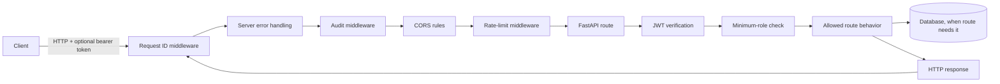

# Phase 3 Explained: CloudDesk's Identity and Request Guards

## The simple story

Phase 2 gave CloudDesk a place to store support information. Phase 3 added
basic safeguards around the application: it can identify a caller from a
signed pass, check whether that caller's role is allowed to perform an
operation, slow down excessive traffic, and keep a record of requests that
change data.

Think of a support office with a front entrance. A visitor shows an
identification pass. The pass tells staff whether the person is a viewer, an
agent, or an administrator. A traffic counter prevents one visitor from
crowding out everybody else. A logbook records important actions so the team
can later answer, “What happened, and when?”

## What Phase 3 delivered

All four Phase 3 tasks are marked complete in the project task tracker:

1. **P3-1 — JWT and `require_role`.** Shared security code validates bearer
   tokens and provides a role check that routes can reuse.
2. **P3-2 — Demo authentication routes and tokens.** In demo mode, the API can
   issue an eight-hour signed token to one of the configured demo profiles and
   return the current user's profile.
3. **P3-3 — Redis rate limit.** Middleware counts requests per client address
   in a fixed time window. It can use Redis or the local fake Redis option.
4. **P3-4 — Audit middleware and middleware order.** Non-GET requests are
   recorded with the request ID, actor when known, route, method, and status.
   The middleware order is arranged so errors and rate-limit rejections still
   carry request IDs and can be audited.

## How sign-in works

In the local demo, an allowed demo email can request a token from
`POST /api/v1/auth/login`. The login route checks that demo authentication is
enabled, that a signing secret is configured, and that the email matches an
active demo profile. It then signs a token containing the profile ID, email,
role, issue time, and expiration time.

For a protected request, the client sends that token in the `Authorization:
Bearer ...` header. The shared security dependency verifies the signature and
required claims, reads the role, and gives the route a typed description of
the caller.

This demo login is intentionally not a production password flow: it does not
verify a password. It must not be presented as production authentication.
Tokens expire after eight hours. The `/api/v1/auth/me` route also confirms
that the corresponding profile still exists and is active.

## How the roles work

| Role | Everyday meaning | Access level |
|---|---|---:|
| `viewer` | Can look at support information | 1 |
| `agent` | Can do viewer actions and agent work | 2 |
| `admin` | Highest support role | 3 |

`require_role("agent")` means that an agent or admin is allowed, but a viewer
is not. This is one shared rule rather than three separate role checks copied
into every route. Authentication answers “Who is calling?”; the role check
answers “May they do this?”

## How request limiting works

The rate-limit middleware assigns a counter to a client address and a
60-second time window. A request increases the counter. When the configured
limit is exceeded, CloudDesk returns `429 Too Many Requests`, includes rate
limit and retry information, and does not send the request to its route.

The default limit is 120 requests per minute. In local development and tests,
the app can use fake Redis so no Redis server is needed. When configured to
use real Redis, the application needs a Redis URL. If the Redis operation
fails, the middleware returns `503 Service Unavailable` rather than silently
allowing requests through without the configured guard.

## How the audit log works

For every non-GET HTTP request, audit middleware records the operation and
its outcome. When available, the record includes the caller's profile ID and
the request ID. It stores a route path, such as a route template, rather than
the full URL with query-string values.

GET requests are not written to this audit log by this middleware. A failed
request that raises an unhandled error is recorded as a server error before
the error is re-raised. The audit layer sits outside the rate limiter, so
rate-limit rejections can also be audited.

## How a request moves through Phase 3

In everyday language:

1. The application assigns or accepts a valid request ID.
2. The audit layer watches non-GET requests and records their results.
3. CORS and the rate limiter apply their rules.
4. A protected route verifies the caller's token and minimum role.
5. Only then does route behavior run.

Health routes may not require a bearer token. Authentication and role checks
are applied by protected routes, not by assuming every route is private.

## Why middleware order matters

Middleware is like several checks at a building entrance. The order determines
which checks see a request and which can add information to its response.

- Request ID is outermost so its header can be attached even to short-circuited
  or generated error responses.
- Audit is outside rate limiting so a rejected non-GET request can still be
  recorded.
- CORS and rate limiting run before the route handler.
- Route-level JWT and role dependencies run when FastAPI resolves a protected
  route.

## What Phase 3 does not claim

- The demo login is not password authentication and is not suitable for
  production.
- The project does not claim that a real Redis service or cloud account was
  provisioned for this phase.
- The rate limiter is a fixed-window, per-client-address guard, not a
  sophisticated abuse-detection system.
- Phase 3 does not yet provide the ticket and customer routes; those arrive in
  Phase 4.
- The audit middleware skips GET requests and does not record request bodies.

## A short interview explanation

> “In Phase 3, I added identity and request safeguards to CloudDesk. The API
> can validate signed bearer tokens and apply a shared viewer-agent-admin role
> hierarchy. Demo mode can issue short-lived tokens for seeded demo profiles,
> but it is clearly separate from production password authentication. I also
> added a Redis-backed fixed-window rate limit and an audit log for
> non-GET requests. Finally, I ordered the middleware so request IDs and audit
> records are preserved for rejected or failed requests. Together these
> safeguards give later API routes a consistent security foundation.”

## Evidence in the repository

- [Phase 3 task status](../../TASKS.md)
- [JWT parsing and role checks](../../backend/app/core/security.py)
- [Demo login and `/me` routes](../../backend/app/api/auth.py)
- [Authentication schemas](../../backend/app/schemas/auth.py)
- [Redis client selection](../../backend/app/core/redis.py)
- [Rate-limit middleware](../../backend/app/middleware/rate_limit.py)
- [Audit middleware](../../backend/app/middleware/audit.py)
- [Request ID middleware](../../backend/app/middleware/request_id.py)
- [Application middleware setup](../../backend/app/main.py)
- [Authentication tests](../../tests/api/test_auth.py)
- [Rate-limit tests](../../tests/api/test_rate_limit.py)
- [Audit tests](../../tests/api/test_audit.py)
