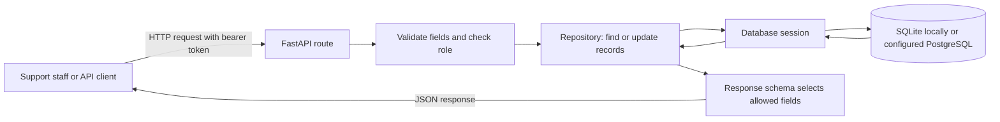

# Phase 4 Explained: CloudDesk's Support API

## The simple story

Before Phase 4, CloudDesk had a reliable application foundation, a place to
store support information, and sign-in and access checks. But other programs
did not yet have a clear, supported way to ask for ticket or customer
information.

Phase 4 gave CloudDesk that front desk: a documented set of requests and
responses, plus working web API routes for core ticket and customer tasks.
An authorized support agent can create and update tickets. An authenticated
viewer can look up tickets and customer details without receiving unrelated
customers' information.

An everyday comparison is a support-office filing desk. The API contract is
the form that says what information a visitor may submit and what the office
will return. The API routes receive those forms, check permissions, and ask
the filing system to find or save the records.

## What Phase 4 delivered

All three Phase 4 tasks are marked complete in the project task tracker:

1. **P4-1 — Ticket and customer API contract.** The contract documents the
   expected routes, roles, fields, filters, response shapes, and common errors.
   It gives the frontend and backend a shared agreement.
2. **P4-2 — Ticket API.** The implemented ticket routes create a ticket and
   its first message, list and filter tickets, return ticket details, and allow
   an agent to edit a limited set of fields.
3. **P4-3 — Customer API.** The implemented customer routes list customers and
   return a customer's subscriptions, workspaces, and latest 20 ticket
   summaries. Customer records are read-only through this API.

The contract also describes later ticket workflow and action routes. Their
presence in the contract is a design agreement, not proof that all those
handlers were implemented in Phase 4. Workflow, approval, reply, and escalation
behavior belongs to later work.

## How a request moves through the system

In plain language:

1. A client sends an HTTP request to the API, along with a sign-in token for
   protected routes.
2. The route checks that the request has the right shape and that the caller's
   role permits the action.
3. The route uses a repository to look up or change records. The API route
   doesn't build SQL itself.
4. A response schema shapes the result into the documented JSON response.
5. The client receives the result and an `X-Request-ID` that can help trace
   the request in logs.

## Example: creating a ticket

An agent sends a subject, message body, customer ID, and channel. The server
checks that the customer exists and that the supplied source ID is not already
used for that channel. It creates a new ticket, assigns its ticket number,
records the submitted message as the first customer message, and commits both
records together. The response includes the ticket, first message, and a small
customer summary.

If the customer doesn't exist, the API returns `404`. If the source ID has
already been used, it returns `409` rather than silently making a duplicate.
Invalid request fields receive a validation error. The client cannot choose
server-managed details such as the ticket number or initial status.

## Example: looking up a customer

An authenticated support user can request a customer list, optionally filtering
by exact email or company name and choosing a page. For an individual
customer, the API returns that customer's profile, subscriptions, workspaces,
and up to 20 recent ticket summaries.

The detail route asks each repository for records using the requested
customer's ID. It does not include ticket messages or customer-memory notes.
Response schemas define the fields that leave the server; unrelated customer
records are not included.

## Why the code is divided into layers

| Part | Easy explanation | Phase 4 example |
|---|---|---|
| API contract | The agreed form and instructions | `docs/API_CONTRACT.md` |
| API route | The clerk who receives a request and checks its rules | `backend/app/api/tickets.py`, `backend/app/api/customers.py` |
| Request/response schema | The form fields and the approved reply format | `backend/app/schemas/tickets.py`, `backend/app/schemas/customers.py` |
| Role check | The staff badge check | `backend/app/core/security.py` |
| Repository | The filing-desk specialist who finds or changes records | `backend/app/repositories/tickets.py`, `backend/app/repositories/customers.py` |
| Database session | The open connection used for one piece of database work | `backend/app/core/database.py` |
| Test | A practice run that checks expected results and refusals | `tests/api/test_tickets.py`, `tests/api/test_customers.py` |

This separation makes it easier to change a database query without changing
the HTTP response, or to change a response field without putting database
logic in the route.

## The access rules

The API uses the existing role levels:

- **Viewer:** can read tickets and customers.
- **Agent:** can also create and edit tickets.
- **Admin:** inherits agent-level access through the role hierarchy.

The routes use bearer-token verification and a minimum required role. The API
contract documents the access level for the wider product, while Phase 4's
implemented customer endpoints are read-only and available to any authenticated
role.

## What Phase 4 intentionally does not do

- It does not provide a customer-facing chat widget or a frontend console.
- It does not run an AI workflow, send a real email, issue a real refund, or
  complete approval and escalation actions.
- It does not create or edit customer records through the customer API.
- It does not claim that a production cloud database or Docker deployment is
  running.
- The API contract can describe planned routes before their later-phase
  implementations exist.

## A short interview explanation

> “Phase 4 turned CloudDesk's stored support data into a usable, documented
> API. I first defined the contract so the client and server agree on routes,
> permissions, fields, and errors. Then I implemented ticket creation,
> listing, detail, and limited updates, plus read-only customer listing and
> detail. The routes validate requests and enforce roles, while repositories
> keep database queries separate from HTTP code. Tests check normal behavior,
> permissions, missing records, pagination, duplicate protection, and that
> customer responses don't leak other customers' information. The AI workflow
> and Docker deployment remain later-phase work.”

## Evidence in the repository

- [Phase 4 task status](../../TASKS.md)
- [API contract](../../docs/API_CONTRACT.md)
- [Application router registration](../../backend/app/main.py)
- [Ticket routes](../../backend/app/api/tickets.py)
- [Customer routes](../../backend/app/api/customers.py)
- [Ticket request and response schemas](../../backend/app/schemas/tickets.py)
- [Customer response schemas](../../backend/app/schemas/customers.py)
- [Ticket and customer repositories](../../backend/app/repositories/)
- [Role and bearer-token checks](../../backend/app/core/security.py)
- [Ticket API tests](../../tests/api/test_tickets.py)
- [Customer API tests](../../tests/api/test_customers.py)
