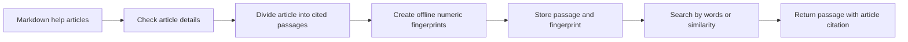

# Phase 5 Explained: CloudDesk's Knowledge Library

## The simple story

Phase 5 gave CloudDesk a support library that the application can organize and
search. It turns the help articles already written by the company into small,
searchable passages, then returns the best passages with a clear link back to
the article they came from.

Imagine a support team with a shelf of 15 instruction books. A person could
read every book to answer a question, but that would take too long. Phase 5
creates a well-organized index: it labels each book, divides long sections into
manageable pieces, and makes it possible to find useful passages by topic or
by similar wording.

The result is a search capability for support staff. It is not yet an
automated AI support agent: later phases can use this knowledge search as one
part of a larger ticket workflow.

## What Phase 5 delivered

All four Phase 5 tasks are marked complete in the project task tracker:

1. **P5-1 — Knowledge articles and chunking.** Markdown articles have
   structured details such as title, category, tags, and summary. The loader
   checks those details, and the chunker divides each article into smaller
   passages while keeping section names and source links.
2. **P5-2 — Vector store and fake embeddings.** Each passage can be represented
   by a numeric fingerprint for similarity search. An interchangeable storage
   interface supports an in-memory option for offline work and Qdrant for a
   configured service.
3. **P5-3 — Hybrid retriever.** Search can compare meanings through vector
   similarity, match words through a keyword index, or combine both rankings.
   The results are deduplicated by article and include citations.
4. **P5-4 — Ingest command and knowledge API.** The command and API synchronize
   the Markdown files with the article database and index. Authenticated users
   can list, read, and search published articles; only an admin can reindex.

## How a help article becomes useful

The workflow has two sides: preparing the library and answering a search.

In everyday words:

1. Articles are written as Markdown files in `sample_data/knowledge_base/`.
2. The loader checks that each file has the required title, category, tags,
   summary, and body.
3. The chunker divides the body by headings and then into overlapping windows.
   The overlap helps keep context when a sentence sits near a window boundary.
4. The indexing step keeps the article itself in the database and stores
   searchable passage data in the selected vector store.
5. A search returns a short passage, its source reference, and an article URL
   so the support worker can inspect the original guidance.

## What “chunk” and “embedding” mean

A **chunk** is a manageable passage from a longer article. In this project,
the chunker uses Markdown headings and then windows of up to 900 characters
with a 150-character overlap. Every passage keeps its article slug, title,
category, heading, and a source such as `kb://mfa-account-recovery#recovery`.

An **embedding** is a list of numbers used to compare text in a vector search.
The current offline implementation, `FakeEmbeddings`, creates a deterministic
hash-based word fingerprint. It is useful for developing and testing without
an API key, but it is not a trained language model and should not be described
as production-quality semantic understanding.

The project can use a Qdrant service when configured. The default local
development store keeps vectors in memory. With that default, the database
keeps article content between runs and the vector index is rebuilt from those
articles when the API first needs it. A configured Qdrant collection can keep
vectors outside the API process.

## How search finds and presents useful passages

The retriever supports three modes:

- **Keyword:** finds passages that contain query words and ranks them with a
  BM25 keyword-scoring method.
- **Semantic:** compares the query fingerprint with stored passage
  fingerprints.
- **Hybrid:** combines the two ranked lists using reciprocal-rank fusion, then
  applies small category and title-match boosts.

The retriever returns at most one passage per article so one long article does
not crowd out other useful sources. Its evidence includes a passage ID,
article title, citation, snippet, score, and article URL. An optional
reranking hook exists, but no external or language-model reranker is configured
as part of this phase.

## The knowledge API in plain words

The knowledge routes are part of the existing FastAPI application:

| Request | What it does | Who can use it |
|---|---|---|
| `GET /api/v1/knowledge` | Lists published articles with pagination. | Any authenticated role |
| `GET /api/v1/knowledge/{article_id}` | Returns one published article. The ID can be its slug or database ID. | Any authenticated role |
| `POST /api/v1/knowledge/search` | Searches by query, optional category, mode, and result count. | Any authenticated role |
| `POST /api/v1/knowledge/reindex` | Reloads the Markdown source, updates published article records, and replaces the vector index. | Admin only |

The route checks the request and the caller's role. A service coordinates
article persistence and retrieval. The repository handles database queries.
This keeps HTTP handling, search behavior, and SQL access in their intended
parts of the application.

## What this phase does not claim

- It does not automatically resolve tickets or send customer replies.
- It does not connect the retriever to a ticket workflow agent yet.
- The default hash-based embeddings are for offline development, not a
  production language model.
- The optional reranker is an extension point, not an active model service.
- It does not provide a frontend or a Docker/Compose deployment.
- It does not claim that Qdrant or a cloud database has been provisioned.

## A short explanation to say in an interview

> “In Phase 5, I built a searchable support library. We start with validated
> Markdown help articles, split them into small passages while preserving
> where each passage came from, and index them for both word matching and
> similarity search. The knowledge API lets authenticated support staff browse
> articles or search for cited passages, while only admins can rebuild the
> index. We can run the default setup offline; the current fake embeddings are
> for development, and the ticket workflow integration comes later.”

## A simple analogy

| System part | Library analogy |
|---|---|
| Markdown article | A book written by the support team |
| Article metadata | The book's title, subject label, and keywords |
| Chunk | A labeled paragraph or page excerpt |
| Embedding | A numeric filing clue for similarity lookup |
| Keyword index | The index at the back of a book |
| Vector store | The cabinet that keeps numeric search clues |
| Hybrid retrieval | Checking both the subject index and the wording |
| Evidence citation | The page and section reference for the source |
| Reindex | Reorganizing the library after its books change |

## Evidence in the repository

- [Phase 5 task status](../../TASKS.md)
- [Knowledge API contract](../../docs/API_CONTRACT.md)
- [Article loading and chunking](../../rag/chunking.py)
- [Offline embeddings](../../rag/embeddings.py)
- [Vector store implementations](../../rag/vector_store.py)
- [Hybrid retrieval and evidence](../../rag/retriever.py)
- [Knowledge service](../../backend/app/services/knowledge_service.py)
- [Knowledge API routes](../../backend/app/api/knowledge.py)
- [Knowledge schemas](../../backend/app/schemas/knowledge.py)
- [Ingest command](../../rag/ingest.py)
- [Ingestion and API tests](../../tests/rag/test_ingest.py) and [knowledge API tests](../../tests/api/test_knowledge.py)
