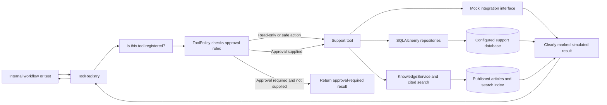

# Phase 6 Explained: CloudDesk's Safe Support Toolkit

## The simple story

Phase 6 gives CloudDesk a small, controlled toolkit for investigating support
requests and preparing safe actions. A support assistant can look up a
customer's account, check subscription and ticket history, search the help
library, and check a simulated service status. It can also prepare specific
changes, but the platform's tool registry checks those actions before they
run.

Think of it like a service desk with two kinds of buttons. The first kind
opens records and reads approved help material. The second kind can change
something. Before a consequential change, a human must approve it. Behind the
buttons are practice versions of billing and workspace systems, so the demo
does not issue money or change a real customer's account.

## What Phase 6 delivered

The Phase 6 checklist now covers all four work items:

1. **P6-1 — Tool registry and policy.** The registry keeps an allow-list,
   applies approval rules, limits execution time, and reports failures as
   explicit results.
2. **P6-2 — Read-only support tools.** Tools look up customer and workspace
   details, subscriptions, recent tickets, cited help articles, and simulated
   service status. These tools do not change records.
3. **P6-3 — Approval-gated write tools.** Ticket updates and escalation
   records use the existing repositories. Refund requests and workspace
   setting resets stop at the registry until its caller supplies an approval
   signal.
4. **P6-4 — Mock integrations.** Billing, workspace administration, and
   service status use small interfaces with local mock implementations. No
   external service or real customer account is contacted.

## How a tool call works

In everyday words:

1. The caller asks for a named operation and provides its input.
2. The registry refuses any operation that was not registered.
3. The policy checks whether the operation needs approval. Refund requests
   and workspace setting resets are blocked until the caller supplies the
   approval signal.
4. The selected tool reads through repository classes, searches through the
   knowledge service, or calls a mock integration.
5. The registry returns a success or a clear failure result. Tool exceptions
   are not passed back with private internal exception text.

The app constructs the registry at startup and keeps it in its internal
application state. Phase 6 does not add a public endpoint for arbitrary tool
execution; the later workflow phase will be its normal caller.

## The tools in plain language

| Tool | What it does | Changes data? | Approval rule |
|---|---|---:|---|
| `get_customer` | Reads a customer profile and workspace names. | No | None |
| `get_subscription` | Reads plan, seat, and storage usage. | No | None |
| `get_ticket_history` | Reads a bounded list of that customer's recent tickets. | No | None |
| `search_docs` | Searches published support articles and includes citations. | No | None |
| `check_service_status` | Reads the mock status of a CloudDesk service. | No | None |
| `update_ticket` | Updates an existing ticket's status or internal summary. | Yes | No approval in the current policy |
| `create_escalation` | Records an escalation for a named support team. | Yes | No approval; escalation is the safe hand-off |
| `create_refund_request` | Creates a simulated refund request. It never transfers money. | Mock state only | Required by default |
| `reset_demo_setting` | Resets one supported setting in the mock workspace adapter. | Mock state only | Required |

The registry only executes tools it has been given. Unknown tools are rejected
even if a caller claims they are approved.

## What “mock integration” means

An integration is a small connection point between the support application
and a system such as billing or workspace administration. A **protocol**
describes the operation the application expects. A **mock adapter** follows
that same shape but runs locally and returns a simulated result.

For example, the billing mock records that a request was created and marks
the result as simulated. Its message states that no money moved. A future
real adapter would require a separate implementation and operational
security review; it is not part of this phase.

## Safety and scope boundaries

- Approval is enforced at the shared `ToolRegistry` path; the tool functions
  themselves are not intended to be called directly.
- The registry currently receives an approval signal from its internal
  caller. The durable approval-request lifecycle, human decision screen, and
  resume flow belong to the later approval phase.
- Refund requests are not refunds. No payment provider is contacted.
- Workspace resets affect only the in-memory mock adapter, not persisted
  workspace settings.
- Ticket updates and escalations are persisted to the configured application
  database and are separate from the mock billing/workspace integrations.
- This phase does not create an AI agent, a customer-facing endpoint, or a
  live integration.

## A short explanation to say in an interview

> “In Phase 6, I built a controlled toolkit for the support workflow. Read
> tools fetch customer, subscription, ticket, and knowledge information
> through existing repository and search layers. A shared registry checks
> every operation against an allow-list and approval policy. Refund requests
> and workspace changes are approval-gated, while the connected billing and
> workspace adapters are mock-only, so the demo cannot move money or modify a
> real account. The approval screen and durable approval record are a later
> workflow phase.”

## A simple analogy

| System part | Service-desk analogy |
|---|---|
| Tool | A specific button at the support desk |
| Tool registry | The desk's controlled button panel |
| Allow-list | The list of buttons installed on the panel |
| Tool policy | The rule card saying which buttons need a supervisor |
| Repository | The clerk who reads or updates the official filing cabinet |
| Integration protocol | The agreed shape of a request to another department |
| Mock adapter | A training simulator that never contacts the real department |
| Citation | A reference showing which help article supports an answer |

## Evidence in the repository

- [Phase 6 task status](../../TASKS.md)
- [Tool registry and policy](../../backend/app/tools/)
- [Read-only tools](../../backend/app/tools/read_only.py)
- [Write tools](../../backend/app/tools/writes.py)
- [Tool construction](../../backend/app/tools/factory.py)
- [Integration protocols and mock adapters](../../integrations/)
- [Application startup wiring](../../backend/app/main.py)
- [Phase 6 tests](../../tests/unit/test_support_tools.py), [registry tests](../../tests/unit/test_tool_registry.py), and [policy tests](../../tests/unit/test_tool_policy.py)
