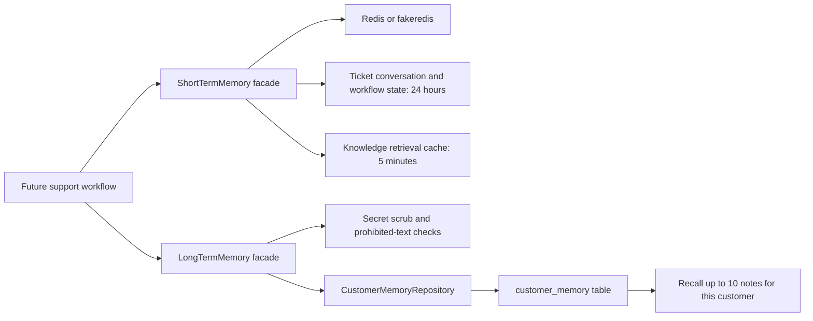

# Phase 8 Explained: CloudDesk Remembers Safely

## The simple story

Phase 8 gives CloudDesk two kinds of memory, like a support desk with a
scratchpad and a carefully managed customer history:

- The **scratchpad** is short-lived. It can hold a ticket conversation, the
  current workflow state, or recently retrieved help articles. Redis removes
  these entries automatically after their time limit.
- The **customer history** is long-lived. It keeps a small number of useful
  facts about one customer in the existing SQL database, so a later support
  interaction can avoid starting from zero.

The history is deliberately selective. Notes use approved types, recognizable
secrets are redacted, ticket text is checked before it is saved, and repeated
notes for the same customer are not added again.

## What Phase 8 delivered

1. **P8-1 - Short-term Redis facade.** A small Python interface stores and
   retrieves conversations and workflow state with a 24-hour expiry. Retrieval
   results use a separate five-minute cache. The same interface works with
   Redis in a configured environment and fakeredis in offline tests.
2. **P8-2 - Long-term customer memory.** The existing SQL table and repository
   now have a memory facade for approved note types: preferences, past issues,
   troubleshooting, and general notes. It limits recall to ten notes,
   isolates each customer's records, and skips exact duplicates within a
   customer and note type.
3. **P8-3 - Recall and record service.** One service records a resolution as
   its short summary, up to three troubleshooting steps, and a resolution
   note. It scrubs recognizable secrets, rejects the source ticket text and
   caller-designated prohibited values, then saves only the curated notes.

## A simple example

Imagine that a customer reports trouble signing in. The short-term scratchpad
can temporarily keep the conversation and the workflow's current step while
CloudDesk investigates. After the support issue is resolved, the long-term
service can save a brief note such as “Customer could not sign in after a
password reset” and a few troubleshooting steps.

If a note contains a recognizable password or API key, the secret value is
replaced with `[REDACTED]`. If the note repeats the full original ticket text
or contains a value the caller marked as prohibited, it is rejected instead
of being saved. A repeated safe note returns the existing record rather than
creating a second copy.

## How the pieces fit together

The facades are ready for a workflow caller, but this phase does not add the
later graph nodes. The existing app already creates a Redis client; a
specialist or workflow phase still needs to call these memory methods during
ticket processing.

## Privacy rules in plain language

- A short-term entry is temporary, not a permanent customer profile.
- Long-term notes must use one of the four approved note types.
- Customer ID is part of every SQL lookup, duplicate check, and write.
- Passwords, tokens, private keys, and recognizable card numbers are
  redacted by the existing secret scrubber.
- The resolution recorder checks notes against the source ticket body and
  values explicitly marked as prohibited by its caller.
- A caller must supply relevant other-customer values as prohibited values;
  the memory layer cannot discover unrelated customer data on its own.
- A database commit is still the caller's transaction responsibility.

## What is and is not connected

The Redis client is created by the existing FastAPI application and is
configured for fakeredis in offline tests. The SQL model, table, and
repository already existed. Phase 8 adds memory access and safety behavior
without adding a public API, a workflow node, a container, or a new database
table. Integration into the future ticket workflow is still pending.

## A short explanation to say in an interview

> “In Phase 8, I added a temporary scratchpad and a safer long-term customer
> history. Conversations and workflow state expire after a day, while search
> results expire after five minutes. Permanent notes are limited to useful
> categories, scoped to one customer, scrubbed for recognizable secrets, and
> checked against the original ticket and other prohibited values. Duplicate
> notes are reused instead of stored again. The memory components are tested
> offline and are ready for the later workflow integration.”

## Phase 8 task-to-test map

| Task | What it delivers | Focused evidence |
|---|---|---|
| P8-1 | Redis-backed expiring values and retrieval cache | Serialization, per-ticket/workflow isolation, and TTL tests |
| P8-2 | Approved durable notes, recall, and exact de-duplication | SQL tests for note kinds, ten-note cap, and per-customer isolation |
| P8-3 | Safe resolution recording | Tests for first-three-step limit, redaction, raw-ticket rejection, and prohibited values |

## Repository references

- [Short-term memory facade](../../memory/short_term.py)
- [Long-term memory facade](../../memory/long_term.py)
- [Customer-memory repository](../../backend/app/repositories/workflow.py)
- [Customer-memory model](../../backend/app/models/entities.py)
- [Secret scrubber](../../memory/secret_scrub.py)
- [Phase 8 tests](../../tests/unit/test_memory.py)
- [Phase 8 system design evolution](../design_evolution/Phase8_Project_System_Design_Evolution.md)
- [Phase 8 infrastructure and wiring](../Infra_design_evolution/Phase8_Infra_design_evolution.md)
- [Phase 8 interview Q&A](../QnA/Phase8_Interview_QnA.md)
- [Task tracker](../../TASKS.md)
